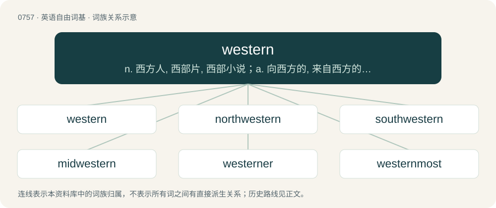

# 0825 · western — n. 西方人, 西部片, 西部小说；a. 向西方的, 来自西方的, 西方的, 西洋的, 西部的

[总目录](../00_总目录_按常用程度.md)

**类型**：英语自由词基　｜　**来源语言**：见词源记录

## 核心含义与来源

- 核心含义：n. 西方人, 西部片, 西部小说；a. 向西方的, 来自西方的, 西方的, 西洋的, 西部的
- 英文含义：Of, facing, situated in, or related to the west.
- 词形：western

**来源记录 1**（形容词；Of, facing, situated in, or related to the west.）

From Middle English westerne, from Old English westerne, from Proto-Germanic \*westrōnijaz. By surface analysis, west + -ern.

## 词族图

## 单词速览（常用到不常用）

| 单词 | 音标 | 释义 |
|---|---|---|
| [western](#w-1) | 英 /ˈwɛstən/；美 /ˈwɛstɚn/ | n. 西方人, 西部片, 西部小说；a. 向西方的, 来自西方的, 西方的, 西洋的, 西部的 |
| [northwestern](#w-2) | 英 /nɔːθˈwɛst.ə(ɹ)n/；/nɔːθˈwɛstn̩/ | a. 在西北部的, 西北方的, 来自西北的 |
| [southwestern](#w-3) | /sauθˈwestən/ | a. 西南的, 向西南的, 来自西南的, 西南部的 |
| [midwestern](#w-4) | /ˈmidˈwestən/ | a. 美国中西部的 |
| [westerner](#w-5) | 英 /ˈwɛstənə/；美 /ˈwɛstɚnɚ/ | n. 西方人, 西洋人 |
| [westernmost](#w-6) | /ˈwestənməust/ | a. 最西的 |
| [westernization](#w-7) | /,westənaiˈzeiʃən;-niˈz-/ | n. \[亦作W-\]西方化,欧美化 |

## 逐词详解

### 1. western

**词性**：形容词　｜　**音标**：英 /ˈwɛstən/；美 /ˈwɛstɚn/

**中文释义**：n. 西方人, 西部片, 西部小说；a. 向西方的, 来自西方的, 西方的, 西洋的, 西部的

**英文义项**：Of, facing, situated in, or related to the west. / Of a wind, blowing from the west; westerly.

**词源与演化**：

From Middle English westerne, from Old English westerne, from Proto-Germanic \*westrōnijaz. By surface analysis, west + -ern.

**用法示例／搭配（非完整句）**：

> the western approaches

该用例对应义项：Of, facing, situated in, or related to the west.

### 2. northwestern

**词性**：形容词　｜　**音标**：英 /nɔːθˈwɛst.ə(ɹ)n/；/nɔːθˈwɛstn̩/

**中文释义**：a. 在西北部的, 西北方的, 来自西北的

**英文义项**：Of or pertaining to the northwest; from or to in such a direction. / Blowing from that direction.

**构词拆分**：north + western

**词源与演化**：

Probably the reflex of Old English \*norþwesterne, equivalent to north + western, cognate with or formed similarly to Middle Low German nōrtwestern and Old High German nordwestrōni. Compare earlier northeastern, southeastern, and southwestern.

**例句**：

> Brittany is located in northwestern France.

该用例对应义项：Of or pertaining to the northwest; from or to in such a direction.

### 3. southwestern

**词性**：形容词　｜　**音标**：/sauθˈwestən/

**中文释义**：a. 西南的, 向西南的, 来自西南的, 西南部的

**英文义项**：Of or pertaining to the southwest.

**构词拆分**：south + western

**词源与演化**：

From Middle English southwesterne, from Old English sūþwesterne, equivalent to south + western.

**例句**：

> Locals think southwestern sunsets are the most beautiful.

该用例对应义项：Of or pertaining to the southwest.

### 4. midwestern

**词性**：形容词　｜　**音标**：/ˈmidˈwestən/

**中文释义**：a. 美国中西部的

**英文义项**：Of or pertaining to any region identified as midwest

**构词拆分**：mid- + western

**词源与演化**：

From mid- + western.

**例句**：

> Bermuda lies in the midwestern Atlantic.

该用例对应义项：Of or pertaining to any region identified as midwest

### 5. westerner

**词性**：名词　｜　**音标**：英 /ˈwɛstənə/；美 /ˈwɛstɚnɚ/

**中文释义**：n. 西方人, 西洋人

**英文义项**：A native or inhabitant of the West, of the Western world—The United States, Canada, Western Europe, Australia, and New Zealand. (Also written capitalized as Westerner.) / A native or inhabitant of the Wild West. (Also written capitalized as Westerner.)

**构词拆分**：western + -er

**词源与演化**：

From western + -er.

**例句**：

> If you practiced meditation, you wouldn't feel so impatient. You're a typical Westerner.

### 6. westernmost

**词性**：形容词　｜　**音标**：/ˈwestənməust/

**中文释义**：a. 最西的

**英文义项**：Farthest west.

**构词拆分**：western + -most

**词源与演化**：

From western + -most.

**例句**：

> Zeeland is the westernmost province of the Netherlands.

该用例对应义项：Farthest west.

### 7. westernization

**词性**：名词　｜　**音标**：/,westənaiˈzeiʃən;-niˈz-/

**中文释义**：n. \[亦作W-\]西方化,欧美化

**英文义项**：The process of assimilation, by a society, of the customs and practices of western culture.

**构词拆分**：western + -ization

**词源与演化**：

From western + -ization.

**例句**：

> In most cases, modernization is identified with Westernization.
