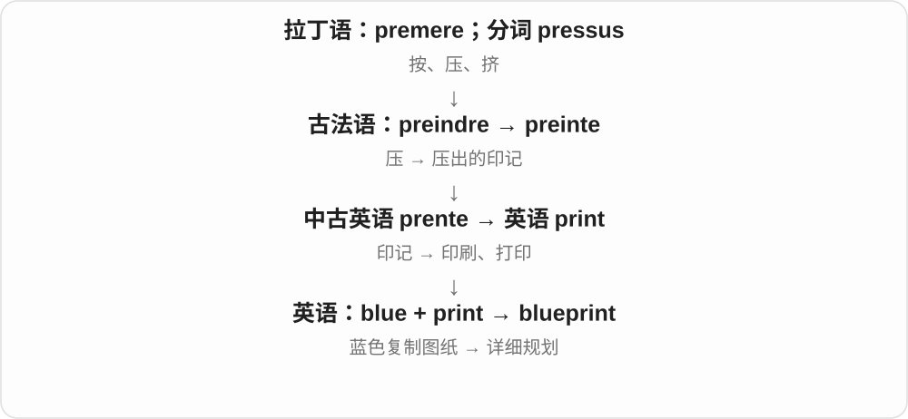

# 0826 · blue — 蓝色、带蓝与固定动植物名称

[逐词精讲目录](../00_逐词精讲目录.md) · [总目录](../00_总目录_按常用程度.md)

## 核心词根与来源

颜色词经法语接日耳曼词族。固定动植物名有实际指称，不能仅凭字面颜色判断物种；较冷门的鱼、石、专名先保留词典版。

**BLUE：先学颜色，再把固定名称分别记清**

blue、bluer、bluish 排在一起；blueberry、bluebird、bluebell 按果、鸟、花归组；bluegrass 单列草与音乐的历史连接。

- **核心颜色与程度**：blue · bluer · bluish
- **植物、果实与鸟名**：blueberry · bluebird · bluebell · bluegrass
- **已有图纸词**：blueprint
- **blue → blues：蓝色、低落与音乐名称**：blue · blues

## 词形与演化规律

blue → bluer、bluish；blue + berry、bird、bell、grass；已有 blueprint 共享。

颜色词经法语接日耳曼来源，忧郁义与音乐义有各自后续历史。

## 单词速览（按词族由简到繁）

同一基础词的相关扩展放在一起，先读基础形式，再读扩展；各组之间优先读常用的。具体词源关系见各词讲解。

| 单词 | 音标 | 核心意思 |
|---|---|---|
| [blue](#w-1) | /bluː/ | 蓝色、蓝色的；忧郁的 |
| [blues](#w-12) | /bluːz/ | 蓝调、布鲁斯音乐；忧郁、低落；不同蓝色〔复数等〕 |
| [blueprint](#w-2) | 英 /ˈbluːprɪnt/；美 /ˈbluːprɪnt/ | 蓝图；详细方案 |
| [blueberry](#w-3) | 英 /ˈbluːbəri/；美 /ˈbluːberi/ | 蓝莓 |
| [bluegrass](#w-4) | 英 /ˈbluːɡrɑːs/；美 /ˈbluːɡræs/ | 早熟禾等草类；蓝草音乐 |
| [bluebird](#w-5) | 英 /ˈbluːbɜːd/；美 /ˈbluːbɜːrd/ | 蓝鸲；蓝色鸟的名称 |
| [bluish](#w-6) | /ˈbluːɪʃ/ | 带蓝色的；有点发蓝的 |
| [bluebell](#w-7) | /ˈbluːbel/ | 蓝铃花；风铃草类植物名 |
| [bluer](#w-11) | 英 /ˈbluːə/；美 /ˈbluːər/ | 更蓝的；更低落的 |

## 逐词讲解

### 1. blue — 蓝色、蓝色的；忧郁的

**音标**：/bluː/

**先抓住这个画面**

天空晴朗时的蓝是基本颜色；feel blue 是情绪低落，需要当常用搭配读，不是脸真的变蓝。

**怎么拆**

现代主流词形经法语接日耳曼语颜色词，古英语也有同源形式。忧郁义的具体连接有不同解释，不把蓝天必然让人伤心写成事实。

**怎么变成今天的意思**

**古法语 bleu 等 ← 日耳曼语蓝色词 → 中古英语 blew、blewe**  
蓝色；早期色词边界与现代不完全相同

↓

**现代 blue**  
蓝色；低落等习惯用法；动植物命名

a blue sky 蓝天，dark blue 深蓝，feel blue 情绪低落；out of the blue 出乎意料、突然。

**常见搭配与例句**

a blue sky；dark blue；feel blue；out of the blue。

> The sky was bright blue after the storm.

风暴过后，天空湛蓝。

> His message arrived out of the blue.

他的消息来得很突然。

**别混淆**

blue 与 blew 吹的过去式同音不同词；blue mood 不等于临床诊断，先理解日常低落语气。

### 2. blues — 蓝调、布鲁斯音乐；忧郁、低落；不同蓝色〔复数等〕

**音标**：/bluːz/

**先抓住这个画面**

blues 可以说心情低落，也可以是音乐类型蓝调。谈配色时，它又只是各种深浅的蓝色。先确定场景，再接相应意思。

**怎么拆**

blue + -s，/uː/ 后读 /z/。颜色词经法语接日耳曼来源；blue 的低落义很早存在，blues 后指忧郁，音乐名称较晚发展，具体命名历史不简化成唯一传说。

**怎么变成今天的意思**

**blue 颜色、低落义 → blues**  
不同蓝色；忧郁、低落情绪

↓

**音乐领域的 blues → 类型名称**  
与低落表达等背景相关的蓝调音乐

listen to the blues 听蓝调；have the blues 心情低落；blues and greens 蓝色与绿色的各类色调。

**常见搭配与例句**

a blues singer 蓝调歌手；soft blues 柔和的各种蓝色。

> She enjoys listening to the blues in the evening.

她喜欢晚上听蓝调。

> The room is decorated in soft blues and greens.

房间用柔和的蓝色和绿色装饰。

**别混淆**

音乐类型 blues 常按单数理解：Blues is...。说低落可用 the blues；说多种蓝色时则是普通复数。音乐名称不等于每首歌都只写伤心。

### 3. blueprint — 蓝图；详细方案

**音标**：英 /ˈbluːprɪnt/；美 /ˈbluːprɪnt/

**先抓住这个画面**

先把要建的东西画清楚，别人照着做；于是任何指导后续行动的详细方案都能叫 blueprint。

**怎么拆**

blue 蓝色 + print 印制图样，原指与蓝色图像或底色有关的复制图纸，后来比喻整体方案。

**怎么变成今天的意思**

a blueprint for reform 是改革的详细方案。现代工程图即使不是蓝底，也可能仍被这样称呼。

**常见搭配与例句**

a blueprint for change；draw up a blueprint；architectural blueprints。

> The architect spread the blueprints across the table.

建筑师把图纸摊在桌上。

> The report offers a blueprint for improving public transport.

报告提出了改善公共交通的详细方案。

**别混淆**

blueprint 比 a vague idea 更具体，但拿到蓝图不等于方案已实现。

### 4. blueberry — 蓝莓

**音标**：英 /ˈbluːbəri/；美 /ˈbluːberi/

**先抓住这个画面**

按成熟果实常见的蓝色外观命名；它是一类具体水果，不是任何染蓝的莓果。

**怎么拆**

blue + berry 浆果，按颜色与果实类别组合。复数 blueberries，berry 的 y 改 ies。

**怎么变成今天的意思**

**古法语 bleu 等 ← 日耳曼语蓝色词 → 中古英语 blew、blewe**  
蓝色；早期色词边界与现代不完全相同

↓

**现代 blue**  
蓝色；低落等习惯用法；动植物命名

↓

**blue + berry → blueberry**  
蓝色浆果的名称 → 蓝莓

fresh blueberries 新鲜蓝莓，blueberry muffins 蓝莓松饼，blueberry jam 蓝莓酱。

**常见搭配与例句**

fresh blueberries；blueberry muffins；blueberry jam。

> She added fresh blueberries to her breakfast.

她在早餐里加了新鲜蓝莓。

> The café sells blueberry muffins.

咖啡馆卖蓝莓松饼。

**别混淆**

blueberry 是固定水果名，blue berry 临时短语只是蓝色的浆果；blackberry 黑莓是另一名称。

### 5. bluegrass — 早熟禾等草类；蓝草音乐

**音标**：英 /ˈbluːɡrɑːs/；美 /ˈbluːɡræs/

**先抓住这个画面**

植物名说一类带蓝绿观感的草；音乐名则通过肯塔基及乐队名称接过来，不是草会演奏。

**怎么拆**

blue + grass 草，先为草名。音乐类型名联系 Bill Monroe 的 Blue Grass Boys 乐队及肯塔基地域称呼，不是把普通草名直接当所有乡村音乐。

**怎么变成今天的意思**

**古法语 bleu 等 ← 日耳曼语蓝色词 → 中古英语 blew、blewe**  
蓝色；早期色词边界与现代不完全相同

↓

**现代 blue**  
蓝色；低落等习惯用法；动植物命名

↓

**blue + grass → bluegrass**  
草名；经乐队名称形成蓝草音乐类型名

bluegrass music 蓝草音乐，a bluegrass band 蓝草乐队，Kentucky bluegrass 草类名称；先判断在园艺还是音乐语境。

**常见搭配与例句**

bluegrass music；a bluegrass band；a bluegrass festival。

> A bluegrass band played at the festival.

一支蓝草乐队在音乐节上演出。

> The gardener planted Kentucky bluegrass in the lawn.

园丁在草坪上种了肯塔基早熟禾。

**别混淆**

bluegrass 是一种具体音乐传统，blues 布鲁斯是另一类型；不能因都带 blue 互换。

### 6. bluebird — 蓝鸲；蓝色鸟的名称

**音标**：英 /ˈbluːbɜːd/；美 /ˈbluːbɜːrd/

**先抓住这个画面**

英语里有一些固定叫 bluebird 的鸟，名字抓住蓝色羽毛；不一定等于所有蓝色的鸟。

**怎么拆**

blue + bird，颜色加鸟类名词组合。现代北美常指蓝鸲属鸟类；文学还会借蓝鸟与幸福联系。

**怎么变成今天的意思**

**古法语 bleu 等 ← 日耳曼语蓝色词 → 中古英语 blew、blewe**  
蓝色；早期色词边界与现代不完全相同

↓

**现代 blue**  
蓝色；低落等习惯用法；动植物命名

↓

**blue + bird → bluebird**  
蓝色羽毛的鸟名 → 蓝鸲等

an eastern bluebird 东蓝鸲，a mountain bluebird 山蓝鸲；具体物种名不可只靠 blue + bird 推定。

**常见搭配与例句**

an eastern bluebird；a mountain bluebird；a bluebird nest。

> A bluebird perched on the fence.

一只蓝鸲停在篱笆上。

> The guide helped us identify a mountain bluebird.

向导帮我们认出了一只山蓝鸲。

**别混淆**

bluebird 固定鸟名，a blue bird 可以只是任一蓝色鸟；blue jay 冠蓝鸦不是同一种鸟名。

### 7. bluish — 带蓝色的；有点发蓝的

**音标**：/ˈbluːɪʃ/

**先抓住这个画面**

不是纯正、明显的蓝，而是原来颜色里透出一点蓝调。

**怎么拆**

blue + -ish，去掉末尾 e，写 bluish。后缀表示略带、近似，与 greenish、reddish 的颜色用法同类。

**怎么变成今天的意思**

**古法语 bleu 等 ← 日耳曼语蓝色词 → 中古英语 blew、blewe**  
蓝色；早期色词边界与现代不完全相同

↓

**现代 blue**  
蓝色；低落等习惯用法；动植物命名

↓

**blue + -ish → bluish**  
略有蓝色的

a bluish tint 蓝色调，bluish light 带蓝的光；只描述外观，不自动说明成因。

**常见搭配与例句**

a bluish tint；bluish light；a bluish colour。

> The glass has a bluish tint.

玻璃略带蓝色。

> Bluish light came from the computer screen.

电脑屏幕发出带蓝色的光。

**别混淆**

bluish 是有点蓝，bluer 是比另一个更蓝；blueberry 则已是固定果实名。

### 8. bluebell — 蓝铃花；风铃草类植物名

**音标**：/ˈbluːbel/

**先抓住这个画面**

花色带蓝，形状像小铃铛，名字用颜色加形状来帮助辨认。

**怎么拆**

blue + bell 铃。不同地区 bluebell 可指不同植物，英国常指林地蓝铃花，不凭同名就认成全球同一物种。

**怎么变成今天的意思**

**古法语 bleu 等 ← 日耳曼语蓝色词 → 中古英语 blew、blewe**  
蓝色；早期色词边界与现代不完全相同

↓

**现代 blue**  
蓝色；低落等习惯用法；动植物命名

↓

**blue + bell → bluebell**  
蓝色铃状花的名称

a carpet of bluebells 一片铺地的蓝铃花，bluebell woods 开满蓝铃花的树林。

**常见搭配与例句**

a carpet of bluebells；bluebell woods；bluebells in spring。

> Bluebells covered the woodland floor in spring.

春天，蓝铃花铺满了林地。

> We followed a path through the bluebell woods.

我们沿小路穿过开满蓝铃花的树林。

**别混淆**

bluebell 是植物名，doorbell 是门铃；bell 抓形状，不表示花会发出铃声。

### 9. bluer — 更蓝的；更低落的

**音标**：英 /ˈbluːə/；美 /ˈbluːər/

**先抓住这个画面**

把两种蓝、两个状态比较：这一片比那一片更蓝。

**怎么拆**

blue 去末尾 e，加完整比较级 -er。比较级最常见于颜色，也可接情绪低落等形容词义。

**怎么变成今天的意思**

**古法语 bleu 等 ← 日耳曼语蓝色词 → 中古英语 blew、blewe**  
蓝色；早期色词边界与现代不完全相同

↓

**现代 blue**  
蓝色；低落等习惯用法；动植物命名

↓

**blue + -er → bluer**  
蓝的比较级 → 更蓝

a bluer sky 更蓝的天空，look bluer 看起来更蓝；最高级 bluest 在正文中一起认识即可。

**常见搭配与例句**

a bluer sky；look bluer；much bluer。

> The sea looked bluer in the afternoon light.

午后的光线下，大海看起来更蓝了。

> This paint is slightly bluer than the sample.

这种油漆比样品略蓝一些。

**别混淆**

bluer 比较级，bluish 稍带蓝色；更蓝要有比较，稍带蓝不必有比较对象。

## 这一组要分清什么

bluer 更蓝，bluish 略带蓝；bluegrass 音乐不是 blues；bluebird 不泛指所有蓝鸟。

## 串起来练习

The bluish glass looked bluer against the white wall.

那块带蓝色的玻璃衬着白墙，看起来更蓝了。
