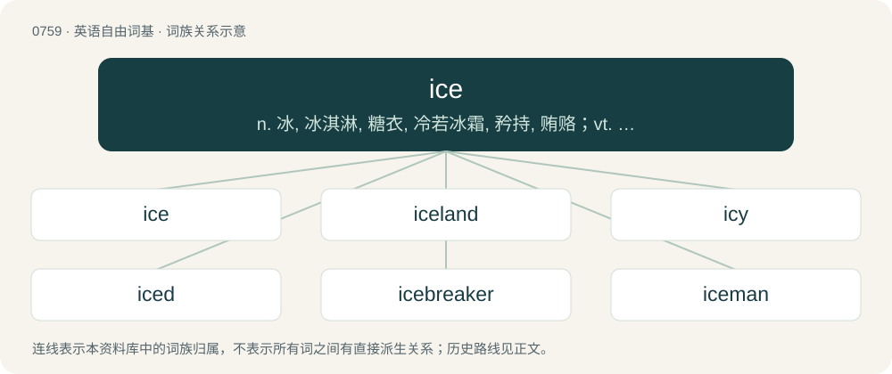

# 0827 · ice — n. 冰, 冰淇淋, 糖衣, 冷若冰霜, 矜持, 贿赂；vt. 使结冰, 冰镇, 覆以糖衣；vi. 结冰

[总目录](../00_总目录_按常用程度.md)

**类型**：英语自由词基　｜　**来源语言**：见词源记录

## 核心含义与来源

- 核心含义：n. 冰, 冰淇淋, 糖衣, 冷若冰霜, 矜持, 贿赂；vt. 使结冰, 冰镇, 覆以糖衣；vi. 结冰
- 英文含义：Water in frozen (solid) form.
- 词形：ice

**来源记录 1**（名词；Water in frozen (solid) form.）

From Middle English hyse, hyys, ice, ijs, is, yce, ys, yys, from Old English īs, from Proto-West Germanic \*īs, from Proto-Germanic \*īsą (“ice”), from Proto-Indo-European \*h₁eyH- (“ice, frost”). Cognates Cognate with North Frisian Iis, is (“ice”), Saterland Frisian Ies (“ice”), West Frisian iis (“ice”), Alemannic German Iis, isch, éisch (“ice”), Bavarian, Cimbrian, and Mòcheno ais (“ice”), Dutch ijs (“ice”), German Eis (“ice”), German Low German Ies (“ice”), Luxembourgish Äis (“ice”), Vilamovian ajs (“ice”), Yiddish אײַז (ayz, “ice”), Danish, Norwegian Bokmål, Norwegian Nynorsk, and Swedish is (“ice”), Elfdalian ais (“ice”), Faroese ísur (“ice”), Icelandic ís (“ice”); also Cornish yey (“ice”), yeyn (“cold”), Irish oighear (“ice”), Scottish Gaelic deigh, eigh, eighre (“ice”), Welsh iâ (“ice”), Lithuanian ýnis (“hoar frost”), Bulgarian and Russian и́ней (ínej, “hoar frost”), Czech jíní (“frost”), Macedonian and Serbo-Croatian и́ње (“hoar frost”), Ukrainian і́ній (ínij, “hoar frost, rime”), Ossetian их (ix, “ice”), Armenian եղյամ (eġyam, “frost, hoar frost, rime”), Persian یخ (yax, “ice”), Hittite 𒂊𒃷 (“ice”). Superseded non-native Middle English glace (“ice”), borrowed from Old French glace (“ice”).

## 词族图

## 单词速览（常用到不常用）

| 单词 | 音标 | 释义 |
|---|---|---|
| [ice](#w-1) | 英 /aɪs/ | n. 冰, 冰淇淋, 糖衣, 冷若冰霜, 矜持, 贿赂；vt. 使结冰, 冰镇, 覆以糖衣；vi. 结冰 |
| [iceland](#w-2) |  | 【英文】A land or region of icy terrain. |
| [icy](#w-3) | /ˈaɪsi/ | a. 冰的, 冰冷的, 冷淡的, 滑溜的 |
| [iced](#w-4) | 英 /ˈaɪst/ | a. 冰冷的；装冰的；冰冻的 |
| [icebreaker](#w-5) | 美 /ˈaɪsˌbɹeɪkəɹ/ | n. 碎冰船, 破冰设备 |
| [iceman](#w-6) | /ˈaismæn/ | n. 零售冰的人, 制冰的人 |
| [icicle](#w-7) | 英 /ˈaɪs.ɪkl̩/ | n. 垂冰, 冰柱, 冷冰冰的人 |
| [icebox](#w-8) | 英 /ˈʌɪsbɒks/ | n. 冷藏库, 冰箱, 冷冻室；\[法\] 冰箱, 无名死尸安置处, 单人牢房 |
| [icehouse](#w-9) | 美 /ˈaɪsˌhaʊs/ | n. 冰库, 制冰厂 |

## 逐词详解

### 1. ice

**词性**：名词　｜　**音标**：英 /aɪs/

**中文释义**：n. 冰, 冰淇淋, 糖衣, 冷若冰霜, 矜持, 贿赂；vt. 使结冰, 冰镇, 覆以糖衣；vi. 结冰

**英文义项**：Water in frozen (solid) form. / Any frozen volatile chemical, such as ammonia or carbon dioxide.

**词源与演化**：

From Middle English hyse, hyys, ice, ijs, is, yce, ys, yys, from Old English īs, from Proto-West Germanic \*īs, from Proto-Germanic \*īsą (“ice”), from Proto-Indo-European \*h₁eyH- (“ice, frost”). Cognates Cognate with North Frisian Iis, is (“ice”), Saterland Frisian Ies (“ice”), West Frisian iis (“ice”), Alemannic German Iis, isch, éisch (“ice”), Bavarian, Cimbrian, and Mòcheno ais (“ice”), Dutch ijs (“ice”), German Eis (“ice”), German Low German Ies (“ice”), Luxembourgish Äis (“ice”), Vilamovian ajs (“ice”), Yiddish אײַז (ayz, “ice”), Danish, Norwegian Bokmål, Norwegian Nynorsk, and Swedish is (“ice”), Elfdalian ais (“ice”), Faroese ísur (“ice”), Icelandic ís (“ice”); also Cornish yey (“ice”), yeyn (“cold”), Irish oighear (“ice”), Scottish Gaelic deigh, eigh, eighre (“ice”), Welsh iâ (“ice”), Lithuanian ýnis (“hoar frost”), Bulgarian and Russian и́ней (ínej, “hoar frost”), Czech jíní (“frost”), Macedonian and Serbo-Croatian и́ње (“hoar frost”), Ukrainian і́ній (ínij, “hoar frost, rime”), Ossetian их (ix, “ice”), Armenian եղյամ (eġyam, “frost, hoar frost, rime”), Persian یخ (yax, “ice”), Hittite 𒂊𒃷 (“ice”). Superseded non-native Middle English glace (“ice”), borrowed from Old French glace (“ice”).

**例句**：

> He said, “Where we’re at right now was back in 2008 all covered with ice. From here to there at the side, the glacier shrank about 20 to 30 meters.”

该用例对应义项：Water in frozen (solid) form.

### 2. iceland

**词性**：名词

**英文义项**：A land or region of icy terrain.

**构词拆分**：ice + land

**词源与演化**：

From ice + land.

**例句**：

> I do not need a residence permit because I am from Iceland.

### 3. icy

**词性**：形容词　｜　**音标**：/ˈaɪsi/

**中文释义**：a. 冰的, 冰冷的, 冷淡的, 滑溜的

**英文义项**：Pertaining to, resembling, or abounding in ice; cold; frosty. / Covered with ice, wholly or partially.

**构词拆分**：ice + -y

**词源与演化**：

From ice + -y; cf. Old English īsiġ.

**例句**：

> Roads and trees glazed with an icy film.

该用例对应义项：shiny and slick as with a thin coating of ice

### 4. iced

**词性**：形容词　｜　**音标**：英 /ˈaɪst/

**中文释义**：a. 冰冷的；装冰的；冰冻的

**英文义项**：With ice added. / Very cold, but not necessarily containing ice.

**构词拆分**：ice + -ed

**词源与演化**：

From ice (“noun”) + -ed.

**例句**：

> I'd like an iced tea.

该用例对应义项：With ice added.

### 5. icebreaker

**词性**：名词　｜　**音标**：美 /ˈaɪsˌbɹeɪkəɹ/

**中文释义**：n. 碎冰船, 破冰设备

**英文义项**：A ship designed to break through ice so that it, or other ships coming behind, can navigate on frozen seas. / A game, activity, humorous anecdote, etc., designed to ease tension and encourage interaction among individuals in a situation where they do not know each other well.

**构词拆分**：ice + breaker

**词源与演化**：

From ice + breaker, in the figurative sense from the expression to break the ice.

**例句**：

> The new college hallmates were awkward with each other at first, but after a game of charades as an icebreaker, they were laughing like old friends.

该用例对应义项：A game, activity, humorous anecdote, etc., designed to ease tension and encourage interaction among individuals in a situation where they do not know each other well.

### 6. iceman

**词性**：名词　｜　**音标**：/ˈaismæn/

**中文释义**：n. 零售冰的人, 制冰的人

**英文义项**：A man who is skilled in travelling upon ice, as among glaciers. / A human figure carved out of ice.

**构词拆分**：ice + -man

**词源与演化**：

From ice + -man.

### 7. icicle

**词性**：名词　｜　**音标**：英 /ˈaɪs.ɪkl̩/

**中文释义**：n. 垂冰, 冰柱, 冷冰冰的人

**英文义项**：A drooping, tapering shape of ice.

**构词拆分**：ice + ickle

**词源与演化**：

From Middle English isykle, isikel, from Old English \*īsġicel, from Proto-West Germanic \*īsajikil, \*īsajekul, equivalent to ice + ickle. It was assimilated to nouns in -icle, from Latin -iculus—the expected spelling would have -ickle. Cognate with Saterland Frisian Iesjuukel (“icicle”), German Low German Iesjökel, dialectal Danish jisegel (“icicle”), Norwegian isjukel (“icicle”) and Elfdalian aisikkel.

**例句**：

> Just as Tom looked up, an icicle fell from overhang of roof.

### 8. icebox

**词性**：名词　｜　**音标**：英 /ˈʌɪsbɒks/

**中文释义**：n. 冷藏库, 冰箱, 冷冻室；\[法\] 冰箱, 无名死尸安置处, 单人牢房

**英文义项**：A box or compartment containing ice, typically used to keep provisions cool. / A compartment in a refrigerator that is colder than the rest of the refrigerator and is used as a freezer.

**构词拆分**：ice + box

**词源与演化**：

From ice + box.

**例句**：

> I moved here from the icebox of the upper Midwest.

该用例对应义项：A city with a cold or snowy climate.

### 9. icehouse

**词性**：名词　｜　**音标**：美 /ˈaɪsˌhaʊs/

**中文释义**：n. 冰库, 制冰厂

**英文义项**：An outbuilding or cellar for the storage of ice for personal use and sometimes also for the storage of food at a low temperature. / An ice hockey rink.

**构词拆分**：ice + house

**词源与演化**：

From ice + house.
