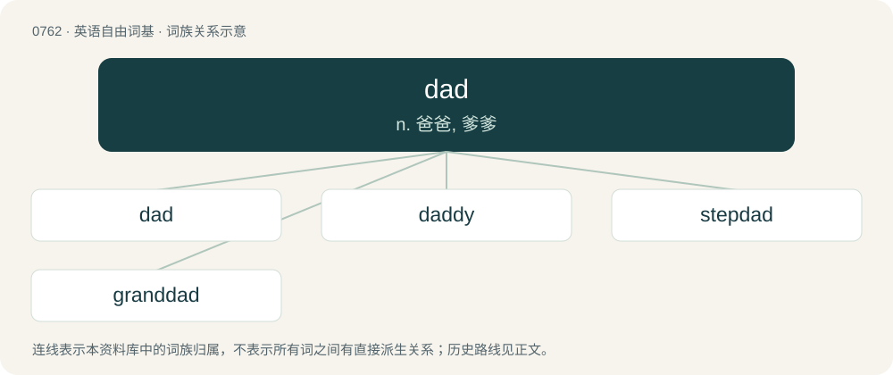

# 0830 · dad — n. 爸爸, 爹爹

[总目录](../00_总目录_按常用程度.md)

**类型**：英语自由词基　｜　**来源语言**：见词源记录

## 核心含义与来源

- 核心含义：n. 爸爸, 爹爹
- 英文含义：A father, a male parent.
- 词形：dad

**多个词源／构词路径**：同一拼写可能有不同来源；以下按词性和含义分别列出。

**来源记录 1**（名词；A father, a male parent.）

From Early Modern English dadd, dadde (circa 1500), undoubtedly older, from unrecorded Middle English \*dadde, of uncertain ultimate origin. Compare West Frisian deite (“dad, daddy”), Swabian Dede (“Godfather”). \* Perhaps of Celtic origin, compare Welsh and Breton tad (from Proto-Brythonic \*tad), Old Irish data; and possibly related to Russian дя́дя (djádja, “uncle”) and/or Russian де́душка (déduška, “grandfather”), all imitative. In Welsh, when subject to soft mutation (which occurs in vocative contexts, among others), tad becomes dad. \* Perhaps imitative of a child's first uttered syllables da, da. \* Possibly from a metathetic variation of a hypothetical Old English \*ætta, \*atta (“father”), from Proto-West Germanic \*attō, from Proto-Germanic \*attô ("father, forefather"; whence also North Frisian ate, aatj, taatje, tääte (“father; dad”), Middle High German tate (“father, dad”) (whence German Tate (“dad”), Bavarian tatte (“dad”), Cimbrian tatta (“dad”)), Icelandic táta (“dad”)), from Proto-Indo-European \*átta (“father”), whence Sanskrit तत (tata, “father”).

**来源记录 2**（名词；A lump or piece.）

From dade (“to strike heavily”), dade (“a heavy blow or thud”). Probably onomatopoeic.

## 词族图

## 单词速览（常用到不常用）

| 单词 | 音标 | 释义 |
|---|---|---|
| [dad](#w-1) | /dæd/ | n. 爸爸, 爹爹 |
| [daddy](#w-2) | 英 /ˈdædi/ | n. 爸爸 |
| [stepdad](#w-3) |  | 继父 |
| [granddad](#w-4) |  | 爷爷, 老太爷, 外公 |

## 逐词详解

### 1. dad

**词性**：名词　｜　**音标**：/dæd/

**中文释义**：n. 爸爸, 爹爹

**英文义项**：A father, a male parent. / Used to address one's father; often capitalized.

**词源与演化**：

From Early Modern English dadd, dadde (circa 1500), undoubtedly older, from unrecorded Middle English \*dadde, of uncertain ultimate origin. Compare West Frisian deite (“dad, daddy”), Swabian Dede (“Godfather”). \* Perhaps of Celtic origin, compare Welsh and Breton tad (from Proto-Brythonic \*tad), Old Irish data; and possibly related to Russian дя́дя (djádja, “uncle”) and/or Russian де́душка (déduška, “grandfather”), all imitative. In Welsh, when subject to soft mutation (which occurs in vocative contexts, among others), tad becomes dad. \* Perhaps imitative of a child's first uttered syllables da, da. \* Possibly from a metathetic variation of a hypothetical Old English \*ætta, \*atta (“father”), from Proto-West Germanic \*attō, from Proto-Germanic \*attô ("father, forefather"; whence also North Frisian ate, aatj, taatje, tääte (“father; dad”), Middle High German tate (“father, dad”) (whence German Tate (“dad”), Bavarian tatte (“dad”), Cimbrian tatta (“dad”)), Icelandic táta (“dad”)), from Proto-Indo-European \*átta (“father”), whence Sanskrit तत (tata, “father”).

**例句**：

> His dad was always there for him.

该用例对应义项：A father, a male parent.

### 2. daddy

**词性**：形容词　｜　**音标**：英 /ˈdædi/

**中文释义**：n. 爸爸

**英文义项**：Characteristic of or resembling a dad or father.

**构词拆分**：dad + -y

**词源与演化**：

From dad + -y (suffix forming adjectives with the sense ‘having the quality of’).

**例句**：

> Daddy, can you read me a story before I go to sleep?

### 3. stepdad

**词性**：名词

**中文释义**：继父

**英文义项**：A stepfather.

**构词拆分**：step- + dad

**词源与演化**：

From step- + dad.

**例句**：

> Daniel cut up all his stepdad's ties and threw them under the bed.

### 4. granddad

**词性**：名词

**中文释义**：爷爷, 老太爷, 外公

**英文义项**：grandfather / A familiar or disparaging term of address to an old man.

**构词拆分**：From grand- + dad (“father”).

**词源与演化**：

From grand- + dad (“father”).

**例句**：

> Hey! Get out of my way, granddad!

该用例对应义项：A familiar or disparaging term of address to an old man.
