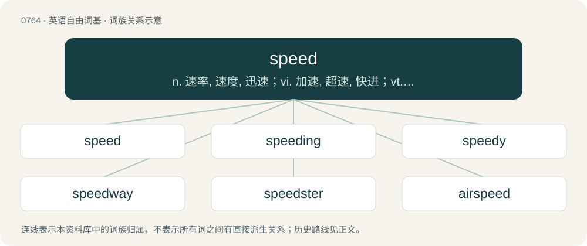

# 0832 · speed — n. 速率, 速度, 迅速；vi. 加速, 超速, 快进；vt. 快速传送, 促进, 使加速

[总目录](../00_总目录_按常用程度.md)

**类型**：英语自由词基　｜　**来源语言**：见词源记录

## 核心含义与来源

- 核心含义：n. 速率, 速度, 迅速；vi. 加速, 超速, 快进；vt. 快速传送, 促进, 使加速
- 英文含义：The state of moving quickly or the capacity for rapid motion.
- 词形：speed

**多个词源／构词路径**：同一拼写可能有不同来源；以下按词性和含义分别列出。

**来源记录 1**（名词；The state of moving quickly or the capacity for rapid motion.）

From Middle English sped (“prosperity, good luck, quickness, success”), from Old English spēd (“success”), from Proto-West Germanic \*spōdi (“prosperity, success”), from Proto-West Germanic \*spōan, from Proto-Germanic \*spōaną (“to prosper, succeed, be happy”), from Proto-Indo-European \*speh₁- (“to prosper, turn out well”). Cognate with Scots spede, speid (“success, quickness, speed”), Dutch spoed (“haste; speed”), German Low German Spood (“haste; speed; eagerness; success”), German Sput (“progress, acceleration, haste”). Related also to Old English spōwan (“to be successful, succeed”), Albanian shpejt (“to speed, to hurry”) and Russian спеши́ть (spešítʹ, “to hurry”), Latin spēs (“hope, expectation”), spērō (“hope”, verb), perhaps also to Ancient Greek σπεύδω (speúdō, “to urge on, hasten, press on”).

**来源记录 2**（动词；To go fast.）

From Middle English speden, from Old English spēdan (“to speed, prosper, succeed, have success”), from Proto-West Germanic \*spōdijan (“to succeed”). Cognate with Scots spede, speid (“to meet with success, assist, promote, accomplish, speed”), Dutch spoeden (“to hurry, rush”), Low German spoden, spöden (“to hasten, speed”), German sputen, spuden (“to speed”).

## 词族图

## 单词速览（常用到不常用）

| 单词 | 音标 | 释义 |
|---|---|---|
| [speed](#w-1) | /spiːd/ | n. 速率, 速度, 迅速；vi. 加速, 超速, 快进；vt. 快速传送, 促进, 使加速 |
| [speeding](#w-2) | /ˈspiːdɪŋ/ | n. 超速行驶 |
| [speedy](#w-3) | /ˈspiː.di/ | a. 快的, 迅速的；\[经\] 快的, 迅速的 |
| [speedway](#w-4) | /ˈspiːdweɪ/ | n. 汽车(或摩托车)竞赛场, 高速公路 |
| [speedster](#w-5) | /ˈspiːdstə/ | n. 高速竞走者, 高速汽车, 超速驾驶者；\[法\] 高速驾驶者, 高速双人座汽车 |
| [airspeed](#w-6) | /ˈєəspiːd/ | n. 空速 |
| [speedometer](#w-7) | 英 /spɪˈdɒm.ɪ.tə/；美 /spɪˈdɑ.mɪ.təɹ/ | n. 速度计, 里程计；\[机\] 里程计, 速度计 |
| [speedboat](#w-8) | 美 /ˈspidˌboʊt/ | n. 高速游艇 |
| [lightspeed](#w-9) |  | \[电影\]光速侠 |
| [speeder](#w-10) | /ˈspiːdə/ | n. 调速装置, 超速驾车者；\[化\] 增速装置 |
| [speedball](#w-11) |  | n. 掺海洛因的可卡因, 掺吗啡的可卡因 |
| [speedrun](#w-12) | /ˈspiːd.ɹʌn/ | 【英文】A playthrough of a computer or video game in which the whole game or a select part of it, such as a single level, is played with the intent of completing it as quickly as possible, optionally with certain prerequisit |

## 逐词详解

### 1. speed

**词性**：名词　｜　**音标**：/spiːd/

**中文释义**：n. 速率, 速度, 迅速；vi. 加速, 超速, 快进；vt. 快速传送, 促进, 使加速

**英文义项**：The state of moving quickly or the capacity for rapid motion. / The rate of motion or action, specifically the magnitude of the velocity; the rate distance is traversed in a given time.

**词源与演化**：

From Middle English sped (“prosperity, good luck, quickness, success”), from Old English spēd (“success”), from Proto-West Germanic \*spōdi (“prosperity, success”), from Proto-West Germanic \*spōan, from Proto-Germanic \*spōaną (“to prosper, succeed, be happy”), from Proto-Indo-European \*speh₁- (“to prosper, turn out well”). Cognate with Scots spede, speid (“success, quickness, speed”), Dutch spoed (“haste; speed”), German Low German Spood (“haste; speed; eagerness; success”), German Sput (“progress, acceleration, haste”). Related also to Old English spōwan (“to be successful, succeed”), Albanian shpejt (“to speed, to hurry”) and Russian спеши́ть (spešítʹ, “to hurry”), Latin spēs (“hope, expectation”), spērō (“hope”, verb), perhaps also to Ancient Greek σπεύδω (speúdō, “to urge on, hasten, press on”).

**例句**：

> Speed limits provide information to the drivers about the safe speed to travel in average conditions.

该用例对应义项：The rate of motion or action, specifically the magnitude of the velocity; the rate distance is traversed in a given time.

### 2. speeding

**词性**：形容词　｜　**音标**：/ˈspiːdɪŋ/

**中文释义**：n. 超速行驶

**英文义项**：Travelling very fast; moving at speed. / Specifically, travelling at an illegal speed (of vehicles, motorists).

**构词拆分**：From speed + -ing.

**词源与演化**：

From speed + -ing.

**例句**：

> We were overtaken on the inside by a speeding motorcyclist.

该用例对应义项：Specifically, travelling at an illegal speed (of vehicles, motorists).

### 3. speedy

**词性**：动词　｜　**音标**：/ˈspiː.di/

**中文释义**：a. 快的, 迅速的；\[经\] 快的, 迅速的

**英文义项**：To process in a faster than normal, accelerated way. / To apply the speedy rule in an online community (often the deletion rule); to speedy delete.

**构词拆分**：speed + -y

**词源与演化**：

From Middle English spedy, spedi, from Old English spēdiġ (“having good speed, lucky, prosperous; having means, wealthy, opulent, rich in material wealth; rich in, abounding in, abundant, plenteous, copious; powerful”), from Proto-Germanic \*spōdigaz (“successful, hurried”), equivalent to speed + -y. Cognate with Scots speedy (“speedy”), Dutch spoedig (“speedy, swift, rapid, quick”), German sputig, spudig (“industrious, speedy”).

**例句**：

> The guy is \*not\* so obviously insignificant that speedying him is appropriate.

该用例对应义项：To apply the speedy rule in an online community (often the deletion rule); to speedy delete.

### 4. speedway

**词性**：名词　｜　**音标**：/ˈspiːdweɪ/

**中文释义**：n. 汽车(或摩托车)竞赛场, 高速公路

**英文义项**：A form of motorcycle racing on flat (without camber) oval dirt tracks using motorcycles with neither brakes nor gears. / A form of bicycle racing on flat (nonbanked) oval dirt tracks.

**构词拆分**：speed + way

**词源与演化**：

From speed + way.

**例句**：

> The most popular sports in that country are soccer, speedway and ski jumping.

### 5. speedster

**词性**：名词　｜　**音标**：/ˈspiːdstə/

**中文释义**：n. 高速竞走者, 高速汽车, 超速驾驶者；\[法\] 高速驾驶者, 高速双人座汽车

**英文义项**：One who is noted for being very fast. / A person who speeds (drives fast).

**构词拆分**：speed + -ster

**词源与演化**：

\* From speed + -ster.

### 6. airspeed

**词性**：名词　｜　**音标**：/ˈєəspiːd/

**中文释义**：n. 空速

**英文义项**：The speed of an aircraft relative to the air through which it is flying.

**构词拆分**：air + speed

**词源与演化**：

From air + speed.

### 7. speedometer

**词性**：名词　｜　**音标**：英 /spɪˈdɒm.ɪ.tə/；美 /spɪˈdɑ.mɪ.təɹ/

**中文释义**：n. 速度计, 里程计；\[机\] 里程计, 速度计

**英文义项**：An instrument located within the dashboard of a vehicle that measures and indicates the current speed of the vehicle. / Such a device incorporating an odometer.

**构词拆分**：speed + -o- + -meter

**词源与演化**：

From speed + -o- + -meter; by surface analysis, speed + -ometer.

**例句**：

> Your car's speedometer tells you the car's instantaneous speed, not its average speed.

### 8. speedboat

**词性**：名词　｜　**音标**：美 /ˈspidˌboʊt/

**中文释义**：n. 高速游艇

**英文义项**：A fast boat, usually small (for 1-8 people). / A boat designed and built for racing.

**构词拆分**：speed + boat

**词源与演化**：

From speed + boat.

**例句**：

> Benedito will ride the speedboat on the river.

### 9. lightspeed

**词性**：名词

**中文释义**：\[电影\]光速侠

**英文义项**：The speed of light (in vacuum unless another medium is specified). / An extremely fast speed.

**构词拆分**：light + speed

**词源与演化**：

From light + speed.

### 10. speeder

**词性**：名词　｜　**音标**：/ˈspiːdə/

**中文释义**：n. 调速装置, 超速驾车者；\[化\] 增速装置

**英文义项**：One who speeds: one who exceeds the maximum legal speed limit. / A machine for drawing and twisting slivers to form rovings, in spinning.

**构词拆分**：speed + -er

**词源与演化**：

From speed + -er.

**例句**：

> The speeder was stopped and given a ticket.

### 11. speedball

**词性**：名词

**中文释义**：n. 掺海洛因的可卡因, 掺吗啡的可卡因

**英文义项**：A mixture of heroin and cocaine or sometimes other drugs. / Coffee with espresso.

**构词拆分**：speed + ball

**词源与演化**：

From speed + ball.

### 12. speedrun

**词性**：名词　｜　**音标**：/ˈspiːd.ɹʌn/

**英文义项**：A playthrough of a computer or video game in which the whole game or a select part of it, such as a single level, is played with the intent of completing it as quickly as possible, optionally with certain prerequisites.

**构词拆分**：speed + run

**词源与演化**：

From speed + run. There are isolated attestations of the term as far back as the 19th century, mostly hyphenated as speed-run and in an engineering context; it is unlikely that these cases influenced the modern form.

**例句**：

> In the speedrun of Super Mario Bros. 3, Anonymous Jones finishes the whole game in just 11 minutes.

该用例对应义项：A playthrough of a computer or video game in which the whole game or a select part of it, such as a single level, is played with the intent of completing it as quickly as possible, optionally with certain prerequisites.
