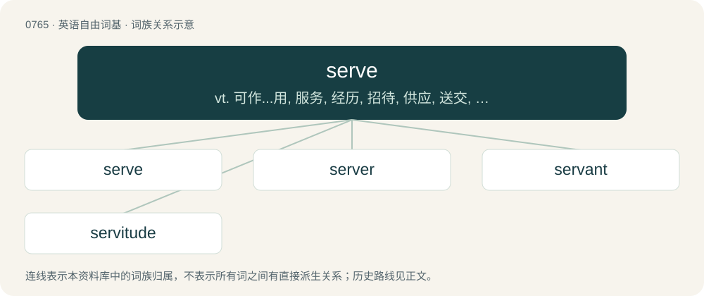

# 0833 · serve — vt. 可作...用, 服务, 经历, 招待, 供应, 送交, 对待；vi. 服务, 服役, 侍应, 适合, 有用, 开球；n. 发球, 轮到发球

[总目录](../00_总目录_按常用程度.md)

**类型**：英语自由词基　｜　**来源语言**：见词源记录

## 核心含义与来源

- 核心含义：vt. 可作...用, 服务, 经历, 招待, 供应, 送交, 对待；vi. 服务, 服役, 侍应, 适合, 有用, 开球；n. 发球, 轮到发球
- 英文含义：To be a formal servant for (a god or deity); to worship in an official capacity.
- 词形：serve

**来源记录 1**（动词；To be a formal servant for (a god or deity); to worship in an official capacity.）

From Middle English serven, from Old French servir, from Latin serviō (“be a slave; serve”), from Latin servus (“slave; servant”), which perhaps derives from Etruscan (compare Etruscan proper names 𐌔𐌄𐌓𐌅𐌉 (servi), 𐌔𐌄𐌓𐌅𐌄 (serve)), or from Proto-Indo-European \*ser- (“watch over, protect”).

## 词族图

## 单词速览（常用到不常用）

| 单词 | 音标 | 释义 |
|---|---|---|
| [serve](#w-1) | 英 /sɜːv/；美 /sɝv/ | vt. 可作...用, 服务, 经历, 招待, 供应, 送交, 对待；vi. 服务, 服役, 侍应, 适合, 有用, 开球；n. 发球, 轮到发球 |
| [server](#w-2) | 英 /ˈsɜːvə/；美 /ˈsɝvɚ/ | n. 服伺者, 上菜用具, 发球员；n. 服务器；\[计\] 服务器, 服务器启动程序, 服务台程序 |
| [servant](#w-3) | 英 /ˈsɜːvənt/；美 /ˈsɝvənt/ | n. 仆人, 有用物, 公务员, 雇员；\[法\] 受雇人, 服务者, 公务员 |
| [servitude](#w-4) | 英 /ˈsɜːvɪtʃuːd/；美 /ˈsərvəˌt(j)ud/ | n. 奴隶状态, 惩役, 地役权；\[法\] 苦役, 劳役, 奴役 |

## 逐词详解

### 1. serve

**词性**：动词　｜　**音标**：英 /sɜːv/；美 /sɝv/

**中文释义**：vt. 可作...用, 服务, 经历, 招待, 供应, 送交, 对待；vi. 服务, 服役, 侍应, 适合, 有用, 开球；n. 发球, 轮到发球

**英文义项**：To be a formal servant for (a god or deity); to worship in an official capacity. / To be a servant for; to work for, to be employed by.

**词源与演化**：

From Middle English serven, from Old French servir, from Latin serviō (“be a slave; serve”), from Latin servus (“slave; servant”), which perhaps derives from Etruscan (compare Etruscan proper names 𐌔𐌄𐌓𐌅𐌉 (servi), 𐌔𐌄𐌓𐌅𐌄 (serve)), or from Proto-Indo-European \*ser- (“watch over, protect”).

**例句**：

> I've received a summons for jury duty. It says I serve one day or one trial.

该用例对应义项：To perform (a public obligation).

### 2. server

**词性**：名词　｜　**音标**：英 /ˈsɜːvə/；美 /ˈsɝvɚ/

**中文释义**：n. 服伺者, 上菜用具, 发球员；n. 服务器；\[计\] 服务器, 服务器启动程序, 服务台程序

**英文义项**：A program that provides services to other programs or devices, either in the same computer or over a computer network. / A computer dedicated to running such programs.

**构词拆分**：serve + -er

**词源与演化**：

From Middle English servere, equivalent to serve + -er.

**例句**：

> The server encountered a temporary error and could not complete your request.

### 3. servant

**词性**：名词　｜　**音标**：英 /ˈsɜːvənt/；美 /ˈsɝvənt/

**中文释义**：n. 仆人, 有用物, 公务员, 雇员；\[法\] 受雇人, 服务者, 公务员

**英文义项**：One who is hired to perform regular household or other duties, and receives compensation. As opposed to a slave. / One who serves another, providing help in some manner.

**构词拆分**：serve + -ant

**词源与演化**：

From Middle English servaunt, from Old French servant, from the present participle of the verb servir. Doublet of sergeant and servient. Morphologically serve + -ant. Displaced native Old English þeġn.

**例句**：

> She is quite the humble servant, the poor in this city owe much to her but she expects nothing.

该用例对应义项：One who serves another, providing help in some manner.

### 4. servitude

**词性**：名词　｜　**音标**：英 /ˈsɜːvɪtʃuːd/；美 /ˈsərvəˌt(j)ud/

**中文释义**：n. 奴隶状态, 惩役, 地役权；\[法\] 苦役, 劳役, 奴役

**英文义项**：The state of being a slave; slavery; being forced to work for others or do their bidding without one's consent or against one's will, either in perpetuity or for a period of time over which one has little or no control. / A qualified beneficial interest severed or fragmented from the ownership of an inferior property and attached to a superior property or to some person other than the owner; the most common form is an easement.

**构词拆分**：serve + -itude

**词源与演化**：

From Middle French servitude, from Latin servitūdō, from Latin servus (“slave”). Equivalent to serve + -itude.

**例句**：

> Every liberation bears within itself the danger of a new kind of servitude.
