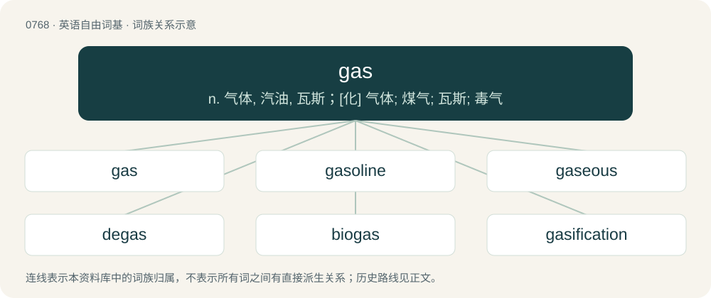

# 0835 · gas — n. 气体, 汽油, 瓦斯；\[化\] 气体; 煤气; 瓦斯; 毒气

[总目录](../00_总目录_按常用程度.md)

**类型**：英语自由词基　｜　**来源语言**：见词源记录

## 核心含义与来源

- 核心含义：n. 气体, 汽油, 瓦斯；\[化\] 气体; 煤气; 瓦斯; 毒气
- 英文含义：Matter in an intermediate state between liquid and plasma that can be contained only if it is fully surrounded by a solid (or in a bubble of liquid, or held together by gravitational pull); it can condense into a liquid, or can (rarely) become a solid directly by deposition.
- 词形：gas

**多个词源／构词路径**：同一拼写可能有不同来源；以下按词性和含义分别列出。

**来源记录 1**（名词；Matter in an intermediate state between liquid and plasma that can be contained only if it is fully surrounded by a solid (or in a bubble of liquid, or held together by gravitational pull); it can condense into a liquid, or can (rarely) become a solid directly by deposition.）

Borrowed from Dutch gas, coined by chemist Jan Baptist van Helmont in Ortus Medicinae. Derived from Ancient Greek χάος (kháos, “chasm, void, empty space”); perhaps also inspired by geest (“breath, vapour, spirit”). Doublet of chaos. First attested in 1648.

**来源记录 2**（名词；Gasoline, a light derivative of petroleum used as fuel.）

Clipping of gasoline. Slang forms popularized on TikTok by Gen Z.

**来源记录 3**（形容词；Comical, zany; fun, amusing.）

Compare the slang usage of "a gas", above.

## 词族图

## 单词速览（常用到不常用）

| 单词 | 音标 | 释义 |
|---|---|---|
| [gas](#w-1) | 英 /ɡæs/；/ɡɛəs/ | n. 气体, 汽油, 瓦斯；\[化\] 气体; 煤气; 瓦斯; 毒气 |
| [gasoline](#w-2) | 英 /ˈɡæs.ə.liːn/；美 /ɡæsˈlin/ | n. 汽油；\[化\] 汽油 |
| [gaseous](#w-3) | 英 /ˈɡeisiəs/；美 /ˈɡæsiəs/ | a. 气体的, 气态的, 无实质的；\[医\] 气\[体\]的 |
| [degas](#w-4) | /diːˈgæs/ | vt. 除去瓦斯；\[化\] 脱气 |
| [biogas](#w-5) | /ˈbaiəu,^æs/ | \[机\] 生物沼气 |
| [gasification](#w-6) | /.ɡæsifiˈkeiʃən/ | n. 气化 |
| [gassy](#w-7) | 英 /ˈɡæsi/ | a. 气体的, 气状的, 含气的 |
| [gasser](#w-8) | /ˈ^æsə/ | n. 气井, 夸夸其谈的人, 出类拔萃的东西；\[化\] 气井; 煤气井 |
| [gasworks](#w-9) | /ˈgæswəːks/ | n. 煤气厂 |

## 逐词详解

### 1. gas

**词性**：名词　｜　**音标**：英 /ɡæs/；/ɡɛəs/

**中文释义**：n. 气体, 汽油, 瓦斯；\[化\] 气体; 煤气; 瓦斯; 毒气

**英文义项**：Matter in an intermediate state between liquid and plasma that can be contained only if it is fully surrounded by a solid (or in a bubble of liquid, or held together by gravitational pull); it can condense into a liquid, or can (rarely) become a solid directly by deposition. / A flammable gaseous hydrocarbon or hydrocarbon mixture used as a fuel, e.g. for cooking, heating, electricity generation or as a fuel in internal combustion engines in vehicles, especially natural gas.

**词源与演化**：

Borrowed from Dutch gas, coined by chemist Jan Baptist van Helmont in Ortus Medicinae. Derived from Ancient Greek χάος (kháos, “chasm, void, empty space”); perhaps also inspired by geest (“breath, vapour, spirit”). Doublet of chaos. First attested in 1648.

**例句**：

> Gas-fired power stations have largely replaced coal-burning ones.

该用例对应义项：A flammable gaseous hydrocarbon or hydrocarbon mixture used as a fuel, e.g. for cooking, heating, electricity generation or as a fuel in internal combustion engines in vehicles, especially natural gas.

### 2. gasoline

**词性**：名词　｜　**音标**：英 /ˈɡæs.ə.liːn/；美 /ɡæsˈlin/

**中文释义**：n. 汽油；\[化\] 汽油

**英文义项**：A flammable liquid consisting of a mixture of refined petroleum hydrocarbons, mainly used as a motor fuel; petrol. / Any specific kind of this fuel.

**构词拆分**：gas + -ol + -ine；gas + -ol

**词源与演化**：

From gas + -ol (suffix used in the names of oils) + -ine (suffix used in the names of derivatives). So called because it was originally used in the manufacture and enrichment of domestic gases, such as air gas. Some sources suggest that the name originated from the brand name Cazeline, a petroleum-derived lighting oil, from the surname of the man who first marketed it in 1862, John Cassell, and the suffix –eline, from Greek ἔλαιον (élaion, “oil, olive oil”), from ἐλαία (elaía, “olive”). Gasolene is found from 1863, and gasoline from 1864.

**例句**：

> You can't put gasoline in this car. This car takes diesel fuel.

该用例对应义项：A flammable liquid consisting of a mixture of refined petroleum hydrocarbons, mainly used as a motor fuel; petrol.

### 3. gaseous

**词性**：形容词　｜　**音标**：英 /ˈɡeisiəs/；美 /ˈɡæsiəs/

**中文释义**：a. 气体的, 气态的, 无实质的；\[医\] 气\[体\]的

**英文义项**：Relating to, or existing as gas (matter in an intermediate state between liquid and plasma). / Of a liquid containing bubbles: gassy.

**构词拆分**：gas + -eous

**词源与演化**：

From gas + -eous.

**例句**：

> At room temperature, oxygen remains in a gaseous state.

该用例对应义项：Relating to, or existing as gas (matter in an intermediate state between liquid and plasma).

### 4. degas

**词性**：动词　｜　**音标**：/diːˈgæs/

**中文释义**：vt. 除去瓦斯；\[化\] 脱气

**英文义项**：To remove the gas from.

**构词拆分**：de- + gas

**词源与演化**：

From de- + gas.

**例句**：

> Let's meet Edgar Degas and look at his pictures with him.

### 5. biogas

**词性**：名词　｜　**音标**：/ˈbaiəu,^æs/

**中文释义**：\[机\] 生物沼气

**英文义项**：A mixture of methane and carbon dioxide, produced by anaerobic digestion of organic waste matter, used as a fuel.

**构词拆分**：bio- + gas

**词源与演化**：

From bio- + gas.

**例句**：

> They told us a story about biogas extraction today.

### 6. gasification

**词性**：名词　｜　**音标**：/.ɡæsifiˈkeiʃən/

**中文释义**：n. 气化

**英文义项**：The action of gasifying. / The process of transforming carbon-based materials into a mix of carbon monoxide and hydrogen that can serve as fuel.

**构词拆分**：gas + -ification

**词源与演化**：

From gas + -ification.

**例句**：

> Coal gas is produced by the gasification of coal.

该用例对应义项：the process of changing into gas

### 7. gassy

**词性**：形容词　｜　**音标**：英 /ˈɡæsi/

**中文释义**：a. 气体的, 气状的, 含气的

**英文义项**：Having the nature of, or containing, gas. / Containing dissolved gas (usually carbon dioxide); fizzy.

**构词拆分**：gas + -y

**词源与演化**：

From gas + -y. Doublet of chaotic.

**例句**：

> Beans are a gassy food.

该用例对应义项：Tending to cause flatulence.

### 8. gasser

**词性**：名词　｜　**音标**：/ˈ^æsə/

**中文释义**：n. 气井, 夸夸其谈的人, 出类拔萃的东西；\[化\] 气井; 煤气井

**英文义项**：One who gasses, or poisons with gas. / Something highly entertaining or remarkable.

**构词拆分**：gas + -er

**词源与演化**：

From gas + -er.

### 9. gasworks

**词性**：名词　｜　**音标**：/ˈgæswəːks/

**中文释义**：n. 煤气厂

**英文义项**：A factory where gas is generated or distributed (whether for industrial consumption or for residential distribution). / One where coal is converted to coal gas and coke (via gasification).

**构词拆分**：gas + works

**词源与演化**：

From gas + works.
