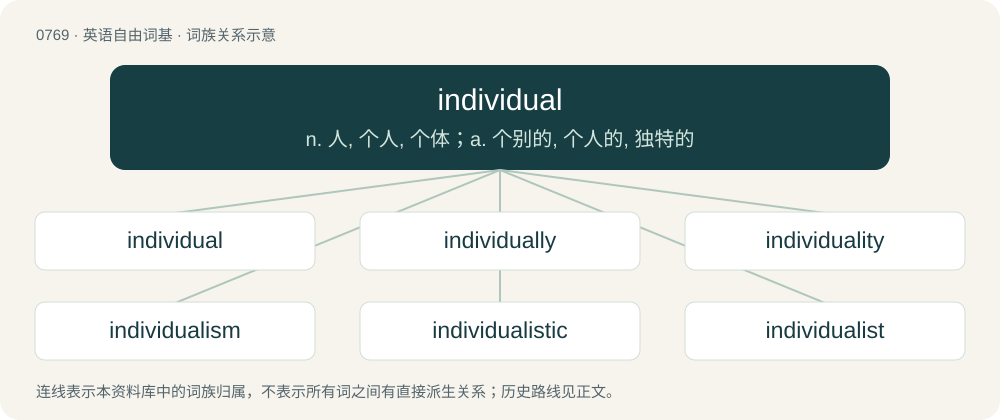

# 0836 · individual — n. 人, 个人, 个体；a. 个别的, 个人的, 独特的

[总目录](../00_总目录_按常用程度.md)

**类型**：英语自由词基　｜　**来源语言**：见词源记录

## 核心含义与来源

- 核心含义：n. 人, 个人, 个体；a. 个别的, 个人的, 独特的
- 英文含义：A person considered alone, rather than as belonging to a group of people.
- 词形：individual

**来源记录 1**（名词；A person considered alone, rather than as belonging to a group of people.）

From Medieval Latin indīviduālis, from Latin indīviduum (“an indivisible thing”), neuter of indīviduus (“indivisible, undivided”), from in + dīviduus (“divisible”), from dīvidō (“divide”). Displaced native Old English hād (“person, individual”).

## 词族图

## 单词速览（常用到不常用）

| 单词 | 音标 | 释义 |
|---|---|---|
| [individual](#w-1) | 美 /ˌɪndɪˈvɪd͡ʒ(u)əl/；/ɪndɪˈvɪd͡ʒʊəl/ | n. 人, 个人, 个体；a. 个别的, 个人的, 独特的 |
| [individually](#w-2) | /ˌɪndɪˈvɪd͡ʒ(u)əli/ | adv. 以个人身分, 各个地, 独特地 |
| [individuality](#w-3) | /ˌɪndɪvɪd͡ʒuˈælɪti/ | n. 个性, 个人, 特征 |
| [individualism](#w-4) | /ˌɪn.dɪˈvɪ.dʒu.əˌlɪ.zəm/ | n. 个人主义, 个人特征；\[经\] 个人主义 |
| [individualistic](#w-5) | /ˌɪn.dɪˌvɪ.dʒu.əˈlɪ.stɪk/ | a. 个人主义的, 独特的 |
| [individualist](#w-6) | /.indiˈvidʒuəlist/ | n. 个人主义者, 利己主义者 |

## 逐词详解

### 1. individual

**词性**：名词　｜　**音标**：美 /ˌɪndɪˈvɪd͡ʒ(u)əl/；/ɪndɪˈvɪd͡ʒʊəl/

**中文释义**：n. 人, 个人, 个体；a. 个别的, 个人的, 独特的

**英文义项**：A person considered alone, rather than as belonging to a group of people. / A single physical human being as a legal subject, as opposed to a legal person such as a corporation.

**词源与演化**：

From Medieval Latin indīviduālis, from Latin indīviduum (“an indivisible thing”), neuter of indīviduus (“indivisible, undivided”), from in + dīviduus (“divisible”), from dīvidō (“divide”). Displaced native Old English hād (“person, individual”).

**例句**：

> He is an unusual individual.

该用例对应义项：A person considered alone, rather than as belonging to a group of people.

### 2. individually

**词性**：副词　｜　**音标**：/ˌɪndɪˈvɪd͡ʒ(u)əli/

**中文释义**：adv. 以个人身分, 各个地, 独特地

**英文义项**：As individuals, separately, independently.

**构词拆分**：individual + -ly

**词源与演化**：

From individual + -ly.

**用法示例／搭配（非完整句）**：

> rate the group individually

该用例对应义项：As individuals, separately, independently.

### 3. individuality

**词性**：名词　｜　**音标**：/ˌɪndɪvɪd͡ʒuˈælɪti/

**中文释义**：n. 个性, 个人, 特征

**英文义项**：The characteristics that contribute to the differentiation or distinction of someone or something from a group of otherwise comparable identity. / A person.

**构词拆分**：individual + -ity

**词源与演化**：

From individual + -ity. Displaced native Old English hād.

**例句**：

> Within his marriage, he must keep his individuality and freedom of action.

### 4. individualism

**词性**：名词　｜　**音标**：/ˌɪn.dɪˈvɪ.dʒu.əˌlɪ.zəm/

**中文释义**：n. 个人主义, 个人特征；\[经\] 个人主义

**英文义项**：The tendency for a person to act without reference to others, particularly in matters of style, fashion or mode of thought. / The moral stance, political philosophy, or social outlook that promotes independence and self-reliance of individual people, while opposing the interference with each person's choices by society, the state, or any other group or institution.

**构词拆分**：individual + -ism

**词源与演化**：

Borrowed from French individualisme, equivalent to individual + -ism.

**例句**：

> Art is the most intense mode of individualism that the world has known.

### 5. individualistic

**词性**：形容词　｜　**音标**：/ˌɪn.dɪˌvɪ.dʒu.əˈlɪ.stɪk/

**中文释义**：a. 个人主义的, 独特的

**英文义项**：More interested in individual people than in society as a whole. / Interested in oneself rather than others; egocentric.

**构词拆分**：individualist + -ic；individual + -istic

**词源与演化**：

From individualist + -ic or individual + -istic.

**例句**：

> The artist has an individualistic style of painting.

### 6. individualist

**词性**：名词　｜　**音标**：/.indiˈvidʒuəlist/

**中文释义**：n. 个人主义者, 利己主义者

**英文义项**：Someone who believes in individualism as a sociopolitical system. / Someone who believes in the philosophy of individualism; a solipsist.

**构词拆分**：individual + -ist

**词源与演化**：

From individual + -ist.

**例句**：

> Sheena took time to get used to the individualist culture of the West.
