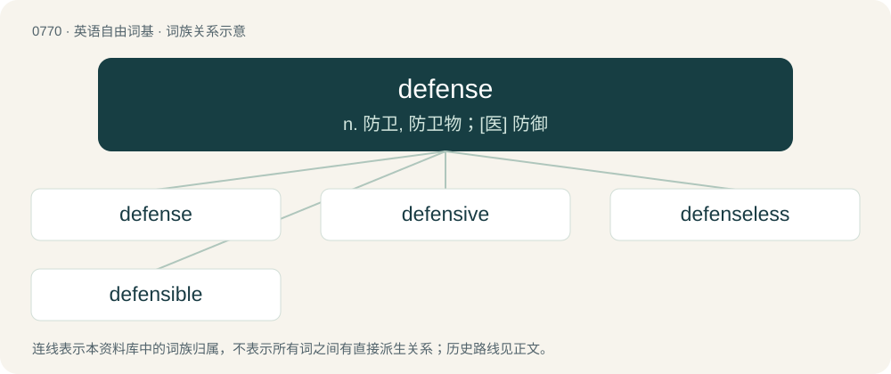

# 0837 · defense — n. 防卫, 防卫物；\[医\] 防御

[总目录](../00_总目录_按常用程度.md)

**类型**：英语自由词基　｜　**来源语言**：见词源记录

## 核心含义与来源

- 核心含义：n. 防卫, 防卫物；\[医\] 防御
- 英文含义：The action of defending or protecting from attack, danger, or injury.
- 词形：defense

**来源记录 1**（名词；The action of defending or protecting from attack, danger, or injury.）

From Middle English defens, defense, from Old French defens, defense, from Late Latin dēfēnsa (“protection”). Displaced native Old English bewering. The verb is from the noun.

## 词族图

## 单词速览（常用到不常用）

| 单词 | 音标 | 释义 |
|---|---|---|
| [defense](#w-1) | 英 /dɪˈfɛns/；美 /ˈdiːˌfɛns/ | n. 防卫, 防卫物；\[医\] 防御 |
| [defensive](#w-2) | 英 /dɪˈfɛn.sɪv/ | a. 防卫的, 防备用的, 自卫的；n. 守势, 防卫姿势, 防卫物 |
| [defenseless](#w-3) | 英 /dɪˈfɛnsləs/ | a. 无防备的 |
| [defensible](#w-4) | 英 /dɪˈfɛn.sɪ.bəl/ | a. 可防卫的, 可防护的, 可辩护的；\[法\] 可辩护的, 能防卫的 |

## 逐词详解

### 1. defense

**词性**：名词　｜　**音标**：英 /dɪˈfɛns/；美 /ˈdiːˌfɛns/

**中文释义**：n. 防卫, 防卫物；\[医\] 防御

**英文义项**：The action of defending or protecting from attack, danger, or injury. / A strategy and tactics employed to prevent the other team from scoring; contrasted with offense.

**词源与演化**：

From Middle English defens, defense, from Old French defens, defense, from Late Latin dēfēnsa (“protection”). Displaced native Old English bewering. The verb is from the noun.

**用法示例／搭配（非完整句）**：

> to come to someone's defense

该用例对应义项：An argument in support or justification of something.

### 2. defensive

**词性**：形容词　｜　**音标**：英 /dɪˈfɛn.sɪv/

**中文释义**：a. 防卫的, 防备用的, 自卫的；n. 守势, 防卫姿势, 防卫物

**英文义项**：Intended for defence; protective. / Intended to deter attack.

**构词拆分**：defense + -ive

**词源与演化**：

From Middle French défensif. Morphologically defense + -ive.

**例句**：

> The victim held up his hand to repel the attacker and received a defensive knife wound.

该用例对应义项：Pertaining to defense, as opposed to attack.

### 3. defenseless

**词性**：形容词　｜　**音标**：英 /dɪˈfɛnsləs/

**中文释义**：a. 无防备的

**英文义项**：Lacking any form of defense; vulnerable; open to attack.

**构词拆分**：defense + -less

**词源与演化**：

From defense + -less.

**例句**：

> The defenseless lady was exposed to the world's mockery and slander.

### 4. defensible

**词性**：形容词　｜　**音标**：英 /dɪˈfɛn.sɪ.bəl/

**中文释义**：a. 可防卫的, 可防护的, 可辩护的；\[法\] 可辩护的, 能防卫的

**英文义项**：Capable of being defended against armed attack. / Capable of being justified.

**构词拆分**：defense + -ible

**词源与演化**：

From Old French defensable, from Latin defensibilem. Equivalent to defense + -ible.

**例句**：

> Ukraine turned out to be much more defensible than previously thought.
