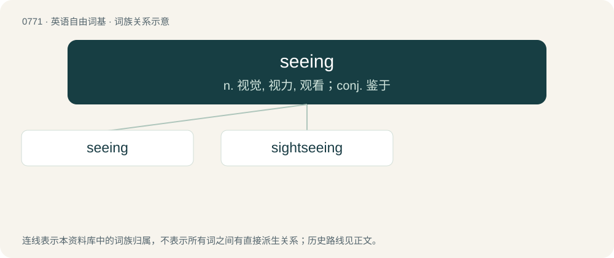

# 0838 · seeing — n. 视觉, 视力, 观看；conj. 鉴于

[总目录](../00_总目录_按常用程度.md)

**类型**：英语自由词基　｜　**来源语言**：见词源记录

## 核心含义与来源

- 核心含义：n. 视觉, 视力, 观看；conj. 鉴于
- 英文含义：Having vision; not blind.
- 词形：seeing

**多个词源／构词路径**：同一拼写可能有不同来源；以下按词性和含义分别列出。

**来源记录 1**（形容词；Having vision; not blind.）

From see + -ing.

**来源记录 2**（连词；Inasmuch as; in view of the fact that.）

Probably an elision of "seeing that" or "seeing as".

## 词族图

## 单词速览（常用到不常用）

| 单词 | 音标 | 释义 |
|---|---|---|
| [seeing](#w-1) | /ˈsiː.ɪŋ/ | n. 视觉, 视力, 观看；conj. 鉴于 |
| [sightseeing](#w-2) | /ˈsaitsiːiŋ/ | n. 观光, 游览；a. 观光的, 游览的 |

## 逐词详解

### 1. seeing

**词性**：形容词　｜　**音标**：/ˈsiː.ɪŋ/

**中文释义**：n. 视觉, 视力, 观看；conj. 鉴于

**英文义项**：Having vision; not blind.

**构词拆分**：From see + -ing.

**词源与演化**：

From see + -ing.

**例句**：

> Seeing that he is still sick, he is unlikely to come today.

### 2. sightseeing

**词性**：名词　｜　**音标**：/ˈsaitsiːiŋ/

**中文释义**：n. 观光, 游览；a. 观光的, 游览的

**英文义项**：The activity of going out looking at things; tourism.

**构词拆分**：sight + seeing

**词源与演化**：

From sight + seeing.

**例句**：

> Sightseeing is a frequent reason to visit San Francisco.

该用例对应义项：The activity of going out looking at things; tourism.
