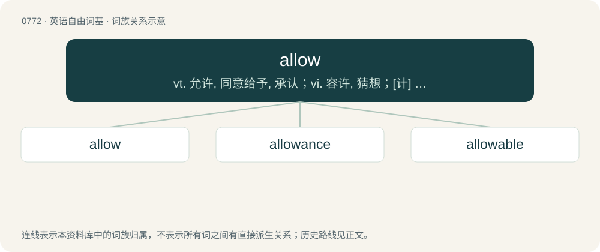

# 0839 · allow — vt. 允许, 同意给予, 承认；vi. 容许, 猜想；\[计\] 允许命令

[总目录](../00_总目录_按常用程度.md)

**类型**：英语自由词基　｜　**来源语言**：见词源记录

## 核心含义与来源

- 核心含义：vt. 允许, 同意给予, 承认；vi. 容许, 猜想；\[计\] 允许命令
- 英文含义：To let one have as a suitable share of something.
- 词形：allow

**来源记录 1**（动词；To let one have as a suitable share of something.）

From Middle English allowen, alowen, a borrowing from Anglo-Norman allouer, alouer, from Medieval Latin allaudāre, merged with alouer, from Medieval Latin allocō (“to assign”). Doublet of allaud (via allaudāre) or allocate (via allocāre). The similarity with Middle English alyfen (from Old English ālīefan) and German erlauben, both from Proto-Germanic \*uzlaubijaną (“to allow”) is unrelated.

## 词族图

## 单词速览（常用到不常用）

| 单词 | 音标 | 释义 |
|---|---|---|
| [allow](#w-1) | /əˈlaʊ/ | vt. 允许, 同意给予, 承认；vi. 容许, 猜想；\[计\] 允许命令 |
| [allowance](#w-2) | 美 /əˈlaʊɪns/；/əˈlaʊəns/ | n. 津贴, 零用钱, 限额, 折扣, 允许；vt. 定量供应 |
| [allowable](#w-3) | /əˈlaʊ.əbəl/ | a. 允许的, 许可的, 容许的；\[经\] 允许产量 |

## 逐词详解

### 1. allow

**词性**：动词　｜　**音标**：/əˈlaʊ/

**中文释义**：vt. 允许, 同意给予, 承认；vi. 容许, 猜想；\[计\] 允许命令

**英文义项**：To let one have as a suitable share of something. / To present something as possible or reasonable.

**词源与演化**：

From Middle English allowen, alowen, a borrowing from Anglo-Norman allouer, alouer, from Medieval Latin allaudāre, merged with alouer, from Medieval Latin allocō (“to assign”). Doublet of allaud (via allaudāre) or allocate (via allocāre). The similarity with Middle English alyfen (from Old English ālīefan) and German erlauben, both from Proto-Germanic \*uzlaubijaną (“to allow”) is unrelated.

**例句**：

> Although I don't consent to their holding such meetings, I will allow them for the time being.

该用例对应义项：To not bar or obstruct.

### 2. allowance

**词性**：名词　｜　**音标**：美 /əˈlaʊɪns/；/əˈlaʊəns/

**中文释义**：n. 津贴, 零用钱, 限额, 折扣, 允许；vt. 定量供应

**英文义项**：Permission; granting, conceding, or admitting. / Acknowledgment.

**构词拆分**：allow + -ance

**词源与演化**：

From Middle English allouance, from Old French alouance. Morphologically allow + -ance.

**例句**：

> Being a volunteer is unpaid, but we get accommodation and a living allowance of 100 euros a week.

该用例对应义项：An amount, portion, or share that is allotted or granted; a sum granted as a reimbursement, a bounty, or as appropriate for any purpose.

### 3. allowable

**词性**：形容词　｜　**音标**：/əˈlaʊ.əbəl/

**中文释义**：a. 允许的, 许可的, 容许的；\[经\] 允许产量

**英文义项**：Appropriate; acceptable. / Intellectually admissible; valid; probable.

**构词拆分**：allow + -able

**词源与演化**：

From Middle English allowable, alowable, a borrowing from Old French alouable (Modern French allouable), from allouer, equivalent to allow + -able.
