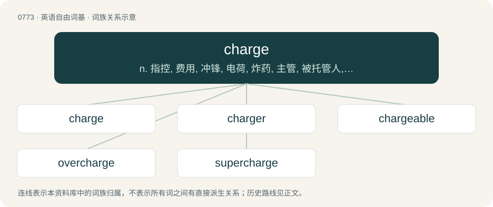

# 0840 · charge — n. 指控, 费用, 冲锋, 电荷, 炸药, 主管, 被托管人, 命令；vt. 控诉, 加罪于, 使充满, 使充电, 使承担；vi. 冲锋, 要价, 收费

[总目录](../00_总目录_按常用程度.md)

**类型**：英语自由词基　｜　**来源语言**：见词源记录

## 核心含义与来源

- 核心含义：n. 指控, 费用, 冲锋, 电荷, 炸药, 主管, 被托管人, 命令；vt. 控诉, 加罪于, 使充满, 使充电, 使承担；vi. 冲锋, 要价, 收费
- 英文含义：The amount of money levied for a service.
- 词形：charge

**来源记录 1**（名词；The amount of money levied for a service.）

From Middle English chargen, from Old French chargier, from Late Latin carricō (“to load”), from Latin carrus (“a car, wagon”); see car. Doublet of cargo.

## 词族图

## 单词速览（常用到不常用）

| 单词 | 音标 | 释义 |
|---|---|---|
| [charge](#w-1) | 英 /ˈt͡ʃɑːd͡ʒ/；美 /ˈt͡ʃɑɹd͡ʒ/ | n. 指控, 费用, 冲锋, 电荷, 炸药, 主管, 被托管人, 命令；vt. 控诉, 加罪于, 使充满, 使充电, 使承担；vi. 冲锋, 要价, 收费 |
| [charger](#w-2) | 英 /ˈtʃɑːdʒə/；美 /ˈt͡ʃɑɹd͡ʒɚ/ | n. 充电器, 冲锋者, 战马；\[化\] 充电器; 装料机; 加料机 |
| [chargeable](#w-3) | 美 /ˈt͡ʃɑɹd͡ʒəbəl/ | a. 应支付的；\[经\] 可记在某人帐上 |
| [overcharge](#w-4) | /.əuvəˈtʃɑːdʒ/ | v. 讨价过高, 装载过多, 过度充电, 渲染；n. 超载, 装药过多, 过度充电 |
| [supercharge](#w-5) | /ˈsjuːpətʃɑːdʒ/ | vt. 对...增压, 使超负荷, 使过度, 使过分；\[化\] 增压器 |

## 逐词详解

### 1. charge

**词性**：名词　｜　**音标**：英 /ˈt͡ʃɑːd͡ʒ/；美 /ˈt͡ʃɑɹd͡ʒ/

**中文释义**：n. 指控, 费用, 冲锋, 电荷, 炸药, 主管, 被托管人, 命令；vt. 控诉, 加罪于, 使充满, 使充电, 使承担；vi. 冲锋, 要价, 收费

**英文义项**：The amount of money levied for a service. / An attack in which combatants rush towards an enemy in an attempt to engage in close combat.

**词源与演化**：

From Middle English chargen, from Old French chargier, from Late Latin carricō (“to load”), from Latin carrus (“a car, wagon”); see car. Doublet of cargo.

**例句**：

> I gave him the charge to get the deal closed by the end of the month.

该用例对应义项：An instruction.

### 2. charger

**词性**：名词　｜　**音标**：英 /ˈtʃɑːdʒə/；美 /ˈt͡ʃɑɹd͡ʒɚ/

**中文释义**：n. 充电器, 冲锋者, 战马；\[化\] 充电器; 装料机; 加料机

**英文义项**：A device that charges or recharges. / One who charges.

**构词拆分**：charge + -er

**词源与演化**：

From Middle English chargere, equivalent to charge + -er.

**例句**：

> Put the batteries in the charger overnight so we can use them tomorrow.

该用例对应义项：A device that charges or recharges.

### 3. chargeable

**词性**：形容词　｜　**音标**：美 /ˈt͡ʃɑɹd͡ʒəbəl/

**中文释义**：a. 应支付的；\[经\] 可记在某人帐上

**英文义项**：Able to be charged. / That may be charged to an account.

**构词拆分**：charge + -able

**词源与演化**：

From charge + -able.

**例句**：

> The battery is chargeable by means of this device.

该用例对应义项：Able to be charged.

### 4. overcharge

**词性**：动词　｜　**音标**：/.əuvəˈtʃɑːdʒ/

**中文释义**：v. 讨价过高, 装载过多, 过度充电, 渲染；n. 超载, 装药过多, 过度充电

**英文义项**：To charge (somebody) more money than the correct amount or to surpass a certain limit while charging a bill. / To continue to charge (an electrical device) beyond its capacity.

**构词拆分**：over- + charge

**词源与演化**：

From Middle English overchargen, equivalent to over- + charge.

**用法示例／搭配（非完整句）**：

> to overcharge a description

该用例对应义项：To exaggerate.

### 5. supercharge

**词性**：动词　｜　**音标**：/ˈsjuːpətʃɑːdʒ/

**中文释义**：vt. 对...增压, 使超负荷, 使过度, 使过分；\[化\] 增压器

**英文义项**：To increase the power of an internal combustion engine (either Otto or Diesel cycle) by compressing the inlet air with power extracted from the crankshaft. / To make faster or more powerful.

**构词拆分**：super- + charge

**词源与演化**：

From super- + charge.

**例句**：

> Using this new battery-pack, should in theory, supercharge your device.
