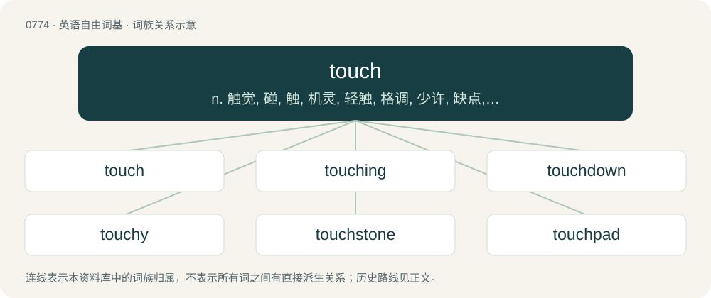

# 0841 · touch — n. 触觉, 碰, 触, 机灵, 轻触, 格调, 少许, 缺点, 弹力；vt. 接触, 触摸, 触及, 使接触, 达到, 涉及, 影响到, 使轻度受害, 感动；vi. 触摸, 接近, 涉及, 提到

[总目录](../00_总目录_按常用程度.md)

**类型**：英语自由词基　｜　**来源语言**：见词源记录

## 核心含义与来源

- 核心含义：n. 触觉, 碰, 触, 机灵, 轻触, 格调, 少许, 缺点, 弹力；vt. 接触, 触摸, 触及, 使接触, 达到, 涉及, 影响到, 使轻度受害, 感动；vi. 触摸, 接近, 涉及, 提到
- 英文含义：To make physical contact with; to bring the hand, finger or other part of the body into contact with.
- 词形：touch

**来源记录 1**（动词；To make physical contact with; to bring the hand, finger or other part of the body into contact with.）

From Middle English touchen, tochen, from Old French tochier (“to touch”) (whence Modern French toucher; compare French doublet toquer (“to offend, bother, harass”)), from Vulgar Latin \*tuccō (“to knock, strike, offend”), from Frankish \*tukkōn (“to knock, strike, touch”), from Proto-Germanic \*tukkōną (“to tug, grab, grasp”), from Proto-Indo-European \*dewk- (“to draw, pull, lead”). Largely displaced native Middle English rinen, from Old English hrīnan (whence Modern English rine). Doublet of tuck. Cognates Cognate with Old High German zochhōn, zuhhōn (“to grasp, take, seize, snatch”) (whence German zucken (“to jerk, flinch”)), German Low German tucken, tocken (“to fidget, twitch, pull up, entice, throb, knock, repeatedly tap”), Middle Dutch tocken, tucken (“to touch, entice”) (whence Dutch tokkelen (“to strum, pluck”)), Old English tucian, tūcian (“to disturb, mistreat”) (whence Modern English tuck). Compare also Old High German tokkōn, tockōn (“to abut, collide”). More at tuck. Via Proto-Indo-European \*dewk- cognate with English tie, tow, tug, team, Latin dūcō, dux.

## 词族图

## 单词速览（常用到不常用）

| 单词 | 音标 | 释义 |
|---|---|---|
| [touch](#w-1) | /tʌt͡ʃ/ | n. 触觉, 碰, 触, 机灵, 轻触, 格调, 少许, 缺点, 弹力；vt. 接触, 触摸, 触及, 使接触, 达到, 涉及, 影响到, 使轻度受害, 感动；vi. 触摸, 接近, 涉及, 提到 |
| [touching](#w-2) | /ˈtʌt͡ʃɪŋ/ | a. 动人的, 令人同情的 |
| [touchdown](#w-3) | /ˈtʌt͡ʃ.daʊn/ | n. 触地, 触地得分, 着地 |
| [touchy](#w-4) | /ˈtʌt͡ʃi/ | a. 易怒的, 难以取悦的, 过于敏感的 |
| [touchstone](#w-5) | /ˈtʌt͡ʃstəʊn/ | n. 试金石, 检验标准 |
| [touchpad](#w-6) | 美 /ˈtʌt͡ʃˌpæd/ | n. 触摸屏设备, 触摸板 |
| [touchline](#w-7) | /ˈtʌtʃlain/ | n. 边线 |

## 逐词详解

### 1. touch

**词性**：动词　｜　**音标**：/tʌt͡ʃ/

**中文释义**：n. 触觉, 碰, 触, 机灵, 轻触, 格调, 少许, 缺点, 弹力；vt. 接触, 触摸, 触及, 使接触, 达到, 涉及, 影响到, 使轻度受害, 感动；vi. 触摸, 接近, 涉及, 提到

**英文义项**：To make physical contact with; to bring the hand, finger or other part of the body into contact with. / To come into (involuntary) contact with; to meet or intersect.

**词源与演化**：

From Middle English touchen, tochen, from Old French tochier (“to touch”) (whence Modern French toucher; compare French doublet toquer (“to offend, bother, harass”)), from Vulgar Latin \*tuccō (“to knock, strike, offend”), from Frankish \*tukkōn (“to knock, strike, touch”), from Proto-Germanic \*tukkōną (“to tug, grab, grasp”), from Proto-Indo-European \*dewk- (“to draw, pull, lead”). Largely displaced native Middle English rinen, from Old English hrīnan (whence Modern English rine). Doublet of tuck. Cognates Cognate with Old High German zochhōn, zuhhōn (“to grasp, take, seize, snatch”) (whence German zucken (“to jerk, flinch”)), German Low German tucken, tocken (“to fidget, twitch, pull up, entice, throb, knock, repeatedly tap”), Middle Dutch tocken, tucken (“to touch, entice”) (whence Dutch tokkelen (“to strum, pluck”)), Old English tucian, tūcian (“to disturb, mistreat”) (whence Modern English tuck). Compare also Old High German tokkōn, tockōn (“to abut, collide”). More at tuck. Via Proto-Indo-European \*dewk- cognate with English tie, tow, tug, team, Latin dūcō, dux.

**例句**：

> Her parents had caught her touching herself when she was fifteen.

该用例对应义项：To sexually excite with the fingers; to finger or masturbate.

### 2. touching

**词性**：形容词　｜　**音标**：/ˈtʌt͡ʃɪŋ/

**中文释义**：a. 动人的, 令人同情的

**英文义项**：Provoking sadness and pity; that can cause sadness or heartbreak among witnesses to a sad event or situation. / In direct contact with.

**构词拆分**：touch + -ing

**词源与演化**：

From Middle English touchynge, equivalent to touch + -ing.

**用法示例／搭配（非完整句）**：

> a touching story

该用例对应义项：Provoking sadness and pity; that can cause sadness or heartbreak among witnesses to a sad event or situation.

### 3. touchdown

**词性**：名词　｜　**音标**：/ˈtʌt͡ʃ.daʊn/

**中文释义**：n. 触地, 触地得分, 着地

**英文义项**：A six-point score occurring when the ball enters possession of a team's player in the opponent's end zone. / A defensive action of grounding the ball in the team's own in-goal to stop the play.

**构词拆分**：From touch + down.

**词源与演化**：

From touch + down.

**例句**：

> The passengers audibly relaxed at touchdown.

该用例对应义项：The moment when an aircraft or spacecraft makes first or final contact with the ground during a landing.

### 4. touchy

**词性**：形容词　｜　**音标**：/ˈtʌt͡ʃi/

**中文释义**：a. 易怒的, 难以取悦的, 过于敏感的

**英文义项**：Extremely sensitive or volatile; easily disturbed to the point of becoming unstable; requiring caution or tactfulness. / Easily offended, oversensitive.

**构词拆分**：touch + -y

**词源与演化**：

A variant of earlier tetchy (“cranky, easily annoyed, difficult to handle”), under influence from some senses of touch (“affect, disturb”) and simulating touch + -y.

**例句**：

> He can be very touchy when you talk about his estranged son, so be as tactful as possible.

该用例对应义项：Easily offended, oversensitive.

### 5. touchstone

**词性**：名词　｜　**音标**：/ˈtʌt͡ʃstəʊn/

**中文释义**：n. 试金石, 检验标准

**英文义项**：A stone used to verify the quality of gold alloys by rubbing them in order to leave a visible trace. / A standard of comparison or evaluation.

**构词拆分**：touch + stone

**词源与演化**：

From touch + stone.

**例句**：

> Do not praise anyone before you hear him speak, for that is the touchstone of human beings.

### 6. touchpad

**词性**：名词　｜　**音标**：美 /ˈtʌt͡ʃˌpæd/

**中文释义**：n. 触摸屏设备, 触摸板

**英文义项**：A flat surface which is sensitive to touch, used mostly in laptop computers to control an on-screen cursor.

**构词拆分**：touch + pad

**词源与演化**：

From touch + pad.

**例句**：

> To select, one presses down on the touchpad instead of a physical button.

### 7. touchline

**词性**：名词　｜　**音标**：/ˈtʌtʃlain/

**中文释义**：n. 边线

**英文义项**：One of the lines that mark the border limits of the pitch.

**构词拆分**：touch + line

**词源与演化**：

From touch + line.

**例句**：

> The manager and coach stood on the touchline shouting out instructions to their team.
