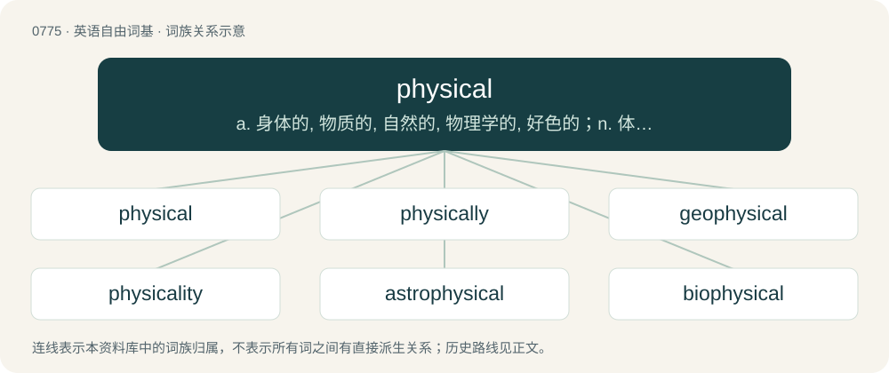

# 0842 · physical — a. 身体的, 物质的, 自然的, 物理学的, 好色的；n. 体格检查

[总目录](../00_总目录_按常用程度.md)

**类型**：英语自由词基　｜　**来源语言**：见词源记录

## 核心含义与来源

- 核心含义：a. 身体的, 物质的, 自然的, 物理学的, 好色的；n. 体格检查
- 英文含义：Pertaining to the world as understood through the senses rather than the mind, having to do with the material world.
- 词形：physical

**来源记录 1**（形容词；Pertaining to the world as understood through the senses rather than the mind, having to do with the material world.）

Borrowed from Late Latin physicālis, from Latin physica (“study of nature”), from Ancient Greek φυσική (phusikḗ), feminine singular of φυσικός (phusikós, “natural; physical”), from φύσις (phúsis, “origin, birth; nature, quality; form, shape; type, kind”), from φῠ́ω (phŭ́ō, “grow”), ultimately from Proto-Indo-European \*bʰuH- (“to appear, become, rise up”).

## 词族图

## 单词速览（常用到不常用）

| 单词 | 音标 | 释义 |
|---|---|---|
| [physical](#w-1) | 英 /ˈfɪz.ɪ.kəl/ | a. 身体的, 物质的, 自然的, 物理学的, 好色的；n. 体格检查 |
| [physically](#w-2) | 英 /ˈfɪz.ɪ.kli/ | adv. 按自然规律, 完全地, 实际上, 真正地, 身体上地 |
| [geophysical](#w-3) | 英 /ˌdʒiː.əʊˈfɪz.ɪk.əl/ | a. 地球物理学的 |
| [physicality](#w-4) | /fiziˈkæliti/ | n. 肉体性 |
| [astrophysical](#w-5) | /.æstrəˈfizikl/ | a. 天体物理学的 |
| [biophysical](#w-6) | 英 /ˈbaɪəʊˌfɪzɪkəl/ | \[医\]生物物理学的 |

## 逐词详解

### 1. physical

**词性**：形容词　｜　**音标**：英 /ˈfɪz.ɪ.kəl/

**中文释义**：a. 身体的, 物质的, 自然的, 物理学的, 好色的；n. 体格检查

**英文义项**：Pertaining to the world as understood through the senses rather than the mind, having to do with the material world. / In accordance with the laws of nature; now specifically, pertaining to physics.

**词源与演化**：

Borrowed from Late Latin physicālis, from Latin physica (“study of nature”), from Ancient Greek φυσική (phusikḗ), feminine singular of φυσικός (phusikós, “natural; physical”), from φύσις (phúsis, “origin, birth; nature, quality; form, shape; type, kind”), from φῠ́ω (phŭ́ō, “grow”), ultimately from Proto-Indo-European \*bʰuH- (“to appear, become, rise up”).

**例句**：

> There is just something so amazing about reading a physical book as compared to an e-book.

该用例对应义项：Of a piece of media, existing as a tangible object instead of being digital.

### 2. physically

**词性**：副词　｜　**音标**：英 /ˈfɪz.ɪ.kli/

**中文释义**：adv. 按自然规律, 完全地, 实际上, 真正地, 身体上地

**英文义项**：In a physical manner. / According to the laws of physics.

**构词拆分**：physic + -ally；physical + -ly

**词源与演化**：

From physic + -ally or physical + -ly.

**例句**：

> After the software updated, I had to go in and physically change all the settings back to the way I wanted them.

该用例对应义项：Directly, rather than automatically or similar.

### 3. geophysical

**词性**：形容词　｜　**音标**：英 /ˌdʒiː.əʊˈfɪz.ɪk.əl/

**中文释义**：a. 地球物理学的

**英文义项**：Of or pertaining to geophysics.

**构词拆分**：geo- + physical

**词源与演化**：

From geo- + physical.

### 4. physicality

**词性**：名词　｜　**音标**：/fiziˈkæliti/

**中文释义**：n. 肉体性

**英文义项**：Physical attributes. / Obsession with physical urges.

**构词拆分**：physical + -ity

**词源与演化**：

From physical + -ity.

**例句**：

> His culture was not concerned so much about physicality.

### 5. astrophysical

**词性**：形容词　｜　**音标**：/.æstrəˈfizikl/

**中文释义**：a. 天体物理学的

**英文义项**：Of or pertaining to astrophysics.

**构词拆分**：astro- + physical

**词源与演化**：

From astro- + physical.

**例句**：

> He was awarded by the chancellor of the university for his doctoral thesis which applied the latest in astrophysical knowledge to how underboobs swing.

### 6. biophysical

**词性**：形容词　｜　**音标**：英 /ˈbaɪəʊˌfɪzɪkəl/

**中文释义**：\[医\]生物物理学的

**英文义项**：Of or pertaining to a combination of biology and physics. / Of or pertaining to biophysics.

**构词拆分**：bio- + physical

**词源与演化**：

From bio- + physical.
