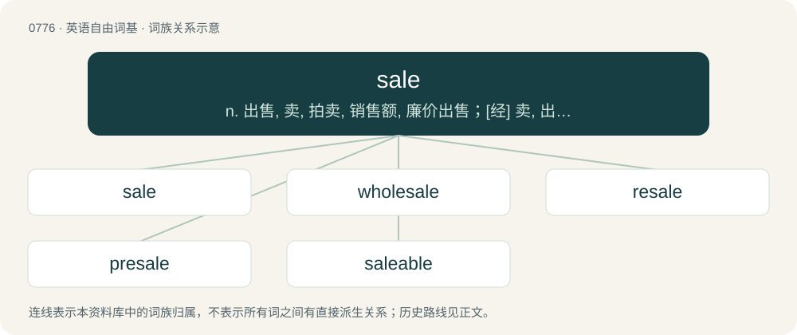

# 0843 · sale — n. 出售, 卖, 拍卖, 销售额, 廉价出售；\[经\] 卖, 出售; 销售(货)

[总目录](../00_总目录_按常用程度.md)

**类型**：英语自由词基　｜　**来源语言**：见词源记录

## 核心含义与来源

- 核心含义：n. 出售, 卖, 拍卖, 销售额, 廉价出售；\[经\] 卖, 出售; 销售(货)
- 英文含义：An exchange of goods or services for currency or credit.
- 词形：sale

**来源记录 1**（名词；An exchange of goods or services for currency or credit.）

From Middle English sale, from Old English sala (“act of selling, sale”), from Old Norse sala (“sale”), from Proto-Germanic \*salō (“delivery”), from Proto-Indo-European \*selh₁- (“to grab”).

## 词族图

## 单词速览（常用到不常用）

| 单词 | 音标 | 释义 |
|---|---|---|
| [sale](#w-1) | /seːl/ | n. 出售, 卖, 拍卖, 销售额, 廉价出售；\[经\] 卖, 出售; 销售(货) |
| [wholesale](#w-2) | /ˈhoʊlseɪl/ | n. 批发；a. 批发的, 大规模的；adv. 大规模, 照批发方式 |
| [resale](#w-3) | 英 /ˈriːseɪl/；美 /ˈriˌseɪl/ | n. 再贩卖, 转售；\[经\] 再卖, 转卖 |
| [presale](#w-4) | /ˈpriːˌseɪl/ | n. 售前展览 |
| [saleable](#w-5) | 英 /ˈseɪləbl̩/ | a. 适销的, 价格适当的, 畅销的 |

## 逐词详解

### 1. sale

**词性**：名词　｜　**音标**：/seːl/

**中文释义**：n. 出售, 卖, 拍卖, 销售额, 廉价出售；\[经\] 卖, 出售; 销售(货)

**英文义项**：An exchange of goods or services for currency or credit. / The act of putting up for auction to the highest bidder.

**词源与演化**：

From Middle English sale, from Old English sala (“act of selling, sale”), from Old Norse sala (“sale”), from Proto-Germanic \*salō (“delivery”), from Proto-Indo-European \*selh₁- (“to grab”).

**例句**：

> He celebrated after the sale of company.

该用例对应义项：An exchange of goods or services for currency or credit.

### 2. wholesale

**词性**：形容词　｜　**音标**：/ˈhoʊlseɪl/

**中文释义**：n. 批发；a. 批发的, 大规模的；adv. 大规模, 照批发方式

**英文义项**：Of or relating to sale in large quantities, for resale. / Extensive, indiscriminate, all-encompassing; blanket.

**构词拆分**：whole + sale

**词源与演化**：

From whole + sale.

**例句**：

> The bombing resulted in wholesale destruction.

该用例对应义项：Extensive, indiscriminate, all-encompassing; blanket.

### 3. resale

**词性**：名词　｜　**音标**：英 /ˈriːseɪl/；美 /ˈriˌseɪl/

**中文释义**：n. 再贩卖, 转售；\[经\] 再卖, 转卖

**英文义项**：Sale of something previously bought. / The sale by the original seller to another purchaser of goods due to non-payment by original purchaser, often with the original purchaser liable for any shortfall between the original sale price and the price realized by the original seller.

**构词拆分**：re- + sale

**词源与演化**：

From re- + sale.

**例句**：

> The resale value was high as the items were quite rare.

该用例对应义项：Sale of something previously bought.

### 4. presale

**词性**：名词　｜　**音标**：/ˈpriːˌseɪl/

**中文释义**：n. 售前展览

**英文义项**：The sale of something privately, before it is available to the public / The sale of a property before it is built

**构词拆分**：pre- + sale

**词源与演化**：

From pre- + sale.

### 5. saleable

**词性**：形容词　｜　**音标**：英 /ˈseɪləbl̩/

**中文释义**：a. 适销的, 价格适当的, 畅销的

**英文义项**：Suitable for sale; marketable; worth enough to try to sell; that can be sold (i.e., for which it is possible to find a willing and able buyer).

**构词拆分**：sale + -able

**词源与演化**：

From sale + -able.

**例句**：

> They held an estate sale last Saturday, which cleared out everything that was saleable; what's left will require a skip for disposal.

该用例对应义项：Suitable for sale; marketable; worth enough to try to sell; that can be sold (i.e., for which it is possible to find a willing and able buyer).
