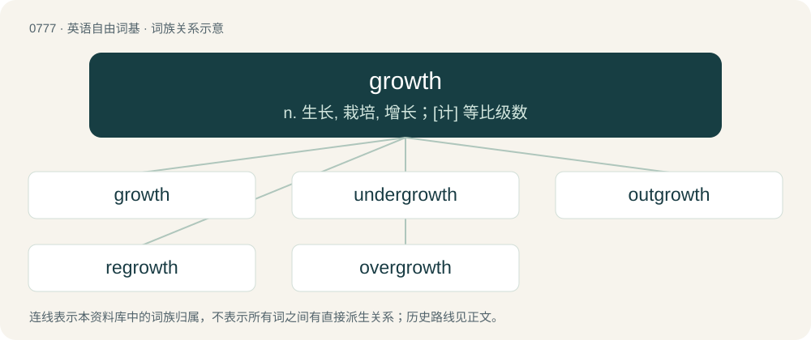

# 0844 · growth — n. 生长, 栽培, 增长；\[计\] 等比级数

[总目录](../00_总目录_按常用程度.md)

**类型**：英语自由词基　｜　**来源语言**：见词源记录

## 核心含义与来源

- 核心含义：n. 生长, 栽培, 增长；\[计\] 等比级数
- 英文含义：An increase in size, number, value, or strength.
- 词形：growth

**来源记录 1**（名词；An increase in size, number, value, or strength.）

From grow + -th (abstract nominal suffix). Compare Old Frisian grēd ("meadow, pasture"; &gt; North Frisian greyde (“growth, pasture”)), Middle High German gruote, gruot (“greens, fresh growth, shoot”), Old Norse gróðr ("growth, crop"; &gt; Faroese grøði, Danish grøde (“fruits”), Swedish gröda (“crop, harvest”)). More at grow.

## 词族图

## 单词速览（常用到不常用）

| 单词 | 音标 | 释义 |
|---|---|---|
| [growth](#w-1) | 英 /ɡɹəʊθ/；美 /ɡɹoʊθ/ | n. 生长, 栽培, 增长；\[计\] 等比级数 |
| [undergrowth](#w-2) | 美 /ˈʌndɚˌɡɹoʊθ/ | n. 下层丛林, 生于大树下的矮树, 发育不全 |
| [outgrowth](#w-3) | /ˈaʊtˌɡroʊθ/ | n. 自然的发展, 结果, 副产物, 分枝；\[医\] 赘疣 |
| [regrowth](#w-4) | /ˈreɡrəʊθ/ | 再生长, 再生苗; 再生物 |
| [overgrowth](#w-5) | /ˈəuvəgrəuθ/ | n. 繁茂, 蔓延, 过度发育, 增生；\[医\] 生长过度, 肥大 |

## 逐词详解

### 1. growth

**词性**：名词　｜　**音标**：英 /ɡɹəʊθ/；美 /ɡɹoʊθ/

**中文释义**：n. 生长, 栽培, 增长；\[计\] 等比级数

**英文义项**：An increase in size, number, value, or strength. / An increase in psychological strength or resilience; an increased ability to overcome adversity.

**构词拆分**：grow + -th (abstract nominal suffix)

**词源与演化**：

From grow + -th (abstract nominal suffix). Compare Old Frisian grēd ("meadow, pasture"; &gt; North Frisian greyde (“growth, pasture”)), Middle High German gruote, gruot (“greens, fresh growth, shoot”), Old Norse gróðr ("growth, crop"; &gt; Faroese grøði, Danish grøde (“fruits”), Swedish gröda (“crop, harvest”)). More at grow.

**例句**：

> Struggle, disappointment, and criticism all contribute to a person's growth.

该用例对应义项：An increase in psychological strength or resilience; an increased ability to overcome adversity.

### 2. undergrowth

**词性**：名词　｜　**音标**：美 /ˈʌndɚˌɡɹoʊθ/

**中文释义**：n. 下层丛林, 生于大树下的矮树, 发育不全

**英文义项**：The plants in a forest which only reach a relatively low height (such as shrubs and bushes).

**构词拆分**：under- + growth

**词源与演化**：

From under- + growth. Cognate with West Frisian ûndergroei (“undergrowth”).

**例句**：

> The forest floor was covered with dense undergrowth.

该用例对应义项：The plants in a forest which only reach a relatively low height (such as shrubs and bushes).

### 3. outgrowth

**词性**：名词　｜　**音标**：/ˈaʊtˌɡroʊθ/

**中文释义**：n. 自然的发展, 结果, 副产物, 分枝；\[医\] 赘疣

**英文义项**：A branch or offshoot of a plant. / An appendage of an animal.

**构词拆分**：out- + growth

**词源与演化**：

From out- + growth.

### 4. regrowth

**词性**：名词　｜　**音标**：/ˈreɡrəʊθ/

**中文释义**：再生长, 再生苗; 再生物

**英文义项**：That which has been regrown after removal. / The process of regrowing.

**构词拆分**：re- + growth

**词源与演化**：

From re- + growth.

**例句**：

> After the forest fire, much of the regrowth consisted of invasive non-native plant species.

该用例对应义项：That which has been regrown after removal.

### 5. overgrowth

**词性**：名词　｜　**音标**：/ˈəuvəgrəuθ/

**中文释义**：n. 繁茂, 蔓延, 过度发育, 增生；\[医\] 生长过度, 肥大

**英文义项**：A usually abundant, luxuriant growth over or on something else. / A tangle of growth occurring at the top of trees involving vines and branches, common in jungles.

**构词拆分**：over- + growth

**词源与演化**：

From over- + growth.
