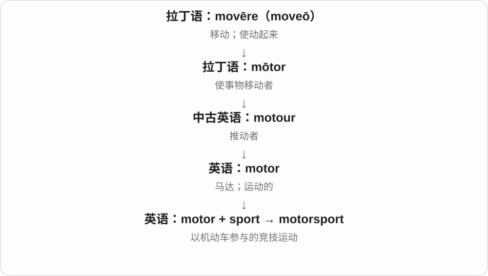

# 0844 · sport — 从消遣到体育与运动风格

[逐词精讲目录](../00_逐词精讲目录.md) · [总目录](../00_总目录_按常用程度.md)

## 核心词根与来源

sport 从 disport 缩短，经法语接消遣词；名词前 sports 是实际搭配，不按单复数一条规则乱推。

**SPORT：娱乐玩乐的历史，体育运动的现代重点**

sport、sports、sporty 紧挨着读，分清活动、惯用修饰和设计风格。

- **基本词与形式、风格**：sport · sports · sporty
- **相关复合词**：motorsport · supersport
- **sport → sporting：消遣到运动、风度与展示**：sport · sporting

## 词形与演化规律

sport → sports、sporty；motor、super + sport 为已有相关词。

sport 是 disport 前部脱落，经法语消遣词传来；现代还有穿戴、展示的动词用法。

## 单词速览（按词族由简到繁）

同一基础词的相关扩展放在一起，先读基础形式，再读扩展；各组之间优先读常用的。具体词源关系见各词讲解。

| 单词 | 音标 | 核心意思 |
|---|---|---|
| [sport](#w-2) | 英 /spɔːt/；美 /spɔːrt/ | 体育运动；消遣；有风度的人；展示、穿戴 |
| [sports](#w-1) | 英 /spɔːts/；美 /spɔːrts/ | 体育运动；体育相关的修饰形式 |
| [sporting](#w-6) | 英 /ˈspɔːtɪŋ/；美 /ˈspɔːrtɪŋ/ | 体育的；大度、公平的；显眼地穿戴、展示着〔分词及形容词〕 |
| [sporty](#w-4) | 英 /ˈspɔːti/；美 /ˈspɔːrti/ | 爱运动的；有运动风格的 |
| [motorsport](#w-3) | 英 /ˈməʊtəspɔːt/；美 /ˈmoʊtərspɔːrt/ | 赛车运动；机动车竞技运动 |
| [supersport](#w-5) | 英 /ˈsuːpəspɔːt/；美 /ˈsuːpərspɔːrt/ | 超级运动型摩托车；相应摩托车竞赛类别 |

## 逐词讲解

### 1. sport — 体育运动；消遣；有风度的人；展示、穿戴

**音标**：英 /spɔːt/；美 /spɔːrt/

**先抓住这个画面**

现代主要先想体育运动；旧的娱乐玩乐还留在一些表达里，动词 sport 则可说显眼地穿着、留着某种外观。

**怎么拆**

中古英语 disport 的前部脱落成 sport，上接法语 desporter 消遣，历史有让心情离开严肃事务的画面。不是 s- 加 port 港口。

**怎么变成今天的意思**

**古法语 desporter 消遣 → 中古英语 disport、sport**  
让心情离开正事 → 娱乐、玩乐

↓

**现代 sport**  
娱乐活动 → 体育运动；也保留玩乐、展示等义

play sport 参加体育运动，a team sport 团队运动，be a good sport 输赢、玩笑中有风度；sport a beard 留着胡须。

**常见搭配与例句**

a team sport；competitive sport；a good sport；sport a beard。

> Swimming is her favourite sport.

游泳是她最喜欢的运动。

> He was a good sport about losing the game.

他输了比赛也很有风度。

**别混淆**

sport 不仅是竞技比赛，语境也可说娱乐；a good sport 评价人有风度，不是说一项运动规则好。

### 2. sports — 体育运动；体育相关的修饰形式

**音标**：英 /spɔːts/；美 /spɔːrts/

**先抓住这个画面**

可以是多种运动，也能在名词前组成体育新闻、运动装备等固定说法。

**怎么拆**

sport + -s，复数形式及体育类名词前的惯用修饰形式。美式总说体育时尤其常用 sports，英式单数集合 sport 也很常见。

**怎么变成今天的意思**

**古法语 desporter 消遣 → 中古英语 disport、sport**  
让心情离开正事 → 娱乐、玩乐

↓

**现代 sport**  
娱乐活动 → 体育运动；也保留玩乐、展示等义

↓

**sport + -s → sports**  
多种运动；体育类别修饰形式

sports news 体育新闻，sports equipment 运动器材，a sports car 跑车；不因有 s 就把后面名词都变复数。

**常见搭配与例句**

sports news；sports equipment；sports day；a sports car。

> She writes sports news for the local paper.

她为当地报纸写体育新闻。

> The school bought new sports equipment.

学校买了新运动器材。

**别混淆**

a sports car 是一辆跑车，sports 的 s 不表示有很多车；news、equipment 也有各自的不可数规则。

### 3. sporting — 体育的；大度、公平的；显眼地穿戴、展示着〔分词及形容词〕

**音标**：英 /ˈspɔːtɪŋ/；美 /ˈspɔːrtɪŋ/

**先抓住这个画面**

运动场上的活动是 sporting 的一面；按比赛风度办事、不计较小输赢，又有大度、公平。动词 sport 还可说显眼地穿着、留着某种东西。

**怎么拆**

sport + -ing，直接加 ing。sport 从中古英语 disport 前部脱落，接法语 desporter 消遣；现代运动、比赛风度和穿戴展示用法分别发展。

**怎么变成今天的意思**

**中古英语 disport → sport**  
消遣 → 运动、体育；后有展示、穿戴等用法

↓

**sport + -ing → sporting**  
体育性质、比赛风度；或正在展示、穿戴

sporting events 体育赛事；a sporting chance 合理的胜算；sporting a new hat 戴着一顶显眼的新帽子。

**常见搭配与例句**

a sporting gesture 有风度的举动；sporting clothes 运动服装。

> The town hosts several sporting events each year.

小镇每年举办几场体育赛事。

> He arrived sporting a bright red hat.

他戴着一顶鲜红的帽子来了。

**别混淆**

sporting 不一定正在运动：He is sporting a beard 是他留着胡子；a sporting reply 可以是大度、有比赛风度的回应。

### 4. sporty — 爱运动的；有运动风格的

**音标**：英 /ˈspɔːti/；美 /ˈspɔːrti/

**先抓住这个画面**

说人时常是喜欢运动，说衣服、汽车时则是看着有运动感，不是物件真的去比赛。

**怎么拆**

sport + -y，具有体育、运动特点。现代性格爱好与设计外观都可用。

**怎么变成今天的意思**

**古法语 desporter 消遣 → 中古英语 disport、sport**  
让心情离开正事 → 娱乐、玩乐

↓

**现代 sport**  
娱乐活动 → 体育运动；也保留玩乐、展示等义

↓

**sport + -y → sporty**  
有运动特点 → 爱运动、运动风的

a sporty person 爱运动的人，a sporty jacket 运动风夹克，a sporty car 运动感强的汽车。

**常见搭配与例句**

a sporty person；sporty clothes；a sporty car。

> She comes from a sporty family.

她来自一个爱运动的家庭。

> The jacket has a sporty look.

这件夹克很有运动风。

**别混淆**

sporty 是爱好或风格，athletic 常更强调身体运动能力、体型；穿 sporty clothes 不保证很会运动。

### 5. motorsport — 赛车运动；机动车竞技运动

**音标**：英 /ˈməʊtəspɔːt/；美 /ˈmoʊtərspɔːrt/

**先抓住这个画面**

motorsport 把机动车变成比赛工具，赛车只是其中最熟悉的画面。

**怎么拆**

motor + sport。

**怎么变成今天的意思**

可泛指赛车及相关竞技，不是所有驾驶活动都算运动比赛。

**常见搭配与例句**

motorsport fans；a motorsport event；a career in motorsport。

> She works as an engineer in motorsport.

她在赛车运动领域担任工程师。

> The festival includes a motorsport exhibition.

节庆活动包括赛车运动展览。

**别混淆**

motorist 是普通驾驶者；motorsport 强调竞技领域。

### 6. supersport — 超级运动型摩托车；相应摩托车竞赛类别

**音标**：英 /ˈsuːpəspɔːt/；美 /ˈsuːpərspɔːrt/

**先抓住这个画面**

把公路运动摩托车的操控和赛道表现推到突出位置，也成为赛车类别的名称。

**怎么拆**

英语 super- + sport，运动性能的强化构词；在摩托车行业形成专门用法。

**怎么变成今天的意思**

**拉丁 super**  
在上方、超过、越过

↓

**英语构词成分 super-**  
超出一般程度；在上、额外或超过某界限

↓

**英语 super- + sport → supersport**  
高性能运动型摩托车及竞赛类别

常写 supersport bike。具体赛事的排量、重量与改装限制由赛事规则决定，不能把某届规则当成单词永久定义。

**常见搭配与例句**

a supersport bike；supersport racing。

> The team entered a supersport bike in the race.

车队用一辆超级运动型摩托车参加了比赛。

> She follows supersport racing more closely than other motorcycle events.

与其他摩托车赛事相比，她更关注超级运动组比赛。

**别混淆**

superbike 也是高性能摩托车及赛事名称；两者在具体锦标赛中有各自规则，不是任意互换的标签。

## 这一组要分清什么

a good sport 是有风度的人；a sports car 一辆车；sporty 衣着不等于具备运动能力。

## 串起来练习

She likes sport and often wears sporty clothes.

她喜欢运动，也经常穿运动风衣服。
