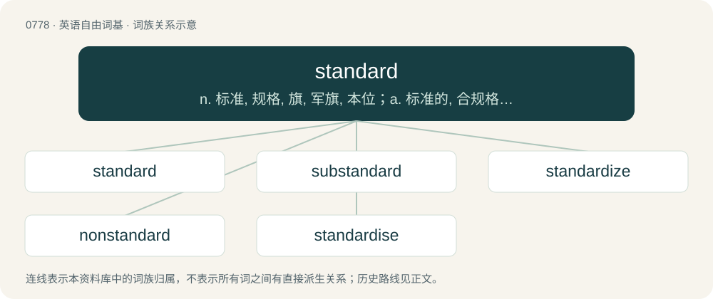

# 0845 · standard — n. 标准, 规格, 旗, 军旗, 本位；a. 标准的, 合规格的；\[计\] 标准

[总目录](../00_总目录_按常用程度.md)

**类型**：英语自由词基　｜　**来源语言**：见词源记录

## 核心含义与来源

- 核心含义：n. 标准, 规格, 旗, 军旗, 本位；a. 标准的, 合规格的；\[计\] 标准
- 英文含义：Falling within an accepted range of size, amount, power, quality, etc.
- 词形：standard

**来源记录 1**（形容词；Falling within an accepted range of size, amount, power, quality, etc.）

From Middle English standard, from Old French estandart (“gathering place, battle flag”), from Frankish \*standahard (literally “stand firm, stand hard”), equivalent to stand + -ard. An alternative etymology derives the second element from Frankish \*oʀd (“point, spot, place”) (compare Old French ordé (“pointed”), Old English ord (“point, source, vanguard”), German Standort (“location, place, site, position, base”, literally “standing-point”)). Merged with Middle English standar, stander, standere (“flag, banner”, literally “stander”), equivalent to stand + -er. More at stand, hard, ord. As a hill-naming term possibly a calque from Cumbric; equivalent to Welsh lluman (“standard”), arising with confusion with the hill-naming element llumon (“chimney”).

## 词族图

## 单词速览（常用到不常用）

| 单词 | 音标 | 释义 |
|---|---|---|
| [standard](#w-1) | 英 /ˈstændəd/；美 /ˈstændɚd/ | n. 标准, 规格, 旗, 军旗, 本位；a. 标准的, 合规格的；\[计\] 标准 |
| [substandard](#w-2) | 英 /ˌsʌbˈstændəd/；美 /ˌsʌbˈstændɚd/ | a. 标准以下的, 不合规格的；\[化\] 低于定额的 |
| [standardize](#w-3) | 英 /ˈstæn.də.daɪz/；美 /ˈstæn.dɚˌdaɪz/ | vt. 使标准化, 使合于标准, 用标准检验；\[计\] 标准化; 规格化 |
| [nonstandard](#w-4) | 美 /nɑnˈstændɚd/ | a. 不标准的 |
| [standardise](#w-5) |  | vt. 使与标准比较, 用标准校验, 使符合标准, 使统一, 使标准化 |

## 逐词详解

### 1. standard

**词性**：形容词　｜　**音标**：英 /ˈstændəd/；美 /ˈstændɚd/

**中文释义**：n. 标准, 规格, 旗, 军旗, 本位；a. 标准的, 合规格的；\[计\] 标准

**英文义项**：Falling within an accepted range of size, amount, power, quality, etc. / Growing alone as a free-standing plant; not trained on a post etc.

**构词拆分**：stand + -ard；stand + -er

**词源与演化**：

From Middle English standard, from Old French estandart (“gathering place, battle flag”), from Frankish \*standahard (literally “stand firm, stand hard”), equivalent to stand + -ard. An alternative etymology derives the second element from Frankish \*oʀd (“point, spot, place”) (compare Old French ordé (“pointed”), Old English ord (“point, source, vanguard”), German Standort (“location, place, site, position, base”, literally “standing-point”)). Merged with Middle English standar, stander, standere (“flag, banner”, literally “stander”), equivalent to stand + -er. More at stand, hard, ord. As a hill-naming term possibly a calque from Cumbric; equivalent to Welsh lluman (“standard”), arising with confusion with the hill-naming element llumon (“chimney”).

**例句**：

> This is the standard model, but we offer a variety of customization options.

该用例对应义项：As normally supplied (not optional or modified by any extra requests).

### 2. substandard

**词性**：形容词　｜　**音标**：英 /ˌsʌbˈstændəd/；美 /ˌsʌbˈstændɚd/

**中文释义**：a. 标准以下的, 不合规格的；\[化\] 低于定额的

**英文义项**：Of inferior quality; not meeting the minimum quality requirements. / Not conforming to the standard variety; nonstandard.

**构词拆分**：sub- + standard

**词源与演化**：

From sub- + standard.

**例句**：

> They built this with substandard parts. No wonder it collapsed.

该用例对应义项：Of inferior quality; not meeting the minimum quality requirements.

### 3. standardize

**词性**：动词　｜　**音标**：英 /ˈstæn.də.daɪz/；美 /ˈstæn.dɚˌdaɪz/

**中文释义**：vt. 使标准化, 使合于标准, 用标准检验；\[计\] 标准化; 规格化

**英文义项**：American and Oxford British standard spelling of standardise.

**构词拆分**：standard + -ize

**词源与演化**：

From standard + -ize.

**例句**：

> It's difficult to standardize language for a multi-ethnic nation.

### 4. nonstandard

**词性**：形容词　｜　**音标**：美 /nɑnˈstændɚd/

**中文释义**：a. 不标准的

**英文义项**：Not standard. / Not conforming to the standard variety, or to the language as used by the majority of its speakers.

**构词拆分**：non- + standard

**词源与演化**：

From non- + standard.

**例句**：

> A nonstandard dialect is one used by uneducated speakers or socially disfavored groups.

该用例对应义项：not conforming to the language usage of a prestige group within a community

### 5. standardise

**词性**：动词

**中文释义**：vt. 使与标准比较, 用标准校验, 使符合标准, 使统一, 使标准化

**英文义项**：To establish a standard consisting of regulations for how something is to be done across an organization. / To make to conform to a standard.

**构词拆分**：standard + -ise

**词源与演化**：

From standard + -ise.
