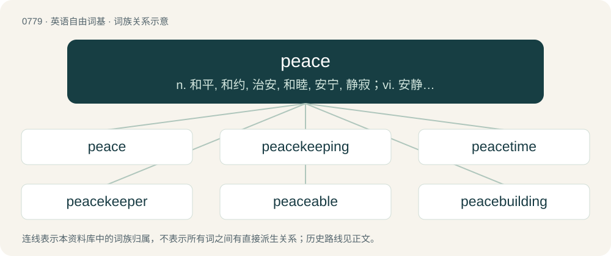

# 0847 · peace — n. 和平, 和约, 治安, 和睦, 安宁, 静寂；vi. 安静下来, 不作声

[总目录](../00_总目录_按常用程度.md)

**类型**：英语自由词基　｜　**来源语言**：见词源记录

## 核心含义与来源

- 核心含义：n. 和平, 和约, 治安, 和睦, 安宁, 静寂；vi. 安静下来, 不作声
- 英文含义：A state of tranquility, quiet, and harmony. For instance, a state free from civil disturbance.
- 词形：peace

**来源记录 1**（名词；A state of tranquility, quiet, and harmony. For instance, a state free from civil disturbance.）

From Middle English pees, pes, pais, borrowed from Anglo-Norman peis and Old French pais (“peace”), from Latin pāx (“peace”), from Proto-Indo-European \*peh₂ḱ- (“to fasten, stick, place”), related to Latin pacīscor (“agree, stipulate”), Latin pangō (“fasten, fix”); see pact. Doublet of pax. Displaced native Old English sibb, frēols, and broadly ousted friþ (modern frith).

## 词族图

## 单词速览（常用到不常用）

| 单词 | 音标 | 释义 |
|---|---|---|
| [peace](#w-1) | /ˈpiːs/ | n. 和平, 和约, 治安, 和睦, 安宁, 静寂；vi. 安静下来, 不作声 |
| [peacekeeping](#w-2) | 英 /ˈpiːskiːpɪŋ/ | \[法\] 维护和平的, 执行停火协定的 |
| [peacetime](#w-3) | /ˈpiːstaɪm/ | n. 平时时期, 和平 |
| [peacekeeper](#w-4) | 英 /ˈpiːsˌkiːpə/；美 /ˈpisˌkipɚ/ | n. (交战国间的)停火执行者(或小组) |
| [peaceable](#w-5) | 英 /ˈpiːsəb(ə)l/ | a. 和平的, 太平的, 温顺的, 温和的, 平静的 |
| [peacebuilding](#w-6) | /ˈpiːsˌbɪl.dɪŋ/ | 【英文】The creation of peace or the conditions for peace. |
| [peacemaking](#w-7) | /ˈpiːsˌmeɪ.kɪŋ/ | n. 调解, 调停；a. 调解的, 调停的 |
| [makepeace](#w-8) |  | 【英文】A peacemaker; one who reconciles persons at variance with one another; a composer of strife; an adjuster of differences. |

## 逐词详解

### 1. peace

**词性**：名词　｜　**音标**：/ˈpiːs/

**中文释义**：n. 和平, 和约, 治安, 和睦, 安宁, 静寂；vi. 安静下来, 不作声

**英文义项**：A state of tranquility, quiet, and harmony. For instance, a state free from civil disturbance. / A feeling of tranquility, free from oppressive and unpleasant thoughts and emotions.

**词源与演化**：

From Middle English pees, pes, pais, borrowed from Anglo-Norman peis and Old French pais (“peace”), from Latin pāx (“peace”), from Proto-Indo-European \*peh₂ḱ- (“to fasten, stick, place”), related to Latin pacīscor (“agree, stipulate”), Latin pangō (“fasten, fix”); see pact. Doublet of pax. Displaced native Old English sibb, frēols, and broadly ousted friþ (modern frith).

**例句**：

> Our lounge strives to maintain an environment of peace for the comfort of our customers.

该用例对应义项：A state of tranquility, quiet, and harmony. For instance, a state free from civil disturbance.

### 2. peacekeeping

**词性**：名词　｜　**音标**：英 /ˈpiːskiːpɪŋ/

**中文释义**：\[法\] 维护和平的, 执行停火协定的

**英文义项**：The act of preserving peace, specifically between hostile groups or states, especially by a sanctioned military force. / (for example) a peacekeeping force.

**构词拆分**：peace + keeping

**词源与演化**：

From peace + keeping, after keep the peace.

**例句**：

> Diplomacy, peacekeeping, and humanitarian aid are critical responses to a genocidal war.

### 3. peacetime

**词性**：名词　｜　**音标**：/ˈpiːstaɪm/

**中文释义**：n. 平时时期, 和平

**英文义项**：The period of time when a nation or people is at peace, not fighting a war.

**构词拆分**：peace + time

**词源与演化**：

From peace + time.

**例句**：

> Soldiers began to come home and find peacetime jobs.

### 4. peacekeeper

**词性**：名词　｜　**音标**：英 /ˈpiːsˌkiːpə/；美 /ˈpisˌkipɚ/

**中文释义**：n. (交战国间的)停火执行者(或小组)

**英文义项**：One that preserves the peace. / A member of a military force charged with peacekeeping duties in a troublespot.

**构词拆分**：peace + keeper

**词源与演化**：

From peace + keeper.

**例句**：

> She's the peacekeeper in that family.

该用例对应义项：someone who keeps peace

### 5. peaceable

**词性**：形容词　｜　**音标**：英 /ˈpiːsəb(ə)l/

**中文释义**：a. 和平的, 太平的, 温顺的, 温和的, 平静的

**英文义项**：Favouring peace rather than conflict; not aggressive, tending to avoid violence (of people, actions etc.). / Characterized by peace; peaceful, tranquil.

**构词拆分**：peace + -able

**词源与演化**：

From Anglo-Norman pesible, peisible, Middle French paisible, from pais (“peace”) + -ible; later remodelled after peace + -able.

**例句**：

> A quiet and peaceable person.

该用例对应义项：disposed to peace or of a peaceful nature

### 6. peacebuilding

**词性**：名词　｜　**音标**：/ˈpiːsˌbɪl.dɪŋ/

**英文义项**：The creation of peace or the conditions for peace. / The reconstruction of physical and societal institutions after a conflict

**构词拆分**：From peace + building.

**词源与演化**：

From peace + building.

### 7. peacemaking

**词性**：名词　｜　**音标**：/ˈpiːsˌmeɪ.kɪŋ/

**中文释义**：n. 调解, 调停；a. 调解的, 调停的

**英文义项**：The act of reconciling two people or groups who disagree.

**构词拆分**：peace + making

**词源与演化**：

From peace + making.

### 8. makepeace

**词性**：名词

**英文义项**：A peacemaker; one who reconciles persons at variance with one another; a composer of strife; an adjuster of differences.

**构词拆分**：make + peace

**词源与演化**：

From make + peace.
