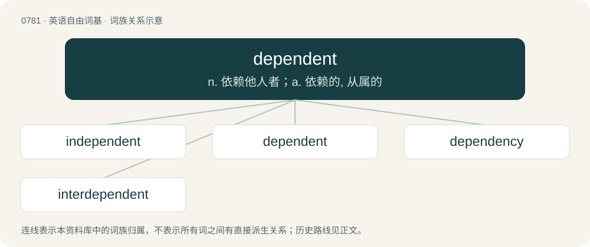

# 0849 · dependent — n. 依赖他人者；a. 依赖的, 从属的

[总目录](../00_总目录_按常用程度.md)

**类型**：英语自由词基　｜　**来源语言**：见词源记录

## 核心含义与来源

- 核心含义：n. 依赖他人者；a. 依赖的, 从属的
- 英文含义：Relying upon; depending upon.
- 词形：dependent

**来源记录 1**（形容词；Relying upon; depending upon.）

From Middle English dependaunt, dependent, from Middle French dependant (present participle of dependre (“to depend”)) and Latin dēpendēns (present participle of dēpendeō (“to depend”)). By surface analysis, depend + -ent.

## 词族图

## 单词速览（常用到不常用）

| 单词 | 音标 | 释义 |
|---|---|---|
| [independent](#w-1) | /ˌɪn.dɪˈpɛn.dənt/ | n. 独立自主者, 无党派者；a. 独立的, 有主见的, 不须依赖的, 不受约束的 |
| [dependent](#w-2) | /dɪˈpɛndənt/ | n. 依赖他人者；a. 依赖的, 从属的 |
| [dependency](#w-3) | 英 /dɪˈpɛndənsi/ | n. 属国, 保护地, 从属物；\[医\] 从属, 从属部 |
| [interdependent](#w-4) | /.intədiˈpendənt/ | a. 相互依赖的, 相互依存的 |

## 逐词详解

### 1. independent

**词性**：形容词　｜　**音标**：/ˌɪn.dɪˈpɛn.dənt/

**中文释义**：n. 独立自主者, 无党派者；a. 独立的, 有主见的, 不须依赖的, 不受约束的

**英文义项**：Not dependent; not contingent or depending on something else; free. / Not affiliated with any political party.

**构词拆分**：in- + dependent

**词源与演化**：

From Middle English independent, equivalent to in- + dependent. Compare French indépendant.

**用法示例／搭配（非完整句）**：

> a man of an independent mind

该用例对应义项：Not subject to bias or influence; self-directing.

### 2. dependent

**词性**：形容词　｜　**音标**：/dɪˈpɛndənt/

**中文释义**：n. 依赖他人者；a. 依赖的, 从属的

**英文义项**：Relying upon; depending upon. / Having a probability that is affected by the outcome of a separate event.

**词源与演化**：

From Middle English dependaunt, dependent, from Middle French dependant (present participle of dependre (“to depend”)) and Latin dēpendēns (present participle of dēpendeō (“to depend”)). By surface analysis, depend + -ent.

**例句**：

> At that point I was dependent on financial aid for my tuition.

该用例对应义项：Relying upon; depending upon.

### 3. dependency

**词性**：名词　｜　**音标**：英 /dɪˈpɛndənsi/

**中文释义**：n. 属国, 保护地, 从属物；\[医\] 从属, 从属部

**英文义项**：A state of dependence; a refusal to exercise initiative. / Something dependent on, or subordinate to, something else

**构词拆分**：dependent + -cy；dependence + -y；depend + -ency

**词源与演化**：

From dependent + -cy or dependence + -y or depend + -ency.

**例句**：

> In the United States' governmental structure, the military is conceived as a dependency under the executive branch.

该用例对应义项：Something dependent on, or subordinate to, something else

### 4. interdependent

**词性**：形容词　｜　**音标**：/.intədiˈpendənt/

**中文释义**：a. 相互依赖的, 相互依存的

**英文义项**：Mutually dependent; reliant on one another.

**构词拆分**：inter- + dependent

**词源与演化**：

From inter- + dependent.

**例句**：

> Seriously, everyone is interdependent, we all need each other.
