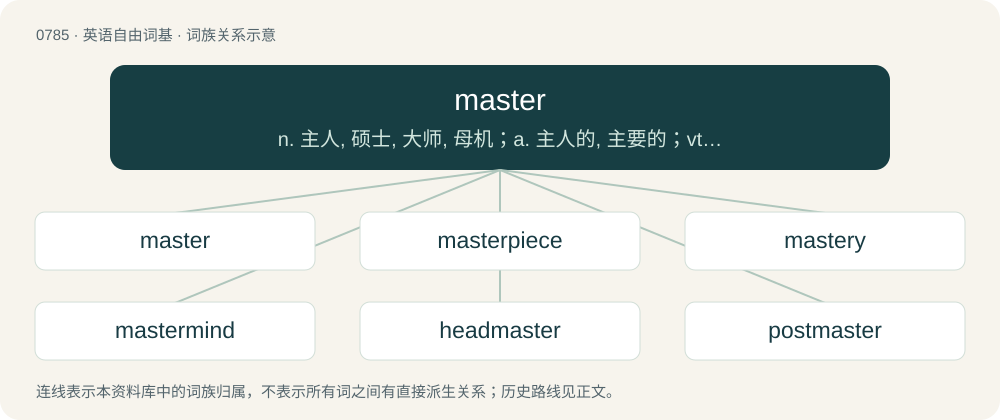

# 0856 · master — n. 主人, 硕士, 大师, 母机；a. 主人的, 主要的；vt. 征服, 控制, 精通

[总目录](../00_总目录_按常用程度.md)

**类型**：英语自由词基　｜　**来源语言**：见词源记录

## 核心含义与来源

- 核心含义：n. 主人, 硕士, 大师, 母机；a. 主人的, 主要的；vt. 征服, 控制, 精通
- 英文含义：Someone who has control over something or someone.
- 词形：master

**多个词源／构词路径**：同一拼写可能有不同来源；以下按词性和含义分别列出。

**来源记录 1**（名词；Someone who has control over something or someone.）

From Middle English maister, mayster, meister (noun) and maistren (verb), from Old English mǣster, mæġster, mæġester, mæġister, magister (“master”), from Latin magister (“chief, teacher, leader”), from Old Latin magester, from Proto-Indo-European \*méǵh₂s (as in magnus (“great”), also cognate of English much and mickle) + -ester/-ister (compare minister (“servant”)). Reinforced by Old French maistre, mestre (noun) and maistriier, maister (verb) from the same Latin source. Compare also Saterland Frisian Mäster (“master”), West Frisian master (“master”), Dutch meester (“master”), German Meister (“master”). Doublet of maestro, magister, and meister.

**来源记录 2**（名词；A vessel having a specified number of masts.）

From mast + -er.

## 词族图

## 单词速览（常用到不常用）

| 单词 | 音标 | 释义 |
|---|---|---|
| [master](#w-1) | 英 /ˈmɑːstə/；美 /ˈmæstɚ/ | n. 主人, 硕士, 大师, 母机；a. 主人的, 主要的；vt. 征服, 控制, 精通 |
| [masterpiece](#w-2) | 英 /ˈmɑːstəˌpiːs/；美 /ˈmæstɚˌpis/ | n. 杰作, 名著 |
| [mastery](#w-3) | 英 /ˈmɑː.stə.ɹi/；美 /ˈmæs.tə.ɹi/ | n. 征服, 统治权, 优势, 精通, 掌握；\[法\] 统治权, 控制权, 征服 |
| [mastermind](#w-4) | 英 /ˈmɑː.stə.mʌɪnd/；美 /ˈmæs.tɚˌmaɪnd/ | n. 优秀策划者, 才子；vt. 指导, 主持, 策划 |
| [headmaster](#w-5) | 英 /ˈhɛdˌmɑːstə/；美 /ˈhɛdˌmæstɚ/ | n. (中小学)校长, 监工 |
| [postmaster](#w-6) | 美 /ˈpoʊstˌmæstɚ/ | n. 邮政局长；\[计\] 邮件主管员 |
| [masterful](#w-7) | /ˈmɑːstəful/ | a. 傲慢的, 主人派头的, 熟练的 |
| [quartermaster](#w-8) | 英 /ˈkwɔːtɚˌmɑːstə/；美 /ˈk(w)ɔɹtɚˌmæstɚ/ | n. 军需官；\[法\] 军需官, 后勤官, 军需主任 |
| [grandmaster](#w-9) | /ɡˈrændmˈɑːstə/ | 大师（最高棋手等的称号） |
| [schoolmaster](#w-10) | 美 /ˈskulˌmæstəɹ/ | n. 男教师, 男校长, 教导者 |
| [remaster](#w-11) | /riːˈmɑːstə(r);-ˈmæs-/ | vt.(根据旧唱片或磁带的)重新灌录 |
| [paymaster](#w-12) | /ˈpeɪmɑːstə/ | n. 出纳员, 军需官；\[经\] 出纳员, 军需机 |
| [masterly](#w-13) | 英 /ˈmɑːstəli/；美 /ˈmæstɚli/ | a. 巧妙的, 熟练的；adv. 巧妙地, 熟练地 |
| [masterwork](#w-14) | /ˈmɑːstəw\\\\ːk;ˈmæs-/ | n. 杰作, 杰出的事, 名作 |
| [webmaster](#w-15) | 美 /ˈwɛbmæstɚ/ | n. 网络管理员 |
| [taskmaster](#w-16) | 美 /ˈtæskˌmæstɚ/ | n. 工头 |
| [ringmaster](#w-17) | /ˈriŋmɑːstə/ | n. 马戏演出指挥, 导演 |
| [masterstroke](#w-18) | /ˈmɑːstəstrəuk/ | n. 巧妙动作, 神技, 卓越成就 |
| [spymaster](#w-19) | /ˈspai,mɑːstə(r); -,mæs-/ | n. 间谍组织的首脑 |
| [choirmaster](#w-20) | /ˈkwaiəmɑːstə/ | n. 唱诗班指挥 |
| [beastmaster](#w-21) |  | 【英文】A character in video games who fights monsters and other creatures. |
| [concertmaster](#w-22) | /ˈkɔnsət,mɑːstə(r)/ | n. (=concertmeister) (交响乐队的)首席小提琴手 |

## 逐词详解

### 1. master

**词性**：名词　｜　**音标**：英 /ˈmɑːstə/；美 /ˈmæstɚ/

**中文释义**：n. 主人, 硕士, 大师, 母机；a. 主人的, 主要的；vt. 征服, 控制, 精通

**英文义项**：Someone who has control over something or someone. / The owner of an animal or slave.

**词源与演化**：

From Middle English maister, mayster, meister (noun) and maistren (verb), from Old English mǣster, mæġster, mæġester, mæġister, magister (“master”), from Latin magister (“chief, teacher, leader”), from Old Latin magester, from Proto-Indo-European \*méǵh₂s (as in magnus (“great”), also cognate of English much and mickle) + -ester/-ister (compare minister (“servant”)). Reinforced by Old French maistre, mestre (noun) and maistriier, maister (verb) from the same Latin source. Compare also Saterland Frisian Mäster (“master”), West Frisian master (“master”), Dutch meester (“master”), German Meister (“master”). Doublet of maestro, magister, and meister.

**例句**：

> The band couldn't find the master, so they re-recorded their tracks.

该用例对应义项：The original of a document or of a recording.

### 2. masterpiece

**词性**：名词　｜　**音标**：英 /ˈmɑːstəˌpiːs/；美 /ˈmæstɚˌpis/

**中文释义**：n. 杰作, 名著

**英文义项**：A piece of work that has been given much critical praise, especially one that is considered the greatest work of a person's career. / A work of outstanding creativity, skill or workmanship.

**构词拆分**：master + piece

**词源与演化**：

From master + piece, a calque of Dutch meesterstuk or German Meisterstück (“masterpiece”). Piecewise doublet of maestropiece and masterstick. Compare also journeyman's piece.

**例句**：

> Masterpieces are not completed, they are abandoned.

该用例对应义项：A work of outstanding creativity, skill or workmanship.

### 3. mastery

**词性**：名词　｜　**音标**：英 /ˈmɑː.stə.ɹi/；美 /ˈmæs.tə.ɹi/

**中文释义**：n. 征服, 统治权, 优势, 精通, 掌握；\[法\] 统治权, 控制权, 征服

**英文义项**：The position or authority of a master; dominion; command; supremacy; superiority. / Superiority in war or competition; victory; triumph; preeminence.

**构词拆分**：master + -y

**词源与演化**：

From Middle English maistery, maistrie, mastere, mastry, from Old French maistrie, equivalent to master + -y.

**例句**：

> Drawing on my fine mastery of the English language, I said nothing.

### 4. mastermind

**词性**：名词　｜　**音标**：英 /ˈmɑː.stə.mʌɪnd/；美 /ˈmæs.tɚˌmaɪnd/

**中文释义**：n. 优秀策划者, 才子；vt. 指导, 主持, 策划

**英文义项**：A person with an extraordinary intellect or skill that is markedly superior to their peers. / A person responsible for the highest level of planning and execution of a major operation.

**构词拆分**：master + mind

**词源与演化**：

From master + mind.

**例句**：

> Tom was the mastermind behind the theft of the crown jewels.

### 5. headmaster

**词性**：名词　｜　**音标**：英 /ˈhɛdˌmɑːstə/；美 /ˈhɛdˌmæstɚ/

**中文释义**：n. (中小学)校长, 监工

**英文义项**：A male headteacher.

**构词拆分**：head + master

**词源与演化**：

From head + master.

**例句**：

> Tom named his schoolmates who had scratched the Chevrolet of the headmaster.

### 6. postmaster

**词性**：名词　｜　**音标**：美 /ˈpoʊstˌmæstɚ/

**中文释义**：n. 邮政局长；\[计\] 邮件主管员

**英文义项**：The head of a post office. / The administrator of an electronic mail system.

**构词拆分**：From post + master.

**词源与演化**：

From post + master.

**例句**：

> The postmaster, who was also the village grocer, had a clear recollection of the telegram.

### 7. masterful

**词性**：形容词　｜　**音标**：/ˈmɑːstəful/

**中文释义**：a. 傲慢的, 主人派头的, 熟练的

**英文义项**：Of or pertaining to the manner of a master of an art, technique, profession, or craft; masterly. / In the manner of a master; very skillful.

**构词拆分**：master + -ful

**词源与演化**：

From Middle English maysterful, maistrefull, equivalent to master + -ful.

**例句**：

> The masterful conducting ensured the orchestra gave of their best.

该用例对应义项：In the manner of a master; very skillful.

### 8. quartermaster

**词性**：名词　｜　**音标**：英 /ˈkwɔːtɚˌmɑːstə/；美 /ˈk(w)ɔɹtɚˌmæstɚ/

**中文释义**：n. 军需官；\[法\] 军需官, 后勤官, 军需主任

**英文义项**：An officer whose duty is to provide quarters, provisions, storage, clothing, fuel, stationery, and transportation for a regiment or other body of troops, and superintend the supplies. Master of quartering. / A petty officer who attends to the helm, binnacle, signals, and the like, under the direction of the master. Once master of the quarterdeck.

**构词拆分**：quarter + master

**词源与演化**：

From Middle English quartermayster, quartermaistre, equivalent to quarter + master. Perhaps reinforced by and merged with Dutch kwartiermeester, kwartier-meester. Compare German Quartiermeister, French quartier-maître.

**例句**：

> The second-class quartermaster is an experienced sailor responsible for technical or logistical duties.

### 9. grandmaster

**词性**：名词　｜　**音标**：/ɡˈrændmˈɑːstə/

**中文释义**：大师（最高棋手等的称号）

**英文义项**：A master in a field, whose skills or accomplishments exceed those of other masters.

**构词拆分**：grand + master

**词源与演化**：

From grand + master.

**例句**：

> Deep Blue beat chess grandmaster Gary Kasparov in 1997.

### 10. schoolmaster

**词性**：名词　｜　**音标**：美 /ˈskulˌmæstəɹ/

**中文释义**：n. 男教师, 男校长, 教导者

**英文义项**：A male teacher. / A male teacher in charge of a school, usually a small one.

**构词拆分**：school + master

**词源与演化**：

From Middle English skolemayster, scolemaister, scol-meister, equivalent to school + master. Cognate with West Frisian skoalmaster (“schoolmaster”), Dutch schoolmeester (“schoolmaster”), Low German Schoolmeester, Schoolmeister (“schoolmaster”), German Schulmeister (“schoolmaster”).

**例句**：

> The war was a tough schoolmaster for the Athenians.

该用例对应义项：Anything that teaches.

### 11. remaster

**词性**：动词　｜　**音标**：/riːˈmɑːstə(r);-ˈmæs-/

**中文释义**：vt.(根据旧唱片或磁带的)重新灌录

**英文义项**：To produce a new version of a recording by remixing the original master recordings. / To create a new master copy by enhancing sound or picture quality of an older recording.

**构词拆分**：re- + master

**词源与演化**：

From re- + master.

### 12. paymaster

**词性**：名词　｜　**音标**：/ˈpeɪmɑːstə/

**中文释义**：n. 出纳员, 军需官；\[经\] 出纳员, 军需机

**英文义项**：An official in charge of payments to employees, troops, etc. / A person or body which demands loyalty or services in return for payment (especially as paid in advance).

**构词拆分**：pay + master

**词源与演化**：

From pay + master.

### 13. masterly

**词性**：形容词　｜　**音标**：英 /ˈmɑːstəli/；美 /ˈmæstɚli/

**中文释义**：a. 巧妙的, 熟练的；adv. 巧妙地, 熟练地

**英文义项**：Executed in the manner of a master; showing competence and skill; masterful.

**构词拆分**：master + -ly

**词源与演化**：

From Middle English maisterli, from maister (“leader, ruler; high official; official in charge of a place; person in control; employer; owner; schoolmaster, teacher; scholar, sage; holder of a master's degree; religious teacher; master craftsman; expert; magician; social superior; husband; lover; Jesus Christ; a god; male stud animal”) + -li (suffix forming adjectives). Maister is derived from Old English mæġester (“master”) and Old French maistre (“master”) (modern French maître), both from Latin magister (“teacher; master”), ultimately from Proto-Indo-European \*méǵh₂s (“big, great”). The English word is analysable as master + -ly.

**例句**：

> Her years of experience enabled her to render a masterly performance.

该用例对应义项：Executed in the manner of a master; showing competence and skill; masterful.

### 14. masterwork

**词性**：名词　｜　**音标**：/ˈmɑːstəw\\\\ːk;ˈmæs-/

**中文释义**：n. 杰作, 杰出的事, 名作

**英文义项**：A piece done to prove possession of skill sufficient to be ranked a master. / A piece of quality, indicative of having been made by a master; a masterpiece.

**构词拆分**：master + work

**词源与演化**：

From master + work.

### 15. webmaster

**词性**：名词　｜　**音标**：美 /ˈwɛbmæstɚ/

**中文释义**：n. 网络管理员

**英文义项**：A person responsible for designing, developing, and maintaining a website or websites.

**构词拆分**：Web + master

**词源与演化**：

From Web + master.

**例句**：

> He was the webmaster of an anime message board.

### 16. taskmaster

**词性**：名词　｜　**音标**：美 /ˈtæskˌmæstɚ/

**中文释义**：n. 工头

**英文义项**：Someone who supervises workers, especially one who imposes hard or burdensome work. / A source of hard work or responsibility.

**构词拆分**：task + master

**词源与演化**：

From task + master.

### 17. ringmaster

**词性**：名词　｜　**音标**：/ˈriŋmɑːstə/

**中文释义**：n. 马戏演出指挥, 导演

**英文义项**：The person who manages the performers in a circus ring. / The person who maintains a webring.

**构词拆分**：ring + master

**词源与演化**：

From ring + master.

### 18. masterstroke

**词性**：名词　｜　**音标**：/ˈmɑːstəstrəuk/

**中文释义**：n. 巧妙动作, 神技, 卓越成就

**英文义项**：An action which demonstrates great skill or artistry.

**构词拆分**：master + stroke

**词源与演化**：

From master + stroke.

### 19. spymaster

**词性**：名词　｜　**音标**：/ˈspai,mɑːstə(r); -,mæs-/

**中文释义**：n. 间谍组织的首脑

**英文义项**：The leader of a group of spies.

**构词拆分**：spy + master

**词源与演化**：

From spy + master.

### 20. choirmaster

**词性**：名词　｜　**音标**：/ˈkwaiəmɑːstə/

**中文释义**：n. 唱诗班指挥

**英文义项**：The musical director of a choir, who conducts performances and supervises rehearsal.

**构词拆分**：choir + master

**词源与演化**：

From choir + master, a calque of German Chormeister. Piecewise doublet of chorusmaster.

### 21. beastmaster

**词性**：名词

**英文义项**：A character in video games who fights monsters and other creatures. / A role-playing video game character of a character class that is able to control beasts or draw upon their aspects or powers.

**构词拆分**：beast + master

**词源与演化**：

From beast + master.

### 22. concertmaster

**词性**：名词　｜　**音标**：/ˈkɔnsət,mɑːstə(r)/

**中文释义**：n. (=concertmeister) (交响乐队的)首席小提琴手

**英文义项**：The first violin in a symphony orchestra, which normally plays violin solos.

**构词拆分**：concert + master

**词源与演化**：

From concert + master, as a calque of German Konzertmeister. Piecewise doublet of concertmeister.
