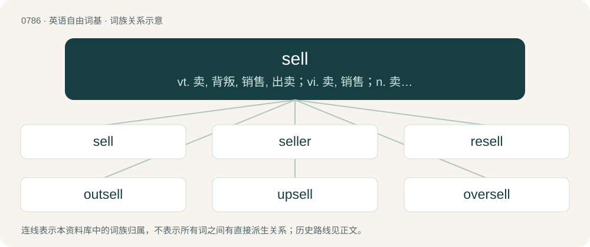

# 0857 · sell — vt. 卖, 背叛, 销售, 出卖；vi. 卖, 销售；n. 卖, 推销术, 失望

[总目录](../00_总目录_按常用程度.md)

**类型**：英语自由词基　｜　**来源语言**：见词源记录

## 核心含义与来源

- 核心含义：vt. 卖, 背叛, 销售, 出卖；vi. 卖, 销售；n. 卖, 推销术, 失望
- 英文含义：To transfer goods or provide services in exchange for money.
- 词形：sell

**来源记录 1**（动词；To transfer goods or provide services in exchange for money.）

From Middle English sellen, from Old English sellan (“give; give up for money”), from Proto-West Germanic \*salljan, from Proto-Germanic \*saljaną, from Proto-Indo-European \*selh₁-. Cognates Cognate with Scots sell (“to sell”), Danish sælge (“to sell”), Norwegian Bokmål selge (“to sell”), Norwegian Nynorsk selja, selje (“to sell”), Swedish sälja (“to sell”), Faroese and Icelandic selja (“to sell”), Gothic 𐍃𐌰𐌻𐌾𐌰𐌽 (saljan, “to pay tribute, make an offer”).

## 词族图

## 单词速览（常用到不常用）

| 单词 | 音标 | 释义 |
|---|---|---|
| [sell](#w-1) | /sɛl/ | vt. 卖, 背叛, 销售, 出卖；vi. 卖, 销售；n. 卖, 推销术, 失望 |
| [seller](#w-2) | 英 /ˈsɛlə/；美 /ˈsɛlɚ/ | n. 销售者；\[化\] 卖方 |
| [resell](#w-3) | /ɹiːˈsɛl/ | vt. 再卖, 转售；\[经\] 转卖, 再卖 |
| [outsell](#w-4) | /ɑʊtˈsɛl/ | vt. 卖得比...多, 比...更畅销 |
| [upsell](#w-5) |  | vi. 向上促销；增销 |
| [oversell](#w-6) | 美 /oʊ.vɚ.sɛl/ | vt. 销售过多, 卖空, 过分吹嘘；vi. 卖空, 吹嘘过分 |

## 逐词详解

### 1. sell

**词性**：动词　｜　**音标**：/sɛl/

**中文释义**：vt. 卖, 背叛, 销售, 出卖；vi. 卖, 销售；n. 卖, 推销术, 失望

**英文义项**：To transfer goods or provide services in exchange for money. / To be sold.

**词源与演化**：

From Middle English sellen, from Old English sellan (“give; give up for money”), from Proto-West Germanic \*salljan, from Proto-Germanic \*saljaną, from Proto-Indo-European \*selh₁-. Cognates Cognate with Scots sell (“to sell”), Danish sælge (“to sell”), Norwegian Bokmål selge (“to sell”), Norwegian Nynorsk selja, selje (“to sell”), Swedish sälja (“to sell”), Faroese and Icelandic selja (“to sell”), Gothic 𐍃𐌰𐌻𐌾𐌰𐌽 (saljan, “to pay tribute, make an offer”).

**例句**：

> My boss is very old-fashioned and I'm having a lot of trouble selling the idea of working at home occasionally.

该用例对应义项：To promote (a particular viewpoint).

### 2. seller

**词性**：名词　｜　**音标**：英 /ˈsɛlə/；美 /ˈsɛlɚ/

**中文释义**：n. 销售者；\[化\] 卖方

**英文义项**：Someone who sells; a vendor; a clerk. / Something which sells.

**构词拆分**：sell + -er (agent noun)；sell + -er (patient)

**词源与演化**：

From Middle English seller, sellere, (also siller, sullar, sullere), from Old English \*sellere, \*syllere, equivalent to sell + -er (agent noun) (sense 1) and sell + -er (patient) (sense 2). Cognate with Danish sælger, Swedish säljare, Icelandic seljari (“a seller; dealer”).

**例句**：

> Two of the books Alisha authored had become big sellers.

该用例对应义项：Something which sells.

### 3. resell

**词性**：动词　｜　**音标**：/ɹiːˈsɛl/

**中文释义**：vt. 再卖, 转售；\[经\] 转卖, 再卖

**英文义项**：To sell again.

**构词拆分**：re- + sell

**词源与演化**：

From re- + sell.

**例句**：

> They buy these goods cheaply overseas and then mark them up to resell at home.

### 4. outsell

**词性**：动词　｜　**音标**：/ɑʊtˈsɛl/

**中文释义**：vt. 卖得比...多, 比...更畅销

**英文义项**：To sell more than; to surpass in sales. / To sell at a higher price (than)

**构词拆分**：out- + sell

**词源与演化**：

From out- + sell.

**例句**：

> The company plans to outsell last year’s revenue with the new product.

该用例对应义项：To sell more than; to surpass in sales.

### 5. upsell

**词性**：动词

**中文释义**：vi. 向上促销；增销

**英文义项**：To persuade a customer to buy more items, or more expensive items, than they had intended.

**构词拆分**：From up- + sell.

**词源与演化**：

From up- + sell.

**例句**：

> I gave up on subscribing to their SaaS because they wouldn't quit the constant attempts to upsell.

该用例对应义项：To persuade a customer to buy more items, or more expensive items, than they had intended.

### 6. oversell

**词性**：动词　｜　**音标**：美 /oʊ.vɚ.sɛl/

**中文释义**：vt. 销售过多, 卖空, 过分吹嘘；vi. 卖空, 吹嘘过分

**英文义项**：To agree to sell more of something than one can supply. / To be too eager in attempting to sell something.

**构词拆分**：over- + sell

**词源与演化**：

From over- + sell.

**例句**：

> I don't want to oversell it, but you've got to check out that new restaurant on Third Street.

该用例对应义项：To praise something to excess.
