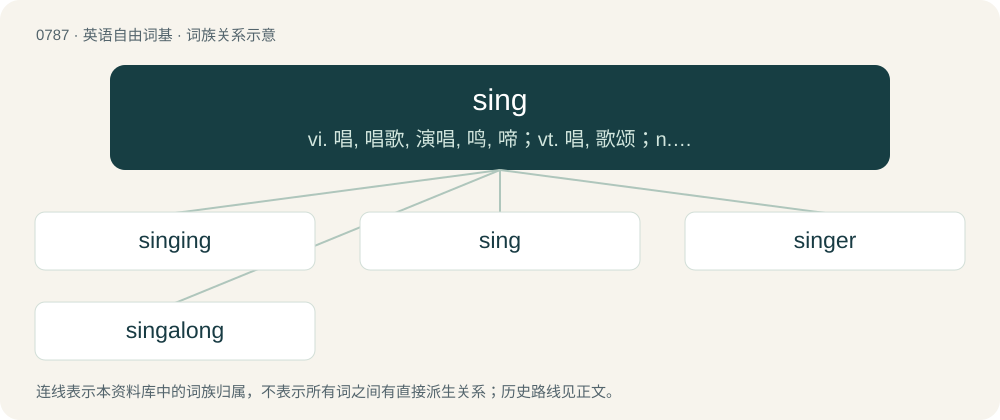

# 0858 · sing — vi. 唱, 唱歌, 演唱, 鸣, 啼；vt. 唱, 歌颂；n. 嗖嗖声

[总目录](../00_总目录_按常用程度.md)

**类型**：英语自由词基　｜　**来源语言**：见词源记录

## 核心含义与来源

- 核心含义：vi. 唱, 唱歌, 演唱, 鸣, 啼；vt. 唱, 歌颂；n. 嗖嗖声
- 英文含义：To produce musical or harmonious sounds with one’s voice.
- 词形：sing

**来源记录 1**（动词；To produce musical or harmonious sounds with one’s voice.）

From Middle English singen, from Old English singan (“to sing”), from Proto-West Germanic \*singwan, from Proto-Germanic \*singwaną (“to sing”), from Proto-Indo-European \*sengʷʰ- (“to recite, sing”). Cognate with Saterland Frisian sjunge (“to sing”), West Frisian sjonge (“to sing”), Dutch zingen (“to sing”), German Low German singen (“to sing”), German singen (“to sing”), Danish and Norwegian Bokmål synge (“to sing”), Swedish sjunga (“to sing”), Norwegian Nynorsk, Faroese, and Icelandic syngja (“to sing”), Ancient Greek ὀμφή (omphḗ, “voice, oracle”).

## 词族图

## 单词速览（常用到不常用）

| 单词 | 音标 | 释义 |
|---|---|---|
| [singing](#w-1) | /ˈsɪŋɪŋ/ | n. 歌唱, 歌声；\[计\] 振鸣; 蜂鸣 |
| [sing](#w-2) | /ˈsɪŋ/ | vi. 唱, 唱歌, 演唱, 鸣, 啼；vt. 唱, 歌颂；n. 嗖嗖声 |
| [singer](#w-3) | 英 /ˈsɪŋ.ə/；美 /ˈsɪŋ.ɚ/ | n. 歌手 |
| [singalong](#w-4) | /ˈsɪŋə(ˌ)lɒŋ/ | n. (非正式的)歌唱聚会, 歌咏会 |

## 逐词详解

### 1. singing

**词性**：名词　｜　**音标**：/ˈsɪŋɪŋ/

**中文释义**：n. 歌唱, 歌声；\[计\] 振鸣; 蜂鸣

**英文义项**：The act of using the voice to produce musical sounds; vocalizing. / Disclosing information, or giving evidence about another.

**构词拆分**：sing + -ing

**词源与演化**：

From Middle English syngyng; equivalent to sing + -ing.

**例句**：

> She generally sings very well, but now she is singing very badly.

### 2. sing

**词性**：动词　｜　**音标**：/ˈsɪŋ/

**中文释义**：vi. 唱, 唱歌, 演唱, 鸣, 啼；vt. 唱, 歌颂；n. 嗖嗖声

**英文义项**：To produce musical or harmonious sounds with one’s voice. / To perform a vocal part in a musical composition, regardless of technique.

**词源与演化**：

From Middle English singen, from Old English singan (“to sing”), from Proto-West Germanic \*singwan, from Proto-Germanic \*singwaną (“to sing”), from Proto-Indo-European \*sengʷʰ- (“to recite, sing”). Cognate with Saterland Frisian sjunge (“to sing”), West Frisian sjonge (“to sing”), Dutch zingen (“to sing”), German Low German singen (“to sing”), German singen (“to sing”), Danish and Norwegian Bokmål synge (“to sing”), Swedish sjunga (“to sing”), Norwegian Nynorsk, Faroese, and Icelandic syngja (“to sing”), Ancient Greek ὀμφή (omphḗ, “voice, oracle”).

**例句**：

> "I really want to sing in the school choir," said Vera.

该用例对应义项：To produce musical or harmonious sounds with one’s voice.

### 3. singer

**词性**：名词　｜　**音标**：英 /ˈsɪŋ.ə/；美 /ˈsɪŋ.ɚ/

**中文释义**：n. 歌手

**英文义项**：A person who sings, often professionally. / dance figure with a fixed structure, sung by a caller, or a piece of music with that structure.

**构词拆分**：sing + -er

**词源与演化**：

Inherited from Middle English synger, syngere, singere, singare, equivalent to sing + -er. Cognate with Scots singar, Saterland Frisian Sjunger, West Frisian sjonger, German Low German Singer. Compare also Old English sangere, Dutch zanger, German Low German Sänger, German Sänger (“singer”), Danish sanger, Swedish sångare, Icelandic söngvari.

**例句**：

> It's the singer, not the song.

该用例对应义项：A person who sings, often professionally.

### 4. singalong

**词性**：形容词　｜　**音标**：/ˈsɪŋə(ˌ)lɒŋ/

**中文释义**：n. (非正式的)歌唱聚会, 歌咏会

**英文义项**：designed to allow or encourage the audience to sing along

**构词拆分**：sing + along

**词源与演化**：

From sing + along.

**例句**：

> ABBA had a talent for writing great singalong pop songs.

该用例对应义项：designed to allow or encourage the audience to sing along
