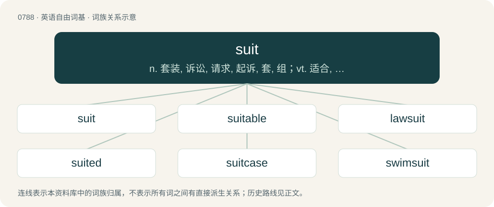

# 0859 · suit — n. 套装, 诉讼, 请求, 起诉, 套, 组；vt. 适合, 使适应；vi. 合适, 相称

[总目录](../00_总目录_按常用程度.md)

**类型**：英语自由词基　｜　**来源语言**：见词源记录

## 核心含义与来源

- 核心含义：n. 套装, 诉讼, 请求, 起诉, 套, 组；vt. 适合, 使适应；vi. 合适, 相称
- 英文含义：A set of clothes to be worn together, now especially a man's matching jacket and trousers (also business suit or lounge suit), or a similar outfit for a woman.
- 词形：suit

**来源记录 1**（名词；A set of clothes to be worn together, now especially a man's matching jacket and trousers (also business suit or lounge suit), or a similar outfit for a woman.）

Inherited from Middle English sute, borrowed from Anglo-Norman suite, from metathesis of earlier Old French siute, from Vulgar Latin \*sequita, from \*sequere, from sequor, sequi, from Proto-Italic \*sekʷōr, from Proto-Indo-European \*sékʷetor, from \*sekʷ-. Doublet of suite. Cognate with Italian seguire and Spanish seguir. Related to sue and segue.

## 词族图

## 单词速览（常用到不常用）

| 单词 | 音标 | 释义 |
|---|---|---|
| [suit](#w-1) | 英 /suːt/；美 /sut/ | n. 套装, 诉讼, 请求, 起诉, 套, 组；vt. 适合, 使适应；vi. 合适, 相称 |
| [suitable](#w-2) | /ˈsjuːtəbl/ | a. 适当的, 相配的；\[法\] 合适的, 适宜的, 适当的 |
| [lawsuit](#w-3) | 英 /ˈlɔːˌs(j)uːt/；美 /ˈlɔˌs(j)ut/ | n. 诉讼；\[法\] 诉讼, 诉讼案件 |
| [suited](#w-4) | 英 /ˈsuːtɪd/；美 /ˈsutɪd/ | a. 适合的 |
| [suitcase](#w-5) | 美 /ˈsutkeɪs/；/ˈs(j)uːtkeɪs/ | n. 手提箱 |
| [swimsuit](#w-6) | /ˈswɪm.s(j)ut/ | n. 游泳衣 |
| [suitability](#w-7) | 英 /ˌsjuːtəˈbɪlɪti/；美 /ˌsutəˈbɪləti/ | n. 适合, 适当；\[医\] 适合性, 适应性 |
| [jumpsuit](#w-8) | 美 /ˈd͡ʒʌmpˌsut/ | n. 连衣裤, （尤指女式）连衣裤 |
| [tracksuit](#w-9) | 美 /ˈtɹækˌsut/ | n. 运动服 |
| [wetsuit](#w-10) | /ˈwɛtˌs(j)ut/ | n. 潜水服；防寒泳衣；湿式保暖服 |
| [bodysuit](#w-11) | /ˈbɒdisuːt/ | n. 紧身衣裤 |
| [pantsuit](#w-12) | /ˈpæntsjuːt/ | n. 裤套装 |
| [catsuit](#w-13) | 美 /ˈkætˌsut/ | n. 女式紧身连衣裤 |
| [wingsuit](#w-14) | 美 /ˈwɪŋˌsut/ | 【英文】A special jumpsuit, used in extreme sports like a parachute, which adds surface area to the wearer's body to create lift. |
| [fursuit](#w-15) | 英 /ˈfɜː(ɹ)ˌsuːt/；美 /ˈfɜɹˌsuːt/ | 【英文】An anthropomorphic animal costume used in the furry subculture. |

## 逐词详解

### 1. suit

**词性**：名词　｜　**音标**：英 /suːt/；美 /sut/

**中文释义**：n. 套装, 诉讼, 请求, 起诉, 套, 组；vt. 适合, 使适应；vi. 合适, 相称

**英文义项**：A set of clothes to be worn together, now especially a man's matching jacket and trousers (also business suit or lounge suit), or a similar outfit for a woman. / A garment or set of garments suitable and/or required for a given task or activity: space suit, boiler suit, protective suit, swimsuit.

**词源与演化**：

Inherited from Middle English sute, borrowed from Anglo-Norman suite, from metathesis of earlier Old French siute, from Vulgar Latin \*sequita, from \*sequere, from sequor, sequi, from Proto-Italic \*sekʷōr, from Proto-Indo-European \*sékʷetor, from \*sekʷ-. Doublet of suite. Cognate with Italian seguire and Spanish seguir. Related to sue and segue.

**例句**：

> Be sure to keep your nose to the grindstone today; the suits are making a "surprise" visit to this department.

该用例对应义项：A person who wears matching jacket and trousers, especially a boss or a supervisor.

### 2. suitable

**词性**：形容词　｜　**音标**：/ˈsjuːtəbl/

**中文释义**：a. 适当的, 相配的；\[法\] 合适的, 适宜的, 适当的

**英文义项**：Having sufficient or the required properties for a certain purpose or task; appropriate to a certain occasion.

**构词拆分**：suit + -able

**词源与演化**：

From suit + -able.

**例句**：

> A tractor suitable (or fit) for heavy duty.

该用例对应义项：meant or adapted for an occasion or use

### 3. lawsuit

**词性**：名词　｜　**音标**：英 /ˈlɔːˌs(j)uːt/；美 /ˈlɔˌs(j)ut/

**中文释义**：n. 诉讼；\[法\] 诉讼, 诉讼案件

**英文义项**：In civil law, a case where two or more people disagree and one or more of the parties take the case to a court for resolution.

**构词拆分**：law + suit

**词源与演化**：

From law + suit.

**例句**：

> My ex-fiancé filed a lawsuit against me for a false restraining order and defamation.

该用例对应义项：In civil law, a case where two or more people disagree and one or more of the parties take the case to a court for resolution.

### 4. suited

**词性**：形容词　｜　**音标**：英 /ˈsuːtɪd/；美 /ˈsutɪd/

**中文释义**：a. 适合的

**英文义项**：Suitable. / Having the specified kind or number of suits.

**构词拆分**：suit + -ed

**词源与演化**：

From suit + -ed.

**用法示例／搭配（非完整句）**：

> Brunson has ace-king suited in the small blind

该用例对应义项：Of the same suit.

### 5. suitcase

**词性**：名词　｜　**音标**：美 /ˈsutkeɪs/；/ˈs(j)uːtkeɪs/

**中文释义**：n. 手提箱

**英文义项**：A large (usually rectangular) piece of luggage used for carrying clothes, and sometimes suits, when travelling. / In the Classic Mac OS operating system, a file containing fonts, icons, sounds, and other resources.

**构词拆分**：suit + case

**词源与演化**：

From suit + case.

**例句**：

> My suitcase is stowed in the luggage rack.

该用例对应义项：A large (usually rectangular) piece of luggage used for carrying clothes, and sometimes suits, when travelling.

### 6. swimsuit

**词性**：名词　｜　**音标**：/ˈswɪm.s(j)ut/

**中文释义**：n. 游泳衣

**英文义项**：A garment worn for swimming. / A tight-fitting one-piece garment worn by women and girls.

**构词拆分**：swim + suit

**词源与演化**：

From swim + suit.

**例句**：

> Jade refused to go swimming with her brother until he helped her find her favorite swimsuit.

该用例对应义项：A tight-fitting one-piece garment worn by women and girls.

### 7. suitability

**词性**：名词　｜　**音标**：英 /ˌsjuːtəˈbɪlɪti/；美 /ˌsutəˈbɪləti/

**中文释义**：n. 适合, 适当；\[医\] 适合性, 适应性

**英文义项**：The quality of being suitable.

**构词拆分**：suit + -ability

**词源与演化**：

From suit + -ability.

**例句**：

> An important requirement is suitability for long trips.

该用例对应义项：the quality of having the properties that are right for a specific purpose

### 8. jumpsuit

**词性**：名词　｜　**音标**：美 /ˈd͡ʒʌmpˌsut/

**中文释义**：n. 连衣裤, （尤指女式）连衣裤

**英文义项**：A one-piece item of clothing originally used by parachutists. / A similar item of clothing used for outdoor sports such as skiing.

**构词拆分**：jump + suit

**词源与演化**：

From jump + suit, referring to parachute jumps.

**例句**：

> The next time you see Tom, he'll be in an orange jumpsuit.

### 9. tracksuit

**词性**：名词　｜　**音标**：美 /ˈtɹækˌsut/

**中文释义**：n. 运动服

**英文义项**：A garment, usually consisting of a top and trousers (commonly known as tracksuit bottoms) worn as an outer layer by participants in sporting events such as athletics. The tracksuit is usually designed to be easily removed or replaced, before or after competing. Tracksuits have also been adopted in some cultures as leisurewear.

**构词拆分**：track + suit

**词源与演化**：

From track + suit.

**例句**：

> You look absolutely hot in this tracksuit.

### 10. wetsuit

**词性**：名词　｜　**音标**：/ˈwɛtˌs(j)ut/

**中文释义**：n. 潜水服；防寒泳衣；湿式保暖服

**英文义项**：A close fitting, insulating garment usually made from neoprene or similar material designed to keep one warm during activities on or under water.

**构词拆分**：wet + suit

**词源与演化**：

From wet + suit.

**例句**：

> Tom usually wears a wetsuit when he goes surfing.

### 11. bodysuit

**词性**：名词　｜　**音标**：/ˈbɒdisuːt/

**中文释义**：n. 紧身衣裤

**英文义项**：A one-piece, skin-tight garment rather like a leotard.

**构词拆分**：body + suit

**词源与演化**：

From body + suit.

### 12. pantsuit

**词性**：名词　｜　**音标**：/ˈpæntsjuːt/

**中文释义**：n. 裤套装

**英文义项**：A women's suit consisting of coordinated pants (trousers) and jacket

**构词拆分**：pant + suit

**词源与演化**：

From pant + suit.

**例句**：

> This pantsuit is perfect for the successful businesswoman.

### 13. catsuit

**词性**：名词　｜　**音标**：美 /ˈkætˌsut/

**中文释义**：n. 女式紧身连衣裤

**英文义项**：A tight-fitting one-piece women's garment, covering the legs, arms and torso.

**构词拆分**：cat + suit

**词源与演化**：

From cat + suit.

### 14. wingsuit

**词性**：名词　｜　**音标**：美 /ˈwɪŋˌsut/

**英文义项**：A special jumpsuit, used in extreme sports like a parachute, which adds surface area to the wearer's body to create lift.

**构词拆分**：wing + suit

**词源与演化**：

From wing + suit.

### 15. fursuit

**词性**：名词　｜　**音标**：英 /ˈfɜː(ɹ)ˌsuːt/；美 /ˈfɜɹˌsuːt/

**英文义项**：An anthropomorphic animal costume used in the furry subculture.

**构词拆分**：fur + suit

**词源与演化**：

From fur + suit.

**例句**：

> I'll probably just wear my fursuit and call it a costume.
