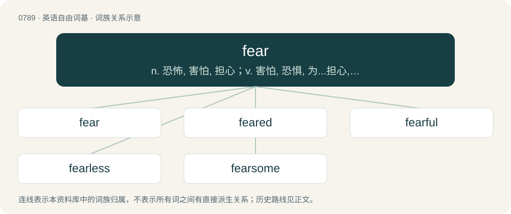

# 0860 · fear — n. 恐怖, 害怕, 担心；v. 害怕, 恐惧, 为...担心, 敬畏

[总目录](../00_总目录_按常用程度.md)

**类型**：英语自由词基　｜　**来源语言**：见词源记录

## 核心含义与来源

- 核心含义：n. 恐怖, 害怕, 担心；v. 害怕, 恐惧, 为...担心, 敬畏
- 英文含义：A strong, unpleasant emotion or feeling caused by actual or perceived danger or threat.
- 词形：fear

**多个词源／构词路径**：同一拼写可能有不同来源；以下按词性和含义分别列出。

**来源记录 1**（名词；A strong, unpleasant emotion or feeling caused by actual or perceived danger or threat.）

From Middle English feer, fere, fer (“fear”), from Old English fǣr, ġefǣr (“calamity, sudden danger, peril, sudden attack, terrible sight”), from Proto-Germanic \*fērō, \*fērą (“danger”), from Proto-Indo-European \*per- (“to go through, carry forth, try”). Cognate with Dutch gevaar (“danger, risk, peril”), German Gefahr (“danger, hazard, risk”), Danish fare (“danger, hazard, risk”), Faroese and Icelandic fár (“accident, anger, calamity”), Norwegian Bokmål and Norwegian Nynorsk fare (“danger”), Swedish fara (“danger, risk, peril”), Latin perīculum (“danger, risk, trial”), Ancient Greek πεῖρα (peîra, “trial, experiment”), Armenian փորձ (pʻorj, “attempt”). Doublet of peril. The verb is from Middle English feren, from Old English fǣran (“to frighten, raven”), from the noun. Cognate with the archaic Dutch verb varen (“to fear, to cause fear”).

**来源记录 2**（形容词；Able; capable; stout; strong; sound.）

From Middle English fere, feore, from Old English fēre (“able to go, fit for service”), from Proto-Germanic \*fēriz (“passable”), from Proto-Indo-European \*per- (“to put across, ferry”). Cognate with Scots fere, feir (“well, active, sound”), Middle High German gevüere (“able, capable, fit, serviceable”), Swedish för (“capable, able, stout”), Icelandic fær (“able”). Related to fare.

## 词族图

## 单词速览（常用到不常用）

| 单词 | 音标 | 释义 |
|---|---|---|
| [fear](#w-1) | 英 /fɪə/；美 /fɪɚ/ | n. 恐怖, 害怕, 担心；v. 害怕, 恐惧, 为...担心, 敬畏 |
| [feared](#w-2) | 英 /fɪəd/；美 /fɪɹd/ | v. 畏惧( fear的过去式和过去分词 ); 为…忧虑（或担心、焦虑）; 敬畏（神等）; 感到害怕 |
| [fearful](#w-3) | 英 /ˈfɪəfəl/；美 /ˈfɪɹfəl/ | a. 可怕的, 恐怕的, 担心的 |
| [fearless](#w-4) | 英 /ˈfɪələs/；美 /ˈfɪɹləs/ | a. 大胆的, 勇敢的, 无畏的 |
| [fearsome](#w-5) | 英 /ˈfɪəsəm/；美 /ˈfɪɹsəm/ | a. 吓人的, 可怕的, 害怕的 |

## 逐词详解

### 1. fear

**词性**：名词　｜　**音标**：英 /fɪə/；美 /fɪɚ/

**中文释义**：n. 恐怖, 害怕, 担心；v. 害怕, 恐惧, 为...担心, 敬畏

**英文义项**：A strong, unpleasant emotion or feeling caused by actual or perceived danger or threat. / A phobia, a sense of fear induced by something or someone in particular.

**词源与演化**：

From Middle English feer, fere, fer (“fear”), from Old English fǣr, ġefǣr (“calamity, sudden danger, peril, sudden attack, terrible sight”), from Proto-Germanic \*fērō, \*fērą (“danger”), from Proto-Indo-European \*per- (“to go through, carry forth, try”). Cognate with Dutch gevaar (“danger, risk, peril”), German Gefahr (“danger, hazard, risk”), Danish fare (“danger, hazard, risk”), Faroese and Icelandic fár (“accident, anger, calamity”), Norwegian Bokmål and Norwegian Nynorsk fare (“danger”), Swedish fara (“danger, risk, peril”), Latin perīculum (“danger, risk, trial”), Ancient Greek πεῖρα (peîra, “trial, experiment”), Armenian փորձ (pʻorj, “attempt”). Doublet of peril. The verb is from Middle English feren, from Old English fǣran (“to frighten, raven”), from the noun. Cognate with the archaic Dutch verb varen (“to fear, to cause fear”).

**例句**：

> He was struck by fear on seeing the snake.

该用例对应义项：A strong, unpleasant emotion or feeling caused by actual or perceived danger or threat.

### 2. feared

**词性**：形容词　｜　**音标**：英 /fɪəd/；美 /fɪɹd/

**中文释义**：v. 畏惧( fear的过去式和过去分词 ); 为…忧虑（或担心、焦虑）; 敬畏（神等）; 感到害怕

**英文义项**：Pertaining to someone or thing that causes great fear in others. / Regarded with fear, respect, or reverence.

**构词拆分**：fear + -ed

**词源与演化**：

From Middle English fard, feard, ferd, ferde, fered, equivalent to fear + -ed.

**例句**：

> They did not oppose the project just because they feared public opinion.

### 3. fearful

**词性**：形容词　｜　**音标**：英 /ˈfɪəfəl/；美 /ˈfɪɹfəl/

**中文释义**：a. 可怕的, 恐怕的, 担心的

**英文义项**：Frightening; causing fear. / Tending to fear; timid.

**构词拆分**：fear + -ful

**词源与演化**：

From Middle English ferful, fervol, equivalent to fear + -ful.

**用法示例／搭配（非完整句）**：

> a fearful boy

该用例对应义项：Tending to fear; timid.

### 4. fearless

**词性**：形容词　｜　**音标**：英 /ˈfɪələs/；美 /ˈfɪɹləs/

**中文释义**：a. 大胆的, 勇敢的, 无畏的

**英文义项**：Without fear.

**构词拆分**：fear + -less

**词源与演化**：

From fear + -less.

**例句**：

> Fearless reporters and photographers.

该用例对应义项：invulnerable to fear or intimidation

### 5. fearsome

**词性**：形容词　｜　**音标**：英 /ˈfɪəsəm/；美 /ˈfɪɹsəm/

**中文释义**：a. 吓人的, 可怕的, 害怕的

**英文义项**：Frightening, especially in appearance.

**构词拆分**：fear + -some

**词源与演化**：

From fear + -some. Compare German furchtsam (“fearful”, obsolete also “fearsome”); this is more closely equivalent to English frightsome, however.

**例句**：

> The warriors faced a fearsome enemy.

该用例对应义项：Frightening, especially in appearance.
