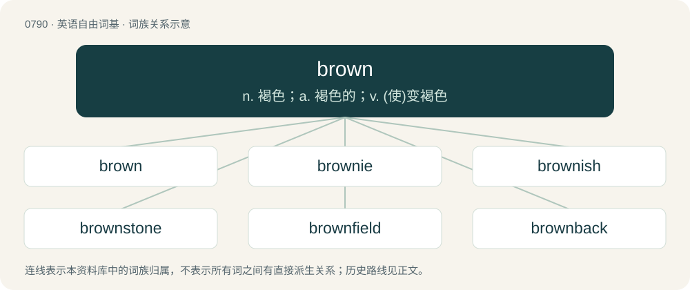

# 0862 · brown — n. 褐色；a. 褐色的；v. (使)变褐色

[总目录](../00_总目录_按常用程度.md)

**类型**：英语自由词基　｜　**来源语言**：见词源记录

## 核心含义与来源

- 核心含义：n. 褐色；a. 褐色的；v. (使)变褐色
- 英文含义：A colour like that of chocolate or coffee.
- 词形：brown

**来源记录 1**（名词；A colour like that of chocolate or coffee.）

Inherited from Middle English broun, from Old English brūn (“brown; dark; dusky”), from Proto-West Germanic \*brūn, from Proto-Germanic \*brūnaz, from Proto-Indo-European \*bʰerH-. Doublet of bruin. Cognates \* Dutch bruin \* German braun \* Danish, Norwegian Bokmål, Norwegian Nynorsk, and Swedish brun \* Ancient Greek φρύνη (phrúnē), φρῦνος (phrûnos, “toad”) \* Latin brunneus (“brown”) \* Lithuanian bė́ras (“brown”) \* Sanskrit बभ्रु (babhrú, “reddish-brown”) \* West Frisian brún

## 词族图

## 单词速览（常用到不常用）

| 单词 | 音标 | 释义 |
|---|---|---|
| [brown](#w-1) | 英 /ˈbɹaʊ̯n/；/ˈbɹæʊ̯n/ | n. 褐色；a. 褐色的；v. (使)变褐色 |
| [brownie](#w-2) | 英 /ˈbɹaʊni/ | n. 界仁巧克力饼 |
| [brownish](#w-3) | /ˈbɹaʊnɪʃ/ | a. 呈褐色的 |
| [brownstone](#w-4) | 美 /ˈbɹaʊnˌstoʊn/ | n. 褐砂石, 褐砂石建筑；a. 有钱人的 |
| [brownfield](#w-5) | /ˈbraʊnfiːld/ | a. 棕色地带 |
| [brownback](#w-6) |  | \[人名\] 布朗巴克 |

## 逐词详解

### 1. brown

**词性**：名词　｜　**音标**：英 /ˈbɹaʊ̯n/；/ˈbɹæʊ̯n/

**中文释义**：n. 褐色；a. 褐色的；v. (使)变褐色

**英文义项**：A colour like that of chocolate or coffee. / One of the colour balls used in snooker, with a value of 4 points.

**词源与演化**：

Inherited from Middle English broun, from Old English brūn (“brown; dark; dusky”), from Proto-West Germanic \*brūn, from Proto-Germanic \*brūnaz, from Proto-Indo-European \*bʰerH-. Doublet of bruin. Cognates \* Dutch bruin \* German braun \* Danish, Norwegian Bokmål, Norwegian Nynorsk, and Swedish brun \* Ancient Greek φρύνη (phrúnē), φρῦνος (phrûnos, “toad”) \* Latin brunneus (“brown”) \* Lithuanian bė́ras (“brown”) \* Sanskrit बभ्रु (babhrú, “reddish-brown”) \* West Frisian brún

**例句**：

> The browns and greens in this painting give it a nice woodsy feel.

该用例对应义项：A colour like that of chocolate or coffee.

### 2. brownie

**词性**：名词　｜　**音标**：英 /ˈbɹaʊni/

**中文释义**：n. 界仁巧克力饼

**英文义项**：A small square piece of rich cake, usually made with chocolate. / A sweet bread with brown sugar and currants.

**构词拆分**：brown + -ie (diminutive suffix)

**词源与演化**：

From brown + -ie (diminutive suffix). In folkloric sense, originally Scots. For sense 7, compare with Dutch kabouter (“a very young female member of the scout movement”) (literally "gnome").

**例句**：

> Order for the brownie was placed but it took half an hour to prepare it.

该用例对应义项：A small square piece of rich cake, usually made with chocolate.

### 3. brownish

**词性**：形容词　｜　**音标**：/ˈbɹaʊnɪʃ/

**中文释义**：a. 呈褐色的

**英文义项**：Of a colour which resembles brown; somewhat brown.

**构词拆分**：brown + -ish

**词源与演化**：

From brown + -ish.

**例句**：

> When he turned the spigot, brownish water came gushing out.

### 4. brownstone

**词性**：名词　｜　**音标**：美 /ˈbɹaʊnˌstoʊn/

**中文释义**：n. 褐砂石, 褐砂石建筑；a. 有钱人的

**英文义项**：A variety of brown to red-brown sandstone once popular as a building material. / A row house built of brownstone, especially in New York City.

**构词拆分**：brown + stone

**词源与演化**：

From brown + stone.

**例句**：

> She lives in a brownstone in a gentrified neighborhood of New York.

### 5. brownfield

**词性**：形容词　｜　**音标**：/ˈbraʊnfiːld/

**中文释义**：a. 棕色地带

**英文义项**：Being a development that has to integrate with legacy systems.

**构词拆分**：brown + field

**词源与演化**：

From brown + field.

**用法示例／搭配（非完整句）**：

> a brownfield project

该用例对应义项：Being a development that has to integrate with legacy systems.

### 6. brownback

**词性**：名词

**中文释义**：\[人名\] 布朗巴克

**英文义项**：A bird, the dowitcher or red-breasted snipe. / A postage stamp printed in brown ink, used in the 1890s.

**构词拆分**：brown + back

**词源与演化**：

From brown + back.
