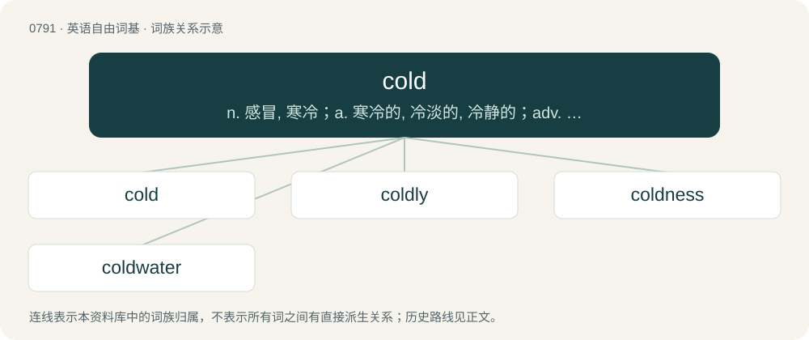

# 0863 · cold — n. 感冒, 寒冷；a. 寒冷的, 冷淡的, 冷静的；adv. 完全地

[总目录](../00_总目录_按常用程度.md)

**类型**：英语自由词基　｜　**来源语言**：见词源记录

## 核心含义与来源

- 核心含义：n. 感冒, 寒冷；a. 寒冷的, 冷淡的, 冷静的；adv. 完全地
- 英文含义：Having a low temperature.
- 词形：cold

**多个词源／构词路径**：同一拼写可能有不同来源；以下按词性和含义分别列出。

**来源记录 1**（形容词；Having a low temperature.）

Inherited from Middle English cold, from Anglian Old English cald. The West Saxon form, ċeald (“cold”), survived as early Middle English cheald, cheld, or chald. Both descended from Proto-West Germanic \*kald, from Proto-Germanic \*kaldaz (“cold”), a participle form of \*kalaną (“to be cold, to freeze”), from Proto-Indo-European \*gel- (“to be cold, to freeze”). Cognates Cognate with Scots cauld (“cold”), Saterland Frisian koold (“cold”), West Frisian kâld (“cold”), Alemannic German chalt, choalt, cholt, chélte (“cold”), Bavarian ckolt, kholt, koid, kòlt (“cold”), Central Franconian kalt (“cold”), Cimbrian kalt, khalt (“cold”), Dutch koud (“cold”), German kalt (“cold”), Low German kold, koolt (“cold”), Luxembourgish kal (“cold”), Mòcheno khòlt, kòlt (“cold”), Vilamovian kāłt (“cold”), Yiddish קאַלט (kalt, “cold”), Danish kold (“cold”), Faroese and Icelandic kaldur (“cold”), Norwegian Bokmål kald (“cold”), Norwegian Nynorsk kald, kald’u (“cold”), Swedish kall (“cold”), Gothic 𐌺𐌰𐌻𐌳𐍃 (kalds, “cold”); also Latin gelū, gelum, gelus (“frost; chill, cold”), Belarusian хо́лад (xólad, “cold”), Bulgarian хлад (hlad, “chill, coolness”), Czech chlad (“cold”), Macedonian лад (lad, “shade; coolness”), Polish chłód (“cold”), Russian and Ukrainian хо́лод (xólod, “cold”), Serbo-Croatian хла̑д, hlȃd (“shade”), Sanskrit जड (jaḍa, “cold; stiff”), जल (jala, “water”). Related to cool.

**来源记录 2**（名词；A condition of low temperature.）

Inherited from Middle English cold, colde, from Old English cald, ċeald (“cold, coldness”), from Proto-West Germanic \*kald, from Proto-Germanic \*kaldą (“coldness”), from Proto-Indo-European \*gel- (“cold”). Cognates Cognate with Saterland Frisian Keelde (“cold”), West Frisian kjeld (“cold”), Dutch koude (“cold”), German Low German Kolle, Koll (“cold”), German Kälte (“cold”), Danish kulde (“cold”), Swedish köld (“cold”), Norwegian kulde (“cold”), Icelandic kuldi (“cold”).

**来源记录 3**（副词；At a low temperature.）

Inherited from Middle English colde, from Old English calde, ċealde (“coldly”), from the adjective (see above).

## 词族图

## 单词速览（常用到不常用）

| 单词 | 音标 | 释义 |
|---|---|---|
| [cold](#w-1) | 英 /kəʊld/；美 /koʊld/ | n. 感冒, 寒冷；a. 寒冷的, 冷淡的, 冷静的；adv. 完全地 |
| [coldly](#w-2) | 英 /ˈkəʊldli/；美 /ˈkoʊldli/ | adv. 冷淡地 |
| [coldness](#w-3) | 英 /ˈkəʊldnəs/；美 /ˈkoʊldnəs/ | n. 寒冷, 冷, 冷淡 |
| [coldwater](#w-4) |  | \[医\]双孔镖鲈; \[人名\] 科德沃特; \[地名\] \[加拿大、美国\] 科尔德沃特 |

## 逐词详解

### 1. cold

**词性**：形容词　｜　**音标**：英 /kəʊld/；美 /koʊld/

**中文释义**：n. 感冒, 寒冷；a. 寒冷的, 冷淡的, 冷静的；adv. 完全地

**英文义项**：Having a low temperature. / Causing the air to be cold.

**词源与演化**：

Inherited from Middle English cold, from Anglian Old English cald. The West Saxon form, ċeald (“cold”), survived as early Middle English cheald, cheld, or chald. Both descended from Proto-West Germanic \*kald, from Proto-Germanic \*kaldaz (“cold”), a participle form of \*kalaną (“to be cold, to freeze”), from Proto-Indo-European \*gel- (“to be cold, to freeze”). Cognates Cognate with Scots cauld (“cold”), Saterland Frisian koold (“cold”), West Frisian kâld (“cold”), Alemannic German chalt, choalt, cholt, chélte (“cold”), Bavarian ckolt, kholt, koid, kòlt (“cold”), Central Franconian kalt (“cold”), Cimbrian kalt, khalt (“cold”), Dutch koud (“cold”), German kalt (“cold”), Low German kold, koolt (“cold”), Luxembourgish kal (“cold”), Mòcheno khòlt, kòlt (“cold”), Vilamovian kāłt (“cold”), Yiddish קאַלט (kalt, “cold”), Danish kold (“cold”), Faroese and Icelandic kaldur (“cold”), Norwegian Bokmål kald (“cold”), Norwegian Nynorsk kald, kald’u (“cold”), Swedish kall (“cold”), Gothic 𐌺𐌰𐌻𐌳𐍃 (kalds, “cold”); also Latin gelū, gelum, gelus (“frost; chill, cold”), Belarusian хо́лад (xólad, “cold”), Bulgarian хлад (hlad, “chill, coolness”), Czech chlad (“cold”), Macedonian лад (lad, “shade; coolness”), Polish chłód (“cold”), Russian and Ukrainian хо́лод (xólod, “cold”), Serbo-Croatian хла̑д, hlȃd (“shade”), Sanskrit जड (jaḍa, “cold; stiff”), जल (jala, “water”). Related to cool.

**例句**：

> Try both these maneuvers until you have them cold and can do them in the dark without thinking.

该用例对应义项：Perfectly, exactly, completely; by heart; down pat.

### 2. coldly

**词性**：副词　｜　**音标**：英 /ˈkəʊldli/；美 /ˈkoʊldli/

**中文释义**：adv. 冷淡地

**英文义项**：In a cold or uncaring manner; indifferently.

**构词拆分**：cold + -ly

**词源与演化**：

From Middle English coldliche, caldeliche, perhaps borrowed from Old Norse kaldliga (“coldly”); equivalent to cold + -ly. Displaced Middle English colde (“coldly”), from Old English cealde (“coldly”).

**例句**：

> Tom begged Mary for a second chance, but she rebuffed him coldly.

### 3. coldness

**词性**：名词　｜　**音标**：英 /ˈkəʊldnəs/；美 /ˈkoʊldnəs/

**中文释义**：n. 寒冷, 冷, 冷淡

**英文义项**：The relative lack of heat. / The sensation resulting from exposure to low temperatures.

**构词拆分**：cold + -ness

**词源与演化**：

From Middle English coldnesse, from Old English cealdness, cealdnys (“coldness”), from Proto-West Germanic \*kaldanassī (“coldness”), equivalent to cold + -ness. Cognate with West Frisian kâldens (“coldness”), Middle Low German koldenisse, kōldenisse (“coldness”), Middle High German kaltnisse, keltnisse (“coldness”).

**例句**：

> A distressing coldness of tone and manner.

该用例对应义项：a lack of affection or enthusiasm

### 4. coldwater

**词性**：形容词

**中文释义**：\[医\]双孔镖鲈; \[人名\] 科德沃特; \[地名\] \[加拿大、美国\] 科尔德沃特

**英文义项**：Located in or near cold ocean waters. / Characterized by the presence or use of cold water.

**构词拆分**：cold + water

**词源与演化**：

From cold + water.

**例句**：

> Coldwater fish, notably salmon and sardines, are good sources of omega-3 acids.
