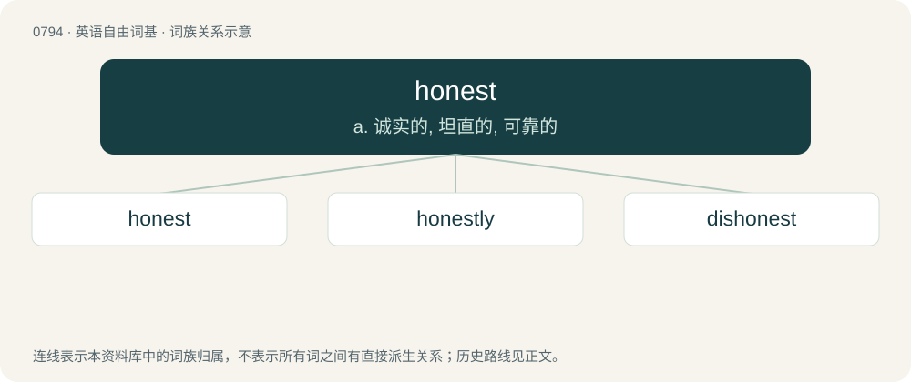

# 0865 · honest — a. 诚实的, 坦直的, 可靠的

[总目录](../00_总目录_按常用程度.md)

**类型**：英语自由词基　｜　**来源语言**：见词源记录

## 核心含义与来源

- 核心含义：a. 诚实的, 坦直的, 可靠的
- 英文含义：Scrupulous with regard to telling the truth; not given to swindling, lying, or fraud; upright.
- 词形：honest

**来源记录 1**（形容词；Scrupulous with regard to telling the truth; not given to swindling, lying, or fraud; upright.）

From Middle English honest, honeste (“honourable, appropriate, excellent”), from Old French honeste, from Latin honestus, from honor. For the verb, see Latin honestāre (“to clothe or adorn with honour”), and compare French honester. Displaced native Old English sōþfæst (literally “truth-firm”).

## 词族图

## 单词速览（常用到不常用）

| 单词 | 音标 | 释义 |
|---|---|---|
| [honest](#w-1) | 英 /ˈɒn.ɪst/；美 /ˈɑ.nɪst/ | a. 诚实的, 坦直的, 可靠的 |
| [honestly](#w-2) | 英 /ˈɒn.ɪst.li/；美 /ˈɑ.nɪst.li/ | adv. 真诚地, 公正地 |
| [dishonest](#w-3) | 英 /dɪˈsɒnɪst/；美 /dɪˈsɑnɪst/ | a. 不诚实的；\[法\] 不忠实的, 不诚实的, 欺诈的 |

## 逐词详解

### 1. honest

**词性**：形容词　｜　**音标**：英 /ˈɒn.ɪst/；美 /ˈɑ.nɪst/

**中文释义**：a. 诚实的, 坦直的, 可靠的

**英文义项**：Scrupulous with regard to telling the truth; not given to swindling, lying, or fraud; upright. / True, especially as far as is known by the person making the statement; fair; unbiased.

**词源与演化**：

From Middle English honest, honeste (“honourable, appropriate, excellent”), from Old French honeste, from Latin honestus, from honor. For the verb, see Latin honestāre (“to clothe or adorn with honour”), and compare French honester. Displaced native Old English sōþfæst (literally “truth-firm”).

**例句**：

> We’re the most honest people you will ever come across.

该用例对应义项：Scrupulous with regard to telling the truth; not given to swindling, lying, or fraud; upright.

### 2. honestly

**词性**：副词　｜　**音标**：英 /ˈɒn.ɪst.li/；美 /ˈɑ.nɪst.li/

**中文释义**：adv. 真诚地, 公正地

**英文义项**：In an honest manner. / Frankly, to be honest.

**构词拆分**：honest + -ly

**词源与演化**：

From Middle English honestly, honestlyche, honestliche, equivalent to honest + -ly.

**例句**：

> Honestly, I didn't believe a word she said.

该用例对应义项：Frankly, to be honest.

### 3. dishonest

**词性**：形容词　｜　**音标**：英 /dɪˈsɒnɪst/；美 /dɪˈsɑnɪst/

**中文释义**：a. 不诚实的；\[法\] 不忠实的, 不诚实的, 欺诈的

**英文义项**：Not honest; shoddy. / Interfering with honesty.

**构词拆分**：dis- + honest

**词源与演化**：

From Middle English dishoneste (“dishonourable”), from Old French deshoneste, from Latin dehonestus. Equivalent to dis- + honest. Displaced native Old English unsōþfæst.

**例句**：

> There are no dishonest people, only ones who forget to be honest.
