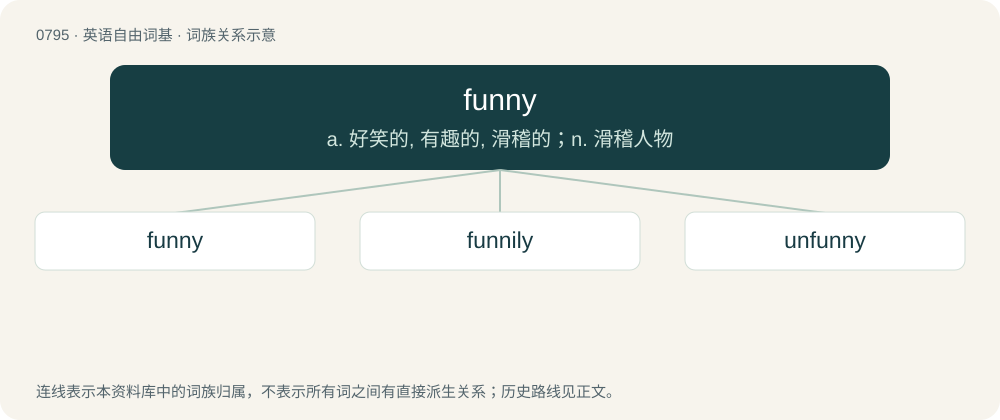

# 0867 · funny — a. 好笑的, 有趣的, 滑稽的；n. 滑稽人物

[总目录](../00_总目录_按常用程度.md)

**类型**：英语自由词基　｜　**来源语言**：见词源记录

## 核心含义与来源

- 核心含义：a. 好笑的, 有趣的, 滑稽的；n. 滑稽人物
- 英文含义：Amusing; humorous; comical.
- 词形：funny

**多个词源／构词路径**：同一拼写可能有不同来源；以下按词性和含义分别列出。

**来源记录 1**（形容词；Amusing; humorous; comical.）

From fun + -y.

**来源记录 2**（名词；A narrow, clinker-built double-ender for sculling.）

Perhaps a jocular use of funny. See above.

## 词族图

## 单词速览（常用到不常用）

| 单词 | 音标 | 释义 |
|---|---|---|
| [funny](#w-1) | 英 /ˈfʌni/ | a. 好笑的, 有趣的, 滑稽的；n. 滑稽人物 |
| [funnily](#w-2) | /ˈfʌnəli/ | adv. 滑稽可笑地 |
| [unfunny](#w-3) | /ˈʌnˈfʌni/ | a. 硬充滑稽的 |

## 逐词详解

### 1. funny

**词性**：形容词　｜　**音标**：英 /ˈfʌni/

**中文释义**：a. 好笑的, 有趣的, 滑稽的；n. 滑稽人物

**英文义项**：Amusing; humorous; comical. / Strange or unusual, often in an unpleasant way.

**构词拆分**：fun + -y

**词源与演化**：

From fun + -y.

**例句**：

> I know you'll enjoy chatting with her — she's really funny and smart.

该用例对应义项：Amusing; humorous; comical.

### 2. funnily

**词性**：副词　｜　**音标**：/ˈfʌnəli/

**中文释义**：adv. 滑稽可笑地

**英文义项**：In a funny or amusing manner. / In a strange or unexpected manner, especially of a coincidence.

**构词拆分**：funny + -ly

**词源与演化**：

From funny + -ly.

**例句**：

> Who, Bob? I just ran into him last week, funnily enough.

该用例对应义项：In a strange or unexpected manner, especially of a coincidence.

### 3. unfunny

**词性**：形容词　｜　**音标**：/ˈʌnˈfʌni/

**中文释义**：a. 硬充滑稽的

**英文义项**：Not funny

**构词拆分**：un- + funny

**词源与演化**：

From un- + funny.

**例句**：

> Edward told an unfunny knock-knock joke that made his brother groan.

该用例对应义项：Not funny
