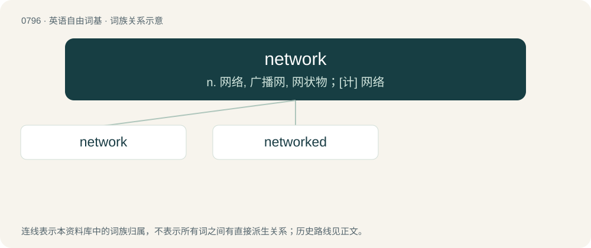

# 0868 · network — n. 网络, 广播网, 网状物；\[计\] 网络

[总目录](../00_总目录_按常用程度.md)

**类型**：英语自由词基　｜　**来源语言**：见词源记录

## 核心含义与来源

- 核心含义：n. 网络, 广播网, 网状物；\[计\] 网络
- 英文含义：Any interconnected group or system.
- 词形：network

**来源记录 1**（名词；Any interconnected group or system.）

From net + work; the nonliteral sense and its subsenses are extended from the literal sense; they are now the dominant senses. Cognate with German Netzwerk.

## 词族图

## 单词速览（常用到不常用）

| 单词 | 音标 | 释义 |
|---|---|---|
| [network](#w-1) | 英 /ˈnɛt.wɜːk/；美 /ˈnɛt.wɝk/ | n. 网络, 广播网, 网状物；\[计\] 网络 |
| [networked](#w-2) |  | a. 网路的；广播电视联播的 |

## 逐词详解

### 1. network

**词性**：名词　｜　**音标**：英 /ˈnɛt.wɜːk/；美 /ˈnɛt.wɝk/

**中文释义**：n. 网络, 广播网, 网状物；\[计\] 网络

**英文义项**：Any interconnected group or system. / A set of people with sociocultural connections to one another; especially, such a set consisting of occupational or business connections.

**构词拆分**：net + work

**词源与演化**：

From net + work; the nonliteral sense and its subsenses are extended from the literal sense; they are now the dominant senses. Cognate with German Netzwerk.

**例句**：

> The copy machine is connected to the network so it can now serve as a printer.

该用例对应义项：A computer network: multiple computers and other devices connected together to share information.

### 2. networked

**词性**：形容词

**中文释义**：a. 网路的；广播电视联播的

**英文义项**：Joined by a network, or to form a network.

**构词拆分**：network + -ed

**词源与演化**：

From network + -ed.

**例句**：

> I have a networked personal computer.
