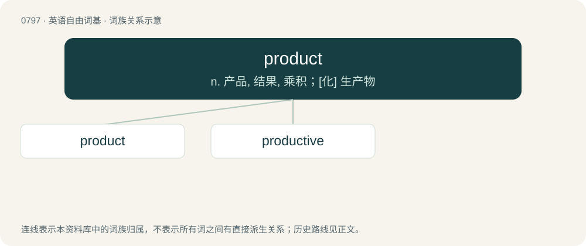

# 0869 · product — n. 产品, 结果, 乘积；\[化\] 生产物

[总目录](../00_总目录_按常用程度.md)

**类型**：英语自由词基　｜　**来源语言**：见词源记录

## 核心含义与来源

- 核心含义：n. 产品, 结果, 乘积；\[化\] 生产物
- 英文含义：Anything that is produced; a result.
- 词形：product

**来源记录 1**（名词；Anything that is produced; a result.）

From Middle English product, from Latin prōductus, perfect participle of prōdūcō, first attested in English in the mathematics sense.

## 词族图

## 单词速览（常用到不常用）

| 单词 | 音标 | 释义 |
|---|---|---|
| [product](#w-1) | 英 /ˈpɹɒd.əkt/；美 /ˈpɹɑ.dəkt/ | n. 产品, 结果, 乘积；\[化\] 生产物 |
| [productive](#w-2) | /pɹəˈdʌk.tɪv/ | a. 能生产的, 有生产价值的, 多产的；\[医\] 产出性的, 产生性的 |

## 逐词详解

### 1. product

**词性**：名词　｜　**音标**：英 /ˈpɹɒd.əkt/；美 /ˈpɹɑ.dəkt/

**中文释义**：n. 产品, 结果, 乘积；\[化\] 生产物

**英文义项**：Anything that is produced; a result. / The amount of an artifact that has been created by someone or some process.

**词源与演化**：

From Middle English product, from Latin prōductus, perfect participle of prōdūcō, first attested in English in the mathematics sense.

**例句**：

> They improve their product every year; they export most of their agricultural production.

该用例对应义项：The amount of an artifact that has been created by someone or some process.

### 2. productive

**词性**：形容词　｜　**音标**：/pɹəˈdʌk.tɪv/

**中文释义**：a. 能生产的, 有生产价值的, 多产的；\[医\] 产出性的, 产生性的

**英文义项**：Capable of producing something, especially in abundance; fertile. / Yielding good or useful results; constructive.

**构词拆分**：product + -ive

**词源与演化**：

Borrowed from Late Latin productivus, equivalent to product + -ive.

**用法示例／搭配（非完整句）**：

> a productive set

该用例对应义项：A type of set of natural numbers, related to mathematical logic; a set S is productive if there exists a total recursive function f such that ∀x∈ℕ,~~W\_x⊆S⇒f(x)∈A⧵W\_x, where W\_x is a recursive function whose Gödel number is x.
