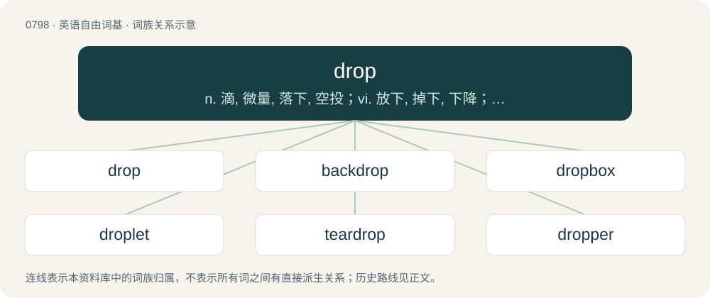

# 0870 · drop — n. 滴, 微量, 落下, 空投；vi. 放下, 掉下, 下降；vt. 使滴下, 放下, 丢失, 遗漏

[总目录](../00_总目录_按常用程度.md)

**类型**：英语自由词基　｜　**来源语言**：见词源记录

## 核心含义与来源

- 核心含义：n. 滴, 微量, 落下, 空投；vi. 放下, 掉下, 下降；vt. 使滴下, 放下, 丢失, 遗漏
- 英文含义：A small quantity of liquid, just large enough to hold its own rounded shape through surface tension, especially one that falls from a source of liquid.
- 词形：drop

**多个词源／构词路径**：同一拼写可能有不同来源；以下按词性和含义分别列出。

**来源记录 1**（名词；A small quantity of liquid, just large enough to hold its own rounded shape through surface tension, especially one that falls from a source of liquid.）

From Late Middle English droppe, Middle English drope (“small quantity of liquid; small or least amount of something; pendant jewel; dripping of a liquid; a shower; nasal flow, catarrh; speck, spot; blemish; disease causing spots on the skin”) \[and other forms\], from Old English dropa (“a drop”), from Proto-West Germanic \*dropō (“drop (of liquid)”), from Proto-Germanic \*drupô (“drop (of liquid)”),, from \*dreupaną (“to drip, droop”), from Proto-Indo-European \*dʰrebʰ- (“to drip, drop”). Cognates Cognate with Saterland Frisian Droupe, Druppe (“drop”), Dutch drop, drup (“droplet”), German Tropfen (“drop”), German Low German Drüpp (“drop”), Luxembourgish Drëps (“drop”), Vilamovian tropa, troppa (“drop”), Yiddish טראָפּן (tropn, “drop”), Danish dråbe (“drop”), Faroese and Icelandic dropi (“drop”), Norwegian Bokmål dråpe (“drop”), Norwegian Nynorsk drope (“drop”), Swedish droppe (“drop”).

**来源记录 2**（动词；Of a liquid: to fall in drops or droplets.）

From Middle English droppen, dropen (“to fall in drops, drip or trickle down; to scatter, sprinkle; to be covered with a liquid; to give off moisture; of an object: to drop, fall; of a living being: to fall to the ground”) \[and other forms\], from Old English droppian, dropian (“to drop”), from Proto-West Germanic \*dropōn, from Proto-Germanic \*drupōną (“to fall in drops, drip”), ultimately from \*dreupaną (“to hang, droop; drop, drip”), from Proto-Indo-European \*dʰrebʰ- (“to drip, drop”). Cognates Cognate with West Frisian drippe (“to drip”), Dutch druipen (“to drip”), German triefen (“to drip”), Yiddish טריפֿן (trifn, “to drip”), Icelandic drjúpa (“to drip”), Norwegian Nynorsk drjupa, drypa, drype (“to drip”), Swedish drypa (“to drip”).

## 词族图

## 单词速览（常用到不常用）

| 单词 | 音标 | 释义 |
|---|---|---|
| [drop](#w-1) | 英 /dɹɒp/；美 /dɹɑp/ | n. 滴, 微量, 落下, 空投；vi. 放下, 掉下, 下降；vt. 使滴下, 放下, 丢失, 遗漏 |
| [backdrop](#w-2) | 英 /ˈbæk.dɹɒp/；美 /ˈbæk.dɹɑp/ | n. 背景幕, 背景 |
| [dropbox](#w-3) | 英 /ˈdɹɒp.bɒks/；美 /ˈdɹɑp.bɑks/ | 【英文】A box wherein objects can be deposited by one person for later collection by another. |
| [droplet](#w-4) | 英 /ˈdɹɒplət/；美 /ˈdɹɑplət/ | n. 小滴；\[医\] 小滴 |
| [teardrop](#w-5) | /ˈtɪədɹɒp/ | n. 泪珠, 泪珠状物 |
| [dropper](#w-6) | 英 /ˈdɹɒp.ə/；美 /ˈdɹɑ.pɚ/ | n. 滴管, 落下的人(或物)；\[化\] 滴管 |
| [airdrop](#w-7) | /ˈєədrɒp/ | n. 空投；vt. 空投 |
| [eavesdrop](#w-8) | 英 /ˈiːvzˌdɹɒp/；美 /ˈivzˌdɹɑp/ | v. 偷听；n. 屋檐水, 偷听 |
| [raindrop](#w-9) | 英 /ˈɹeɪndɹɒp/；美 /ˈɹeɪndɹɑp/ | n. 雨滴, 雨点 |
| [dropship](#w-10) | /ˈdɹɒpˌʃɪp/ | 【英文】A flying transport that drops troops or equipment onto a planet, etc. |
| [snowdrop](#w-11) | 英 /ˈsnəʊ.dɹɒp/；美 /ˈsnoʊ.dɹɑp/ | n. 雪花莲, (美)(非正式)宪兵 |

## 逐词详解

### 1. drop

**词性**：名词　｜　**音标**：英 /dɹɒp/；美 /dɹɑp/

**中文释义**：n. 滴, 微量, 落下, 空投；vi. 放下, 掉下, 下降；vt. 使滴下, 放下, 丢失, 遗漏

**英文义项**：A small quantity of liquid, just large enough to hold its own rounded shape through surface tension, especially one that falls from a source of liquid. / A dose of liquid medicine in the form of a drop (sense 1).

**词源与演化**：

From Late Middle English droppe, Middle English drope (“small quantity of liquid; small or least amount of something; pendant jewel; dripping of a liquid; a shower; nasal flow, catarrh; speck, spot; blemish; disease causing spots on the skin”) \[and other forms\], from Old English dropa (“a drop”), from Proto-West Germanic \*dropō (“drop (of liquid)”), from Proto-Germanic \*drupô (“drop (of liquid)”),, from \*dreupaną (“to drip, droop”), from Proto-Indo-European \*dʰrebʰ- (“to drip, drop”). Cognates Cognate with Saterland Frisian Droupe, Druppe (“drop”), Dutch drop, drup (“droplet”), German Tropfen (“drop”), German Low German Drüpp (“drop”), Luxembourgish Drëps (“drop”), Vilamovian tropa, troppa (“drop”), Yiddish טראָפּן (tropn, “drop”), Danish dråbe (“drop”), Faroese and Icelandic dropi (“drop”), Norwegian Bokmål dråpe (“drop”), Norwegian Nynorsk drope (“drop”), Swedish droppe (“drop”).

**例句**：

> He usually enjoys a drop after dinner. She won’t touch a drop while she’s on duty.

该用例对应义项：A small amount of an alcoholic beverage.

### 2. backdrop

**词性**：名词　｜　**音标**：英 /ˈbæk.dɹɒp/；美 /ˈbæk.dɹɑp/

**中文释义**：n. 背景幕, 背景

**英文义项**：A decorated cloth hung at the back of a stage. / An image that serves as a visual background.

**构词拆分**：back + drop

**词源与演化**：

From back + drop.

**例句**：

> Against a backdrop of falling interest rates, the new savings account is looking less appealing.

该用例对应义项：Any background situation.

### 3. dropbox

**词性**：名词　｜　**音标**：英 /ˈdɹɒp.bɒks/；美 /ˈdɹɑp.bɑks/

**英文义项**：A box wherein objects can be deposited by one person for later collection by another. / A computer folder to which files may be dragged and dropped and from which users of other computers on the network can access those files.

**构词拆分**：drop + box

**词源与演化**：

From drop + box.

### 4. droplet

**词性**：名词　｜　**音标**：英 /ˈdɹɒplət/；美 /ˈdɹɑplət/

**中文释义**：n. 小滴；\[医\] 小滴

**英文义项**：A very small drop.

**构词拆分**：drop + -let

**词源与演化**：

From drop + -let.

**例句**：

> What's the volume of a single water droplet?

### 5. teardrop

**词性**：名词　｜　**音标**：/ˈtɪədɹɒp/

**中文释义**：n. 泪珠, 泪珠状物

**英文义项**：a single tear (clear, salty liquid secreted by the eye). / The shape of a drop of liquid about to fall. (Note that once detached from a surface, a drop changes shape to become spherical).

**构词拆分**：tear + drop

**词源与演化**：

From tear + drop.

**例句**：

> Devin's teardrop landed on Cody's head.

该用例对应义项：a single tear (clear, salty liquid secreted by the eye).

### 6. dropper

**词性**：名词　｜　**音标**：英 /ˈdɹɒp.ə/；美 /ˈdɹɑ.pɚ/

**中文释义**：n. 滴管, 落下的人(或物)；\[化\] 滴管

**英文义项**：A utensil for dispensing a single drop of liquid at a time. / One who drops something, especially one who drops a specific item to cause mischief.

**构词拆分**：drop + -er

**词源与演化**：

From drop + -er.

**例句**：

> The dropper left the suitcase with the bomb next to the garbage can.

该用例对应义项：One who drops something, especially one who drops a specific item to cause mischief.

### 7. airdrop

**词性**：名词　｜　**音标**：/ˈєədrɒp/

**中文释义**：n. 空投；vt. 空投

**英文义项**：The act of delivering goods, equipment, or personnel by dropping them from an aircraft in flight. / The distribution of free tokens to help bootstrap a new cryptocurrency.

**构词拆分**：air + drop

**词源与演化**：

From air + drop.

**例句**：

> Until then, front line troops will be supplied by airdrop.

该用例对应义项：delivery of supplies or equipment or personnel by dropping them by parachute from an aircraft

### 8. eavesdrop

**词性**：动词　｜　**音标**：英 /ˈiːvzˌdɹɒp/；美 /ˈivzˌdɹɑp/

**中文释义**：v. 偷听；n. 屋檐水, 偷听

**英文义项**：To hear (intentionally) a conversation one is not intended to hear; to listen in. / To listen for another organism's calls, so as to exploit them.

**构词拆分**：eaves + drop

**词源与演化**：

From eaves + drop; the "listening" sense derives from the notion of the listener standing in the area denoted by the physical sense.

**例句**：

> I swear I didn't mean to eavesdrop; my hearing is just very good.

### 9. raindrop

**词性**：名词　｜　**音标**：英 /ˈɹeɪndɹɒp/；美 /ˈɹeɪndɹɑp/

**中文释义**：n. 雨滴, 雨点

**英文义项**：A single droplet of rainwater that has just fallen or is falling from the sky.

**构词拆分**：rain + drop

**词源与演化**：

From Middle English rein-drope, reyn-drope, reyn drope, from Old English reġndropa, from Proto-Germanic \*regnadrupô. Equivalent to rain + drop. Cognate with Saterland Frisian Riendruppe, West Frisian reindrip, Dutch regendroppel, regendruppel, German Low German Regendrüpp, German Regentropfen, Swedish regndroppe, Icelandic regndropi.

**例句**：

> A raindrop splashed on her cheek.

### 10. dropship

**词性**：名词　｜　**音标**：/ˈdɹɒpˌʃɪp/

**英文义项**：A flying transport that drops troops or equipment onto a planet, etc.

**构词拆分**：drop + ship

**词源与演化**：

From drop + ship.

### 11. snowdrop

**词性**：名词　｜　**音标**：英 /ˈsnəʊ.dɹɒp/；美 /ˈsnoʊ.dɹɑp/

**中文释义**：n. 雪花莲, (美)(非正式)宪兵

**英文义项**：Any of the 20 species of the genus Galanthus of the Amaryllidaceae, bulbous flowering plants, bearing a solitary, pendulous, white, bell-shaped flower that appears, depending on species, between autumn and late winter or early spring, all native to temperate Eurasia.

**构词拆分**：snow + drop

**词源与演化**：

From snow + drop.

**例句**：

> I saw my first snowdrop of the year today!
