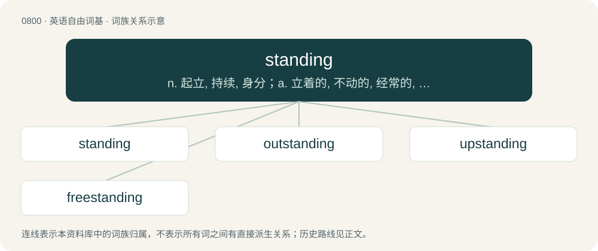

# 0872 · standing — n. 起立, 持续, 身分；a. 立着的, 不动的, 经常的, 持续的

[总目录](../00_总目录_按常用程度.md)

**类型**：英语自由词基　｜　**来源语言**：见词源记录

## 核心含义与来源

- 核心含义：n. 起立, 持续, 身分；a. 立着的, 不动的, 经常的, 持续的
- 英文含义：Erect, not cut down.
- 词形：standing

**多个词源／构词路径**：同一拼写可能有不同来源；以下按词性和含义分别列出。

**来源记录 1**（形容词；Erect, not cut down.）

From Middle English standynge, stondynge, standende, stondinde, standande, stondande, from Old English standende, stondende, from Proto-Germanic \*standandz (“standing”), present participle of Proto-Germanic \*standaną (“to stand”), equivalent to stand + -ing.

**来源记录 2**（名词；Position or reputation in society or a profession.）

From Middle English standyng, stonding, stondung, from Old English \*standung, equivalent to stand + -ing.

## 词族图

## 单词速览（常用到不常用）

| 单词 | 音标 | 释义 |
|---|---|---|
| [standing](#w-1) | /ˈstændɪŋ/ | n. 起立, 持续, 身分；a. 立着的, 不动的, 经常的, 持续的 |
| [outstanding](#w-2) | 英 /ˌaʊtˈstæn.dɪŋ/ | a. 杰出的, 突出的, 未偿付的, 未决定的；\[经\] 未解决的, 未偿付 |
| [upstanding](#w-3) | /ʌpˈstændɪŋ/ | a. 直立的, 姿势笔直的, 正直的 |
| [freestanding](#w-4) | /ˈfriːstændiŋ/ | a. 独立式的, 不需依靠支撑物的 |

## 逐词详解

### 1. standing

**词性**：形容词　｜　**音标**：/ˈstændɪŋ/

**中文释义**：n. 起立, 持续, 身分；a. 立着的, 不动的, 经常的, 持续的

**英文义项**：Erect, not cut down. / Performed from an erect position.

**构词拆分**：stand + -ing

**词源与演化**：

From Middle English standynge, stondynge, standende, stondinde, standande, stondande, from Old English standende, stondende, from Proto-Germanic \*standandz (“standing”), present participle of Proto-Germanic \*standaną (“to stand”), equivalent to stand + -ing.

**用法示例／搭配（非完整句）**：

> a standing bed, distinguished from a trundle-bed

该用例对应义项：Not movable; fixed.

### 2. outstanding

**词性**：形容词　｜　**音标**：英 /ˌaʊtˈstæn.dɪŋ/

**中文释义**：a. 杰出的, 突出的, 未偿付的, 未决定的；\[经\] 未解决的, 未偿付

**英文义项**：Prominent or noticeable; sovereign. / Exceptionally good; distinguished from others by its superiority.

**构词拆分**：out- + standing；outstand + -ing

**词源与演化**：

From outstand, equivalent to out- + standing or outstand + -ing.

**例句**：

> You must pay any outstanding corporate card balance immediately.

该用例对应义项：Owed as a debt.

### 3. upstanding

**词性**：形容词　｜　**音标**：/ʌpˈstændɪŋ/

**中文释义**：a. 直立的, 姿势笔直的, 正直的

**英文义项**：Honest; reputable; respectable.

**构词拆分**：From up- + standing.

**词源与演化**：

From up- + standing.

**例句**：

> An upstanding merchant will exchange a faulty product.

该用例对应义项：Honest; reputable; respectable.

### 4. freestanding

**词性**：形容词　｜　**音标**：/ˈfriːstændiŋ/

**中文释义**：a. 独立式的, 不需依靠支撑物的

**英文义项**：Standing or set apart. / Not attached to anything.

**构词拆分**：free + standing

**词源与演化**：

From free + standing.

**例句**：

> The Leaning Tower of Pisa is a freestanding bell tower.

该用例对应义项：Standing or set apart.
