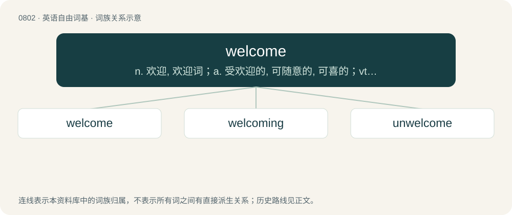

# 0874 · welcome — n. 欢迎, 欢迎词；a. 受欢迎的, 可随意的, 可喜的；vt. 欢迎, 接待

[总目录](../00_总目录_按常用程度.md)

**类型**：英语自由词基　｜　**来源语言**：见词源记录

## 核心含义与来源

- 核心含义：n. 欢迎, 欢迎词；a. 受欢迎的, 可随意的, 可喜的；vt. 欢迎, 接待
- 英文含义：Whose arrival is a cause of joy; received with gladness; admitted willingly to the house, entertainment, or company.
- 词形：welcome

**来源记录 1**（形容词；Whose arrival is a cause of joy; received with gladness; admitted willingly to the house, entertainment, or company.）

From Middle English welcome, wolcume, wulcume, wilcume, from Old English wilcuma (“a wished-for guest”; compare also wilcume (“welcome!”, interjection)), from Proto-West Germanic \*willjakwemō, from Proto-Germanic \*wiljakwemô (“a wished-for arrival or guest”), possibly from \*wiljakwemaną (“to be welcome”), equivalent to will (“desire”) + come (“comer, arrival”). The component wil- was replaced by wel- when the sense “guest” of the second component was no longer understood, likely under influence from the adverb well. Cognates Cognate with Scots walcome, Yola welcome, welkome, North Frisian welkimen, Saterland Frisian wilkemen, wäilkeemen, wülkemen, West Frisian wolkom, Alemannic German wol chomne, wolgcheemen, woul chemne, wéllkòmm, Cimbrian bóolkhèmm, Dutch welkom (earlier willecome), German willkommen, German Low German willkamen, Limburgish welkom, wéllekemm, Luxembourgish wëllkomm, Danish and Norwegian Bokmål velkommen, Elfdalian welkumin, Faroese vælkomin, Icelandic velkominn, Norwegian Nynorsk velkomen, Swedish välkommen, and Old French wilecome (whence Middle French willecomme (“welcome”)), from Germanic. The verb is from Middle English welcomen, wolcumen, wilcumen, from Old English wellcumian, wylcumian, wilcumian (“to welcome, receive gladly”). Similar constructions are found in Modern Greek καλώς ορίσατε (kalós orísate), South Slavic languages, such as Bulgarian добре́ дошъ́л (dobré došắl), Serbo-Croatian dobrodošao, and also in Romance languages, such as Italian benvenuto, Spanish bienvenido, French bienvenu, Catalan benvingut, Portuguese bem-vindo and Romanian bun venit, meaning “\[may you have fared\] well \[in\] coming \[here\]”. These Romance terms do not derive from a Classical Latin root, as no similar construction in Latin is found to exist, but are instead presumed (considering the ruling elite of the Germanic kingdoms which succeeded the Western Roman Empire) to be the result of a calque from a Germanic language into Proto-Romance (Vulgar Latin; see Latin \*bene venūtus, and compare perdōnō and compāniō for similar historical calques).

## 词族图

## 单词速览（常用到不常用）

| 单词 | 音标 | 释义 |
|---|---|---|
| [welcome](#w-1) | 英 /ˈwɛl.kəm/ | n. 欢迎, 欢迎词；a. 受欢迎的, 可随意的, 可喜的；vt. 欢迎, 接待 |
| [welcoming](#w-2) | /ˈwelkəmɪŋ/ | v. 欢迎( welcome的现在分词 ); 迎接; 乐于接受; 希望有 |
| [unwelcome](#w-3) | /ʌnˈwɛlkəm/ | a. 不受欢迎的, 讨厌的；n. 冷淡；vt. 冷淡地对待, 冷淡地接受 |

## 逐词详解

### 1. welcome

**词性**：形容词　｜　**音标**：英 /ˈwɛl.kəm/

**中文释义**：n. 欢迎, 欢迎词；a. 受欢迎的, 可随意的, 可喜的；vt. 欢迎, 接待

**英文义项**：Whose arrival is a cause of joy; received with gladness; admitted willingly to the house, entertainment, or company. / Producing gladness.

**构词拆分**：will (“desire”) + come (“comer, arrival”)

**词源与演化**：

From Middle English welcome, wolcume, wulcume, wilcume, from Old English wilcuma (“a wished-for guest”; compare also wilcume (“welcome!”, interjection)), from Proto-West Germanic \*willjakwemō, from Proto-Germanic \*wiljakwemô (“a wished-for arrival or guest”), possibly from \*wiljakwemaną (“to be welcome”), equivalent to will (“desire”) + come (“comer, arrival”). The component wil- was replaced by wel- when the sense “guest” of the second component was no longer understood, likely under influence from the adverb well. Cognates Cognate with Scots walcome, Yola welcome, welkome, North Frisian welkimen, Saterland Frisian wilkemen, wäilkeemen, wülkemen, West Frisian wolkom, Alemannic German wol chomne, wolgcheemen, woul chemne, wéllkòmm, Cimbrian bóolkhèmm, Dutch welkom (earlier willecome), German willkommen, German Low German willkamen, Limburgish welkom, wéllekemm, Luxembourgish wëllkomm, Danish and Norwegian Bokmål velkommen, Elfdalian welkumin, Faroese vælkomin, Icelandic velkominn, Norwegian Nynorsk velkomen, Swedish välkommen, and Old French wilecome (whence Middle French willecomme (“welcome”)), from Germanic. The verb is from Middle English welcomen, wolcumen, wilcumen, from Old English wellcumian, wylcumian, wilcumian (“to welcome, receive gladly”). Similar constructions are found in Modern Greek καλώς ορίσατε (kalós orísate), South Slavic languages, such as Bulgarian добре́ дошъ́л (dobré došắl), Serbo-Croatian dobrodošao, and also in Romance languages, such as Italian benvenuto, Spanish bienvenido, French bienvenu, Catalan benvingut, Portuguese bem-vindo and Romanian bun venit, meaning “\[may you have fared\] well \[in\] coming \[here\]”. These Romance terms do not derive from a Classical Latin root, as no similar construction in Latin is found to exist, but are instead presumed (considering the ruling elite of the Germanic kingdoms which succeeded the Western Roman Empire) to be the result of a calque from a Germanic language into Proto-Romance (Vulgar Latin; see Latin \*bene venūtus, and compare perdōnō and compāniō for similar historical calques).

**例句**：

> You are welcome to the use of my library.

该用例对应义项：Followed by to: free to have or enjoy gratuitously.

### 2. welcoming

**词性**：形容词　｜　**音标**：/ˈwelkəmɪŋ/

**中文释义**：v. 欢迎( welcome的现在分词 ); 迎接; 乐于接受; 希望有

**英文义项**：hospitable, accessible and cordial.

**构词拆分**：welcome + -ing

**词源与演化**：

From welcome + -ing.

**例句**：

> Johnson transformed the interior of her shop into a welcoming, homey environment.

### 3. unwelcome

**词性**：形容词　｜　**音标**：/ʌnˈwɛlkəm/

**中文释义**：a. 不受欢迎的, 讨厌的；n. 冷淡；vt. 冷淡地对待, 冷淡地接受

**英文义项**：Not welcome.

**构词拆分**：un- + welcome

**词源与演化**：

From Middle English unwelcome, unwelcum; equivalent to un- + welcome.

**例句**：

> The English teacher ridiculed the foreign students' cultural differences, making them feel unwelcome.
