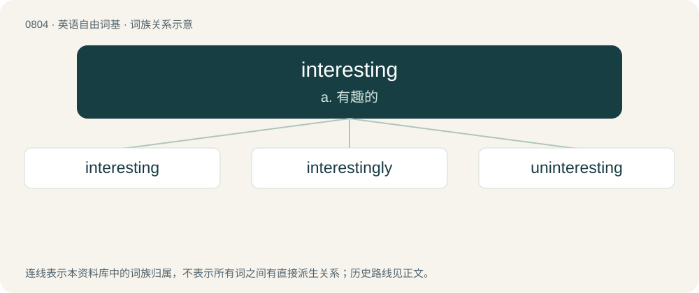

# 0876 · interesting — a. 有趣的

[总目录](../00_总目录_按常用程度.md)

**类型**：英语自由词基　｜　**来源语言**：见词源记录

## 核心含义与来源

- 核心含义：a. 有趣的
- 英文含义：Arousing or holding the attention or interest of someone.
- 词形：interesting

**来源记录 1**（形容词；Arousing or holding the attention or interest of someone.）

From interest + -ing.

## 词族图

## 单词速览（常用到不常用）

| 单词 | 音标 | 释义 |
|---|---|---|
| [interesting](#w-1) | 英 /ˈɪntɹəstɪŋ/；美 /ˈɪntəɹəstɪŋ/ | a. 有趣的 |
| [interestingly](#w-2) | /ˈintristiŋli/ | adv. 有趣地 |
| [uninteresting](#w-3) | /.ʌnˈintəristiŋ/ | a. 引不起兴趣的, 无趣味的, 乏味的 |

## 逐词详解

### 1. interesting

**词性**：形容词　｜　**音标**：英 /ˈɪntɹəstɪŋ/；美 /ˈɪntəɹəstɪŋ/

**中文释义**：a. 有趣的

**英文义项**：Arousing or holding the attention or interest of someone. / Pregnant. (used with situation and condition)

**构词拆分**：From interest + -ing.

**词源与演化**：

From interest + -ing.

**例句**：

> It is said that "Hamlet" is the most interesting play ever written.

### 2. interestingly

**词性**：副词　｜　**音标**：/ˈintristiŋli/

**中文释义**：adv. 有趣地

**英文义项**：In an interesting way. / It is interesting to note that…

**构词拆分**：interesting + -ly

**词源与演化**：

From interesting + -ly.

**例句**：

> When he ceases to be just interestingly neurotic and...gets locked up.

该用例对应义项：in an interesting manner

### 3. uninteresting

**词性**：形容词　｜　**音标**：/.ʌnˈintəristiŋ/

**中文释义**：a. 引不起兴趣的, 无趣味的, 乏味的

**英文义项**：Arousing little or no interest; boring or uneventful.

**构词拆分**：un- + interesting

**词源与演化**：

From un- + interesting.

**例句**：

> A very uninteresting account of her trip.

该用例对应义项：arousing no interest or attention or curiosity or excitement
