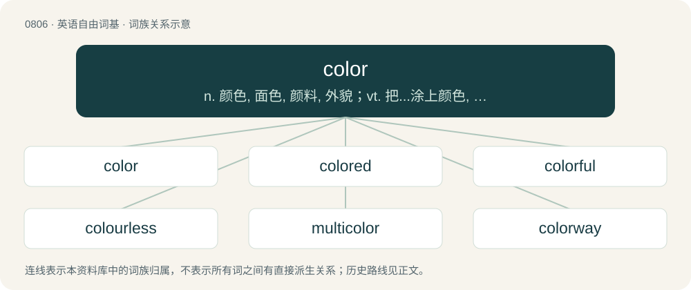

# 0877 · color — n. 颜色, 面色, 颜料, 外貌；vt. 把...涂上颜色, 粉饰, 使脸红, 歪曲；vi. 变色

[总目录](../00_总目录_按常用程度.md)

**类型**：英语自由词基　｜　**来源语言**：见词源记录

## 核心含义与来源

- 核心含义：n. 颜色, 面色, 颜料, 外貌；vt. 把...涂上颜色, 粉饰, 使脸红, 歪曲；vi. 变色
- 英文含义：The spectral composition of visible light.
- 词形：color

**来源记录 1**（名词；The spectral composition of visible light.）

From Middle English colour, color, borrowed from Anglo-Norman colur, from Old French colour, color, from Latin color. Doublet of couleur. Largely displaced English blee, Middle English blee (“color”), from Old English blēo. Also partially replaced Old English hīew (“color”) and its descendants (English hue), which is less often used in this sense. The spelling color was popularized in modern American English by Noah Webster, to match the spelling of the word's Latin etymon, and make all American spellings of the derivatives consistent (colorimeter, coloration, colorize, colorless, etc).

## 词族图

## 单词速览（常用到不常用）

| 单词 | 音标 | 释义 |
|---|---|---|
| [color](#w-1) | 英 /ˈkʌl.ə(ɹ)/；美 /ˈkʌl.ɚ/ | n. 颜色, 面色, 颜料, 外貌；vt. 把...涂上颜色, 粉饰, 使脸红, 歪曲；vi. 变色 |
| [colored](#w-2) | 英 /ˈkʌləd/；美 /ˈkʌləɹd/ | a. 染色的；\[建\] 有色的 |
| [colorful](#w-3) | 英 /ˈkʌl.ə.fl̩/；美 /ˈkʌl.əɹ.fl̩/ | a. 华美的, 富有色彩的, 有趣的 |
| [colourless](#w-4) | 英 /ˈkʌlə(ɹ).ləs/ | a. 无色的, 无血色的, 无趣味的, 无特色的, 不生动的, 单调的, 不偏不倚的 |
| [multicolor](#w-5) | /ˌmʌltɪˈkʌlə/ | \[计\] 多色绘图的；\[医\] 多色的, 杂色的 |
| [colorway](#w-6) | /ˈkʌləɹˌweɪ/ | n. 色彩设计 |
| [colorist](#w-7) | /ˈkʌlərist/ | n. 善于运用色彩的画家, 配色师, 着色师；\[建\] 着色师 |
| [discolor](#w-8) | /dɪsˈkʰʌlə(ɹ)/ | vi.vt. (使)变色, 污染, (使)褪色；\[计\] 变色, 褪色 |

## 逐词详解

### 1. color

**词性**：名词　｜　**音标**：英 /ˈkʌl.ə(ɹ)/；美 /ˈkʌl.ɚ/

**中文释义**：n. 颜色, 面色, 颜料, 外貌；vt. 把...涂上颜色, 粉饰, 使脸红, 歪曲；vi. 变色

**英文义项**：The spectral composition of visible light. / A particular set of visible spectral compositions, perceived or named as a class.

**词源与演化**：

From Middle English colour, color, borrowed from Anglo-Norman colur, from Old French colour, color, from Latin color. Doublet of couleur. Largely displaced English blee, Middle English blee (“color”), from Old English blēo. Also partially replaced Old English hīew (“color”) and its descendants (English hue), which is less often used in this sense. The spelling color was popularized in modern American English by Noah Webster, to match the spelling of the word's Latin etymon, and make all American spellings of the derivatives consistent (colorimeter, coloration, colorize, colorless, etc).

**例句**：

> Could you give me some color with regards to which products made up the mix of revenue for this quarter?

该用例对应义项：Richness of expression; detail or flavour that is likely to generate interest or enjoyment.

### 2. colored

**词性**：形容词　｜　**音标**：英 /ˈkʌləd/；美 /ˈkʌləɹd/

**中文释义**：a. 染色的；\[建\] 有色的

**英文义项**：Having a color. / Having a particular color or kind of color.

**构词拆分**：color + -ed

**词源与演化**：

From color + -ed.

**例句**：

> Wash colored items separately from whites and darks to prevent the colors from bleeding.

该用例对应义项：Having a color.

### 3. colorful

**词性**：形容词　｜　**音标**：英 /ˈkʌl.ə.fl̩/；美 /ˈkʌl.əɹ.fl̩/

**中文释义**：a. 华美的, 富有色彩的, 有趣的

**英文义项**：Possessing prominent and varied colors. / Interesting, multifaceted, energetic, distinctive.

**构词拆分**：color + -ful

**词源与演化**：

From color + -ful.

**例句**：

> I love looking at everyone's colorful kimonos on Coming of Age Day.

### 4. colourless

**词性**：形容词　｜　**音标**：英 /ˈkʌlə(ɹ).ləs/

**中文释义**：a. 无色的, 无血色的, 无趣味的, 无特色的, 不生动的, 单调的, 不偏不倚的

**英文义项**：Having little or no colour. / Water white.

**构词拆分**：color + -less

**词源与演化**：

From colour + -less.

**例句**：

> I can't imagine how much more colourless life would be without multiple languages.

### 5. multicolor

**词性**：名词　｜　**音标**：/ˌmʌltɪˈkʌlə/

**中文释义**：\[计\] 多色绘图的；\[医\] 多色的, 杂色的

**英文义项**：A display of many colors.

**构词拆分**：multi- + color

**词源与演化**：

Borrowed from Latin multicolor, equivalent to multi- + color; see below.

**用法示例／搭配（非完整句）**：

> a stamp printed in multicolor

该用例对应义项：A display of many colors.

### 6. colorway

**词性**：名词　｜　**音标**：/ˈkʌləɹˌweɪ/

**中文释义**：n. 色彩设计

**英文义项**：Any of the schemes of two or more colors in which a design is available.

**构词拆分**：color + way

**词源与演化**：

From color + way.

**例句**：

> This shirt comes in three colorways: taupe, red, and navy.

该用例对应义项：Any of the schemes of two or more colors in which a design is available.

### 7. colorist

**词性**：名词　｜　**音标**：/ˈkʌlərist/

**中文释义**：n. 善于运用色彩的画家, 配色师, 着色师；\[建\] 着色师

**英文义项**：One who colors; an artist with a talent for coloring. / A hairdresser who is a specialist in coloring and tinting hair.

**构词拆分**：color + -ist

**词源与演化**：

From color + -ist.

### 8. discolor

**词性**：动词　｜　**音标**：/dɪsˈkʰʌlə(ɹ)/

**中文释义**：vi.vt. (使)变色, 污染, (使)褪色；\[计\] 变色, 褪色

**英文义项**：To change or lose color.

**构词拆分**：dis- + color

**词源与演化**：

From Middle English discoloren, discoloren, from Old French descolorer, discolorer, equivalent to dis- + color.

**例句**：

> Washing light laundry with dark may cause your clothes to discolor.

该用例对应义项：To change or lose color.
