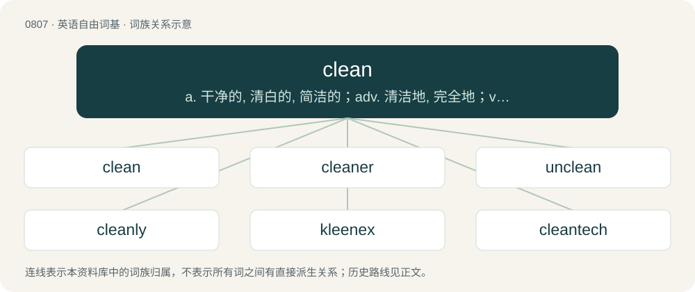

# 0878 · clean — a. 干净的, 清白的, 简洁的；adv. 清洁地, 完全地；vt. 清理, 使干净, 出空

[总目录](../00_总目录_按常用程度.md)

**类型**：英语自由词基　｜　**来源语言**：见词源记录

## 核心含义与来源

- 核心含义：a. 干净的, 清白的, 简洁的；adv. 清洁地, 完全地；vt. 清理, 使干净, 出空
- 英文含义：Free of dirt, filth, or impurities (extraneous matter); not dirty, filthy, or soiled.
- 词形：clean

**来源记录 1**（形容词；Free of dirt, filth, or impurities (extraneous matter); not dirty, filthy, or soiled.）

From Middle English clene, from Old English clāne, clǣne (“clean; pure; clear”), from Proto-West Germanic \*klainī (“dainty, fine, small; clean”), perhaps from Proto-Indo-European \*glēy- (“gleaming”), from Proto-Indo-European \*gel- (“to gleam”). Cognates Cognate with Alemannic German chlei, chli, chlii, chly, klei (“small”), Bavarian gloa, kla, klaa, kloa, kloan (“small; young; insignificant”), Central Franconian and Low German kleen (“small”), Cimbrian khlòan, khlumma (“small”), Dutch and German klein (“small”), Limburgish klein, kléïn (“small”), Luxembourgish kleng (“small”), Mòcheno khloa'n (“small”), Vilamovian klin (“small”), Yiddish קליין (kleyn, “small”), Danish klejn (“delicate, tiny”), Faroese klænur (“slight, slim, thin”), Icelandic klénn (“feeble, poor; indisposed; short; lame; good, pretty, snug”), Norwegian Bokmål klein, klen (“slender; sick; feeble; bad, poor, weak; inept”), Swedish klen (“weak”).

## 词族图

## 单词速览（常用到不常用）

| 单词 | 音标 | 释义 |
|---|---|---|
| [clean](#w-1) | 英 /kliːn/；美 /kliːn/ | a. 干净的, 清白的, 简洁的；adv. 清洁地, 完全地；vt. 清理, 使干净, 出空 |
| [cleaner](#w-2) | 英 /ˈkliː.nə/；美 /ˈkli.nɚ/ | n. 清洁工人, 清洁剂, 干洗商；\[化\] 滤清器; 除垢器; 洗净剂; 清洁剂 |
| [unclean](#w-3) | /ʌnˈkliːn/ | a. 不洁净的, 不纯洁的, 行为不检的 |
| [cleanly](#w-4) | /ˈklɛnli/ | a. 爱清洁的, 干净的, 清洁的；adv. 干净地, 利索地, 熟练地 |
| [kleenex](#w-5) | /ˈkli.nɛks/ | 【英文】A disposable tissue. |
| [cleantech](#w-6) | 英 /ˈkliː.ntɛk/ | 【英文】Technologies that support increased productivity or profitability while also reducing resource consumption or pollution. |

## 逐词详解

### 1. clean

**词性**：形容词　｜　**音标**：英 /kliːn/；美 /kliːn/

**中文释义**：a. 干净的, 清白的, 简洁的；adv. 清洁地, 完全地；vt. 清理, 使干净, 出空

**英文义项**：Free of dirt, filth, or impurities (extraneous matter); not dirty, filthy, or soiled. / Of metal, having relatively few impurities.

**词源与演化**：

From Middle English clene, from Old English clāne, clǣne (“clean; pure; clear”), from Proto-West Germanic \*klainī (“dainty, fine, small; clean”), perhaps from Proto-Indo-European \*glēy- (“gleaming”), from Proto-Indo-European \*gel- (“to gleam”). Cognates Cognate with Alemannic German chlei, chli, chlii, chly, klei (“small”), Bavarian gloa, kla, klaa, kloa, kloan (“small; young; insignificant”), Central Franconian and Low German kleen (“small”), Cimbrian khlòan, khlumma (“small”), Dutch and German klein (“small”), Limburgish klein, kléïn (“small”), Luxembourgish kleng (“small”), Mòcheno khloa'n (“small”), Vilamovian klin (“small”), Yiddish קליין (kleyn, “small”), Danish klejn (“delicate, tiny”), Faroese klænur (“slight, slim, thin”), Icelandic klénn (“feeble, poor; indisposed; short; lame; good, pretty, snug”), Norwegian Bokmål klein, klen (“slender; sick; feeble; bad, poor, weak; inept”), Swedish klen (“weak”).

**例句**：

> Mister, I want to see a clean dinner plate or there'll be no dessert for you.

该用例对应义项：Empty.

### 2. cleaner

**词性**：名词　｜　**音标**：英 /ˈkliː.nə/；美 /ˈkli.nɚ/

**中文释义**：n. 清洁工人, 清洁剂, 干洗商；\[化\] 滤清器; 除垢器; 洗净剂; 清洁剂

**英文义项**：A person whose occupation is to clean things, especially rooms, floors, and windows. / A device that cleans, such as the vacuum cleaner.

**构词拆分**：clean + -er (agent noun suffix)

**词源与演化**：

Inherited from Middle English clener, clenere, equivalent to clean + -er (agent noun suffix).

**例句**：

> I'll have to take this shirt to the cleaners.

该用例对应义项：A professional laundry or dry cleaner (business).

### 3. unclean

**词性**：形容词　｜　**音标**：/ʌnˈkliːn/

**中文释义**：a. 不洁净的, 不纯洁的, 行为不检的

**英文义项**：Dirty, soiled or foul. / Not moral or chaste.

**构词拆分**：un- + clean

**词源与演化**：

From Middle English unclene, from Old English unclǣne, equivalent to un- + clean.

**例句**：

> And the swine...is unclean to you.

该用例对应义项：having a physical or moral blemish so as to make impure according to dietary or ceremonial laws

### 4. cleanly

**词性**：形容词　｜　**音标**：/ˈklɛnli/

**中文释义**：a. 爱清洁的, 干净的, 清洁的；adv. 干净地, 利索地, 熟练地

**英文义项**：Being habitually clean, practising good hygiene.

**构词拆分**：clean + -ly

**词源与演化**：

From Middle English clenly, clenliche, clanly, from Old English clǣnlīċ (“cleanly, pure, excellent”), equivalent to clean + -ly.

**例句**：

> Cleanly in their persons and habitations.

该用例对应义项：habitually clean

### 5. kleenex

**词性**：名词　｜　**音标**：/ˈkli.nɛks/

**英文义项**：A disposable tissue.

**构词拆分**：clean + -ex

**词源与演化**：

By genericization from the name of brand of tissues trademarked by Cellucotton Products Company (now Kimberly-Clark) in 1924–25. Alteration of clean + -ex.

**例句**：

> Could you hand me a kleenex? My nose is running.

该用例对应义项：A disposable tissue.

### 6. cleantech

**词性**：名词　｜　**音标**：英 /ˈkliː.ntɛk/

**英文义项**：Technologies that support increased productivity or profitability while also reducing resource consumption or pollution.

**构词拆分**：clean + tech

**词源与演化**：

From clean + tech.
