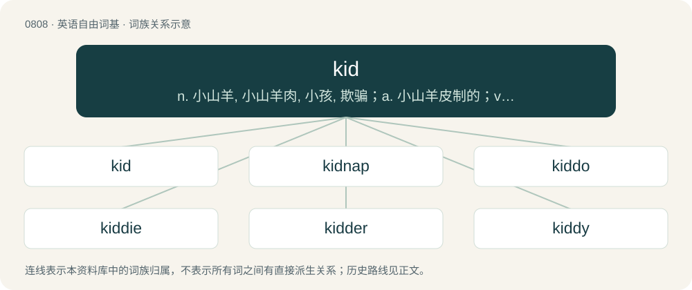

# 0879 · kid — n. 小山羊, 小山羊肉, 小孩, 欺骗；a. 小山羊皮制的；v. 哄骗, 嘲弄

[总目录](../00_总目录_按常用程度.md)

**类型**：英语自由词基　｜　**来源语言**：见词源记录

## 核心含义与来源

- 核心含义：n. 小山羊, 小山羊肉, 小孩, 欺骗；a. 小山羊皮制的；v. 哄骗, 嘲弄
- 英文含义：A child, adolescent, or (loosely) a young adult.
- 词形：kid

**多个词源／构词路径**：同一拼写可能有不同来源；以下按词性和含义分别列出。

**来源记录 1**（名词；A child, adolescent, or (loosely) a young adult.）

From Middle English kide, from Old Norse kið (“young goat”), from Proto-Germanic \*kidją, \*kittīną (“goatling, kid”), perhaps from Proto-Indo-European \*gʰaydn-, \*ǵʰaydn- (“goat”) or Proto-Indo-European \*gidʰ- (“kid, goatling, little goat”). Compare Swedish and Danish kid, German Kitz and Kitze, Albanian kedh and kec. The sense of child has been in use since the 1590s as slang, and since the 1840s in informal use.

**来源记录 2**（名词；A seed pod, usually of a leguminous plant.）

Of uncertain origin. Possibly from Middle English \*kidde, from Old English \*cydde (“pouch, belly”), from Proto-West Germanic \*kuddijā, derived from or related to Proto-Germanic \*kuddô (“bag, sack, pod, shell, husk”).

**来源记录 3**（名词；Synonym of faggot (“bundle of heath and furze”).）

Compare Welsh cidysen.

## 词族图

## 单词速览（常用到不常用）

| 单词 | 音标 | 释义 |
|---|---|---|
| [kid](#w-1) | /ˈkɪd/ | n. 小山羊, 小山羊肉, 小孩, 欺骗；a. 小山羊皮制的；v. 哄骗, 嘲弄 |
| [kidnap](#w-2) | /ˈkɪdnæp/ | vt. 绑架, 诱拐, 拐骗；\[法\] 拐带, 诱拐, 绑架 |
| [kiddo](#w-3) | 美 /ˈkɪdoʊ/ | n. 老兄, 老姐 |
| [kiddie](#w-4) | /ˈkɪdi/ | n. 小孩, 小家伙 |
| [kidder](#w-5) |  | \[人名\] 基德尔; \[地名\] \[美国\] 基德 |
| [kiddy](#w-6) | /ˈkɪdi/ | n. 小孩, 小家伙 |

## 逐词详解

### 1. kid

**词性**：名词　｜　**音标**：/ˈkɪd/

**中文释义**：n. 小山羊, 小山羊肉, 小孩, 欺骗；a. 小山羊皮制的；v. 哄骗, 嘲弄

**英文义项**：A child, adolescent, or (loosely) a young adult. / A person whose childhood took place in a particular time period or area.

**词源与演化**：

From Middle English kide, from Old Norse kið (“young goat”), from Proto-Germanic \*kidją, \*kittīną (“goatling, kid”), perhaps from Proto-Indo-European \*gʰaydn-, \*ǵʰaydn- (“goat”) or Proto-Indo-European \*gidʰ- (“kid, goatling, little goat”). Compare Swedish and Danish kid, German Kitz and Kitze, Albanian kedh and kec. The sense of child has been in use since the 1590s as slang, and since the 1840s in informal use.

**例句**：

> He treated the oxen like they didn't exist, but he treated the goat kid like a puppy.

该用例对应义项：A young goat.

### 2. kidnap

**词性**：动词　｜　**音标**：/ˈkɪdnæp/

**中文释义**：vt. 绑架, 诱拐, 拐骗；\[法\] 拐带, 诱拐, 绑架

**英文义项**：To seize or detain a person unlawfully and move or conceal them; sometimes for ransom.

**构词拆分**：kid + nap (“to nab; to grab”)

**词源与演化**：

From kid + nap (“to nab; to grab”). Originally Thieves' cant, referring to the practice of stealing children and shipping them to colonies or plantations as laborers. First attested c. 1680.

**例句**：

> You thought you were going to kidnap the kid, didn't you?

### 3. kiddo

**词性**：名词　｜　**音标**：美 /ˈkɪdoʊ/

**中文释义**：n. 老兄, 老姐

**英文义项**：A close friend; especially used as a form of address. / A child.

**构词拆分**：kid + -o

**词源与演化**：

From kid + -o; see kid (“child”).

**例句**：

> Okay, kiddo, I gotta run.

该用例对应义项：A close friend; especially used as a form of address.

### 4. kiddie

**词性**：名词　｜　**音标**：/ˈkɪdi/

**中文释义**：n. 小孩, 小家伙

**英文义项**：A child.

**构词拆分**：From kid + -ie.

**词源与演化**：

From kid + -ie.

**例句**：

> The kiddie pool was shallow so the children would be safe, which meant it was much warmer than the adult pool.

该用例对应义项：A child.

### 5. kidder

**词性**：名词

**中文释义**：\[人名\] 基德尔; \[地名\] \[美国\] 基德

**英文义项**：One who kids, or teases light-heartedly. / A term of endearment/address for a child or young adult, usually male.

**构词拆分**：From kid + -er.

**词源与演化**：

From kid + -er.

### 6. kiddy

**词性**：名词　｜　**音标**：/ˈkɪdi/

**中文释义**：n. 小孩, 小家伙

**英文义项**：A small kid (young goat).

**构词拆分**：From kid + -y.

**词源与演化**：

From kid + -y.
