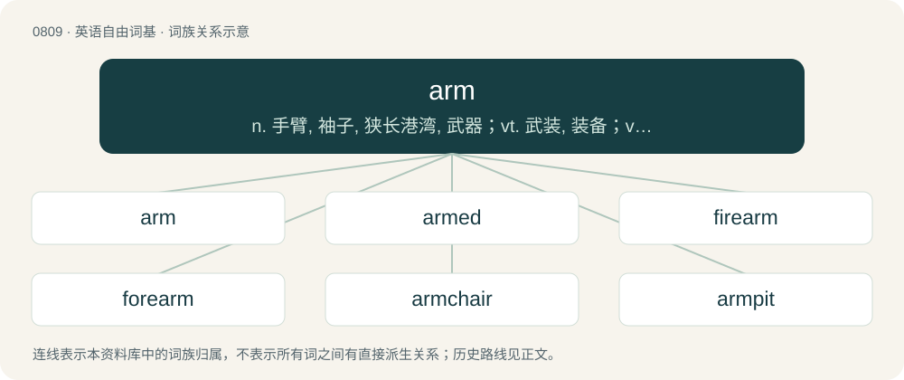

# 0880 · arm — n. 手臂, 袖子, 狭长港湾, 武器；vt. 武装, 装备；vi. 武装起来

[总目录](../00_总目录_按常用程度.md)

**类型**：英语自由词基　｜　**来源语言**：见词源记录

## 核心含义与来源

- 核心含义：n. 手臂, 袖子, 狭长港湾, 武器；vt. 武装, 装备；vi. 武装起来
- 英文含义：The portion of the upper human appendage, from the shoulder to the wrist and sometimes including the hand.
- 词形：arm

**多个词源／构词路径**：同一拼写可能有不同来源；以下按词性和含义分别列出。

**来源记录 1**（名词；The portion of the upper human appendage, from the shoulder to the wrist and sometimes including the hand.）

From Middle English arm, from Old English earm (Anglian arm), from Proto-West Germanic \*arm, from Proto-Germanic \*armaz (“arm”), from Proto-Indo-European \*h₂(e)rmos (“a fitting, joint; arm, forequarter”), a suffixed form of \*h₂er- (“to join, fit together”). Cognates Akin to Dutch arm, German Arm, Yiddish אָרעם (orem), Danish, Norwegian Bokmål, Norwegian Nynorsk, and Swedish arm. Indo-European cognates include Latin armus (“the uppermost part of the arm, shoulder”), Bulgarian рамо (ramo), Polish ramię, Serbo-Croatian rȁme, Armenian արմունկ (armunk, “elbow”), Ancient Greek ἁρμός (harmós, “joint, shoulder”) and ἅρμα (hárma, “wagon, chariot”), Avestan 𐬀𐬭𐬨𐬀 (arma), Old Persian \[script needed\] (arma).

**来源记录 2**（形容词；Poor; lacking in riches or wealth.）

From Middle English arm (“poor, wretched”), from Old English earm (“poor, miserable, pitiful, wretched”), from Proto-West Germanic \*arm, from Proto-Germanic \*armaz (“poor”), from Proto-Indo-European \*h₁erm- (“poor, ill”). Cognates Akin to Dutch arm (“poor”), German arm (“poor”), Yiddish אָרעם (orem, “poor”), Swedish arm (“poor”).

**来源记录 3**（名词；A weapon.）

Back-formation from arms (plural), from Middle English armes, from Old French armes, from Latin arma (“weapons”), from Proto-Indo-European \*h₂er-mo-, a suffixed form of \*h₂er- (“to fit together”), hence ultimately cognate with etymology 1.

## 词族图

## 单词速览（常用到不常用）

| 单词 | 音标 | 释义 |
|---|---|---|
| [arm](#w-1) | 英 /ɑːm/；美 /ɑɹm/ | n. 手臂, 袖子, 狭长港湾, 武器；vt. 武装, 装备；vi. 武装起来 |
| [armed](#w-2) | 英 /ɑːmd/；美 /ɑɹmd/ | a. 有扶手的, 武装的, 有防卫器官的；\[法\] 武装的, 持械的, "F带武器的 |
| [firearm](#w-3) | /ˈfaɪəɹˌɑː(ɹ)m/ | n. 火器, 枪炮 |
| [forearm](#w-4) | /ˈfɔːˌɹɑːm/ | n. 前臂；vt. 预先武装, 准备 |
| [armchair](#w-5) | 英 /ˈɑː(ɹ)mtʃɛə(ɹ)/；美 /ˈɑɹmt͡ʃɛɚ/ | n. 扶手椅 |
| [armpit](#w-6) | 美 /ˈɑɹmˌpɪt/ | n. 腋窝；\[医\] 腋, 腋窝 |
| [armband](#w-7) | /ˈɑːmbænd/ | n. 臂章 |
| [sidearm](#w-8) | 美 /ˈsaɪdˌɑɹm/ | a. 侧投球的 |
| [underarm](#w-9) | 美 /ˈʌndɚˌɑɹm/ | a. 腋下的 |
| [armrest](#w-10) | 美 /ˈɑɹmˌɹɛst/ | n. 扶手, 靠手 |
| [armbar](#w-11) |  | 【英文】A joint lock where the elbow is hyperextended in order to cause pain or injury. |
| [armless](#w-12) | /ˈɑːmlis/ | a. 无臂的, 无扶手的, 无武器的 |
| [rearm](#w-13) | /ˌɹiːˈɑː(ɹ)m/ | v. 重整军备, 重新武装 |

## 逐词详解

### 1. arm

**词性**：名词　｜　**音标**：英 /ɑːm/；美 /ɑɹm/

**中文释义**：n. 手臂, 袖子, 狭长港湾, 武器；vt. 武装, 装备；vi. 武装起来

**英文义项**：The portion of the upper human appendage, from the shoulder to the wrist and sometimes including the hand. / The extended portion of the upper limb, from the shoulder to the elbow.

**词源与演化**：

From Middle English arm, from Old English earm (Anglian arm), from Proto-West Germanic \*arm, from Proto-Germanic \*armaz (“arm”), from Proto-Indo-European \*h₂(e)rmos (“a fitting, joint; arm, forequarter”), a suffixed form of \*h₂er- (“to join, fit together”). Cognates Akin to Dutch arm, German Arm, Yiddish אָרעם (orem), Danish, Norwegian Bokmål, Norwegian Nynorsk, and Swedish arm. Indo-European cognates include Latin armus (“the uppermost part of the arm, shoulder”), Bulgarian рамо (ramo), Polish ramię, Serbo-Croatian rȁme, Armenian արմունկ (armunk, “elbow”), Ancient Greek ἁρμός (harmós, “joint, shoulder”) and ἅρμα (hárma, “wagon, chariot”), Avestan 𐬀𐬭𐬨𐬀 (arma), Old Persian \[script needed\] (arma).

**例句**：

> She stood with her right arm extended and her palm forward to indicate “Stop!”

该用例对应义项：The portion of the upper human appendage, from the shoulder to the wrist and sometimes including the hand.

### 2. armed

**词性**：形容词　｜　**音标**：英 /ɑːmd/；美 /ɑɹmd/

**中文释义**：a. 有扶手的, 武装的, 有防卫器官的；\[法\] 武装的, 持械的, "F带武器的

**英文义项**：Equipped, especially with a weapon. / Equipped with a gun.

**构词拆分**：arm + -ed

**词源与演化**：

From arm (“to equip with a weapon”) + -ed.

**用法示例／搭配（非完整句）**：

> nuclear-armed

该用例对应义项：Equipped, especially with a weapon.

### 3. firearm

**词性**：名词　｜　**音标**：/ˈfaɪəɹˌɑː(ɹ)m/

**中文释义**：n. 火器, 枪炮

**英文义项**：A personal weapon that uses explosive powder to propel a projectile often made of lead.

**构词拆分**：fire + arm

**词源与演化**：

From fire (“projectile discharge”) + arm (“weapon”).

**例句**：

> David was arrested for illegal possession of firearms.

该用例对应义项：A personal weapon that uses explosive powder to propel a projectile often made of lead.

### 4. forearm

**词性**：名词　｜　**音标**：/ˈfɔːˌɹɑːm/

**中文释义**：n. 前臂；vt. 预先武装, 准备

**英文义项**：The part of the arm between the wrist and the elbow. / A section of the weapon between the receiver and the muzzle, used to hold the firearm steady.

**构词拆分**：fore- + arm

**词源与演化**：

From fore- + arm. Compare Dutch voorarm (“forearm”), Danish forarm (“forearm”), German Vorderarm (“forearm”).

**例句**：

> The elbow is a joint that connects the forearm and the upper arm.

### 5. armchair

**词性**：名词　｜　**音标**：英 /ˈɑː(ɹ)mtʃɛə(ɹ)/；美 /ˈɑɹmt͡ʃɛɚ/

**中文释义**：n. 扶手椅

**英文义项**：A chair with supports for the arms or elbows. / An upholstered chair without armrests intended for the living room

**构词拆分**：arm + chair

**词源与演化**：

From arm + chair.

**例句**：

> I collapsed into an armchair.

该用例对应义项：A chair with supports for the arms or elbows.

### 6. armpit

**词性**：名词　｜　**音标**：美 /ˈɑɹmˌpɪt/

**中文释义**：n. 腋窝；\[医\] 腋, 腋窝

**英文义项**：The cavity beneath the junction of the arm and shoulder. / Somewhere or something unpleasant or undesirable.

**构词拆分**：arm + pit

**词源与演化**：

From Middle English armpitt, arme-pitt, armput, equivalent to arm + pit. (something unpleasant): Presumably a reference to underarm body odor.

**用法示例／搭配（非完整句）**：

> the armpit of America

该用例对应义项：Somewhere or something unpleasant or undesirable.

### 7. armband

**词性**：名词　｜　**音标**：/ˈɑːmbænd/

**中文释义**：n. 臂章

**英文义项**：A band worn around the arm, usually to symbolize mourning or protest. / A band worn around the arm of the captain of a team.

**构词拆分**：arm + band

**词源与演化**：

From arm + band.

**例句**：

> Only a captain should wear an armband on the field.

### 8. sidearm

**词性**：名词　｜　**音标**：美 /ˈsaɪdˌɑɹm/

**中文释义**：a. 侧投球的

**英文义项**：A personal weapon, either a firearm (handgun type) or a cold weapon (such as a sword), carried on the hip in a belt, sheath, holster, etc., for rapid access.

**构词拆分**：side + arm

**词源与演化**：

From side + arm.

### 9. underarm

**词性**：名词　｜　**音标**：美 /ˈʌndɚˌɑɹm/

**中文释义**：a. 腋下的

**英文义项**：The armpit. / Old-fashioned and now outlawed style of bowling in which the arm is not swung over the shoulder.

**构词拆分**：under- + arm

**词源与演化**：

From under- + arm. The armpit sense is not old, historically speaking (1920s), and it is believed to have arisen as a euphemism in advertising.

**用法示例／搭配（非完整句）**：

> underarm deodorant

该用例对应义项：The armpit.

### 10. armrest

**词性**：名词　｜　**音标**：美 /ˈɑɹmˌɹɛst/

**中文释义**：n. 扶手, 靠手

**英文义项**：Part of the seat of a chair that is designed to support the arm.

**构词拆分**：arm + rest

**词源与演化**：

From arm + rest.

**例句**：

> In the armrest is a cup holder.

### 11. armbar

**词性**：名词

**英文义项**：A joint lock where the elbow is hyperextended in order to cause pain or injury.

**构词拆分**：arm + bar

**词源与演化**：

From arm + bar.

### 12. armless

**词性**：形容词　｜　**音标**：/ˈɑːmlis/

**中文释义**：a. 无臂的, 无扶手的, 无武器的

**英文义项**：Having no arms.

**构词拆分**：arm + -less

**词源与演化**：

From Middle English armlees; equivalent to arm + -less.

**例句**：

> The armless Venus de Milo.

该用例对应义项：having no arms

### 13. rearm

**词性**：动词　｜　**音标**：/ˌɹiːˈɑː(ɹ)m/

**中文释义**：v. 重整军备, 重新武装

**英文义项**：To replace or restore the weapons or arms of a previously defeated, or disarmed army, country, person or other body. / To arm, or prepare for use, again.

**构词拆分**：re- + arm

**词源与演化**：

From re- + arm.

**例句**：

> After the war, the defeated country was not allowed to rearm.

该用例对应义项：arm anew
