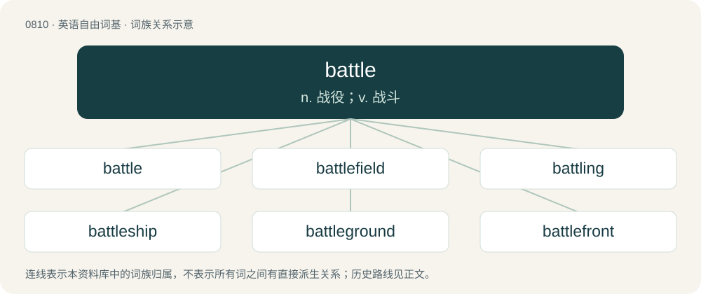

# 0881 · battle — n. 战役；v. 战斗

[总目录](../00_总目录_按常用程度.md)

**类型**：英语自由词基　｜　**来源语言**：见词源记录

## 核心含义与来源

- 核心含义：n. 战役；v. 战斗
- 英文含义：A contest, a struggle.
- 词形：battle

**多个词源／构词路径**：同一拼写可能有不同来源；以下按词性和含义分别列出。

**来源记录 1**（名词；A contest, a struggle.）

From Middle English batel, batell, batelle, batayle, bataylle, borrowed from Old French bataille, from Late Latin battālia, variant of battuālia (“fighting and fencing exercises”) from Latin battuō (“to strike, hit, beat, fight”), of uncertain origin. Possibly from a Gaulish or Proto-Germanic root from Proto-Indo-European \*bʰedʰ- (“to stab, dig”), related to Old English beado (“battle”); or possibly from a Proto-Indo-European \*bʰew- (“to hit, strike, beat”). Doublet of battalia and battel. Displaced native Old English ġefeoht, beado, camp, and wīg (“battle”), among others.

**来源记录 2**（形容词；Of grass or pasture: nutritious to cattle or sheep; fattening, nourishing.）

From Early Modern English batell, probably from Middle English \*batel (“flourishing”), from Old English \*batol (“improving, tending to be good”), from batian (“to get better, improve”) + -ol ( + -le).

## 词族图

## 单词速览（常用到不常用）

| 单词 | 音标 | 释义 |
|---|---|---|
| [battle](#w-1) | 英 /ˈbætl̩/；美 /ˈbætl̩/ | n. 战役；v. 战斗 |
| [battlefield](#w-2) | /ˈbætəlˌfiːld/ | n. 战场, 沙场 |
| [battling](#w-3) | /ˈbæt(ə)l/ | 【英文】Engaged in battle. |
| [battleship](#w-4) | 美 /ˈbætəlˌʃɪp/ | n. 战列舰, 主力舰 |
| [battleground](#w-5) | /ˈbætəlˌɡɹaʊnd/ | n. 战场, 战地 |
| [battlefront](#w-6) | /ˈbætlfrʌnt/ | n. 前线 |
| [battler](#w-7) | 英 /ˈbæt.lə(ɹ)/ | n. 战斗者；勇士；n. (Battler)人名；(罗)巴特勒尔 |

## 逐词详解

### 1. battle

**词性**：名词　｜　**音标**：英 /ˈbætl̩/；美 /ˈbætl̩/

**中文释义**：n. 战役；v. 战斗

**英文义项**：A contest, a struggle. / A one-on-one competition in rapping or breakdance.

**词源与演化**：

From Middle English batel, batell, batelle, batayle, bataylle, borrowed from Old French bataille, from Late Latin battālia, variant of battuālia (“fighting and fencing exercises”) from Latin battuō (“to strike, hit, beat, fight”), of uncertain origin. Possibly from a Gaulish or Proto-Germanic root from Proto-Indo-European \*bʰedʰ- (“to stab, dig”), related to Old English beado (“battle”); or possibly from a Proto-Indo-European \*bʰew- (“to hit, strike, beat”). Doublet of battalia and battel. Displaced native Old English ġefeoht, beado, camp, and wīg (“battle”), among others.

**用法示例／搭配（非完整句）**：

> the battle of life

该用例对应义项：A contest, a struggle.

### 2. battlefield

**词性**：名词　｜　**音标**：/ˈbætəlˌfiːld/

**中文释义**：n. 战场, 沙场

**英文义项**：The area where a land battle is fought, which may not necessarily be a field.

**构词拆分**：battle + field

**词源与演化**：

From battle + field.

**例句**：

> Which game do you prefer playing, Call of Duty or Battlefield?

### 3. battling

**词性**：形容词　｜　**音标**：/ˈbæt(ə)l/

**英文义项**：Engaged in battle.

**构词拆分**：battle + -ing

**词源与演化**：

From Middle English batellynge, equivalent to battle + -ing.

### 4. battleship

**词性**：名词　｜　**音标**：美 /ˈbætəlˌʃɪp/

**中文释义**：n. 战列舰, 主力舰

**英文义项**：A large capital warship displacing thousands to tens of thousands of tons, heavily armoured and armed with large-caliber guns; now obsolescent and replaced by smaller vessels with guided missiles. / A starship of comparable role.

**构词拆分**：battle + ship

**词源与演化**：

From battle + ship; shortened from line-of-battle ship, attested 1794.

**例句**：

> The battleship did not dare come within range of the coastal batteries.

### 5. battleground

**词性**：名词　｜　**音标**：/ˈbætəlˌɡɹaʊnd/

**中文释义**：n. 战场, 战地

**英文义项**：A location where a battle may be fought, or has been fought. / Any place or situation of dispute or contention.

**构词拆分**：battle + ground

**词源与演化**：

From battle + ground.

**例句**：

> The farmer's field was a civil war battleground, and relics such a minnie bullets were frequently found while plowing.

该用例对应义项：A location where a battle may be fought, or has been fought.

### 6. battlefront

**词性**：名词　｜　**音标**：/ˈbætlfrʌnt/

**中文释义**：n. 前线

**英文义项**：The region or line along which opposing armies engage in combat. / The area in which opponents or opposing ideas meet.

**构词拆分**：battle + front

**词源与演化**：

From battle + front.

### 7. battler

**词性**：名词　｜　**音标**：英 /ˈbæt.lə(ɹ)/

**中文释义**：n. 战斗者；勇士；n. (Battler)人名；(罗)巴特勒尔

**英文义项**：One who wages battle against an enemy; a soldier; a general. / An itinerant worker or unemployed person.

**构词拆分**：battle + -er

**词源与演化**：

From Middle English batailloure, from Old French batailleor; equivalent to battle + -er.

**例句**：

> Four years later it was stormed by the Aragonese, King Alfonso the Battler being the third to enter the fortress.
