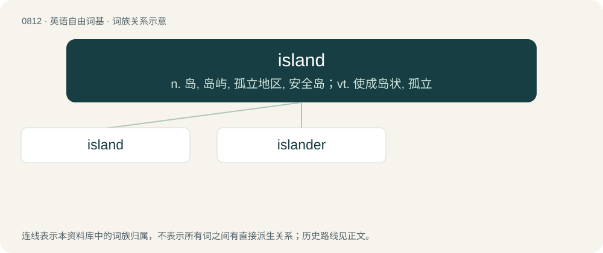

# 0882 · island — n. 岛, 岛屿, 孤立地区, 安全岛；vt. 使成岛状, 孤立

[总目录](../00_总目录_按常用程度.md)

**类型**：英语自由词基　｜　**来源语言**：见词源记录

## 核心含义与来源

- 核心含义：n. 岛, 岛屿, 孤立地区, 安全岛；vt. 使成岛状, 孤立
- 英文含义：A contiguous area of land, smaller than a continent, totally surrounded by water.
- 词形：island

**来源记录 1**（名词；A contiguous area of land, smaller than a continent, totally surrounded by water.）

From earlier iland, from Middle English iland, yland, ylond, from Old English īeġland, from Proto-West Germanic \*auwjuland, from Proto-Germanic \*awjōlandą (from Proto-Germanic \*awjō (“island, waterland, meadow”), from Proto-Indo-European \*h₂ekʷeh₂) + \*landą (“land”), equivalent to ey + land. Doublet of Öland. Cognate with Scots island, iland, yland (“island”), West Frisian eilân (“island”), Saterland Frisian Ailound (“island”), Dutch eiland (“island”), Low German Eiland (“island”), German Eiland (“island”), Swedish ö (“island”), Öland (“Sweden's second largest island”), Danish ø (“island”), Norwegian øy (“island”), øyland (“large island”), Icelandic eyland (“island”). The insertion of ⟨s⟩—a 16th century spelling modification—is due to a change in spelling to the unrelated term isle, which previously lacked s (cf. Middle English ile, yle). The re-addition was mistakenly carried over to include iland as well. Related also to German Aue (“water-meadow”), Latin aqua (“water”). More at ea.

## 词族图

## 单词速览（常用到不常用）

| 单词 | 音标 | 释义 |
|---|---|---|
| [island](#w-1) | Western /ˈaɪlənd/ | n. 岛, 岛屿, 孤立地区, 安全岛；vt. 使成岛状, 孤立 |
| [islander](#w-2) | 英 /ˈaɪləndə/；美 /ˈaɪləndɚ/ | n. 岛民 |

## 逐词详解

### 1. island

**词性**：名词　｜　**音标**：Western /ˈaɪlənd/

**中文释义**：n. 岛, 岛屿, 孤立地区, 安全岛；vt. 使成岛状, 孤立

**英文义项**：A contiguous area of land, smaller than a continent, totally surrounded by water. / A contiguous area of land, smaller than a continent, partially surrounded by water; a peninsula; a half-island.

**构词拆分**：ey + land

**词源与演化**：

From earlier iland, from Middle English iland, yland, ylond, from Old English īeġland, from Proto-West Germanic \*auwjuland, from Proto-Germanic \*awjōlandą (from Proto-Germanic \*awjō (“island, waterland, meadow”), from Proto-Indo-European \*h₂ekʷeh₂) + \*landą (“land”), equivalent to ey + land. Doublet of Öland. Cognate with Scots island, iland, yland (“island”), West Frisian eilân (“island”), Saterland Frisian Ailound (“island”), Dutch eiland (“island”), Low German Eiland (“island”), German Eiland (“island”), Swedish ö (“island”), Öland (“Sweden's second largest island”), Danish ø (“island”), Norwegian øy (“island”), øyland (“large island”), Icelandic eyland (“island”). The insertion of ⟨s⟩—a 16th century spelling modification—is due to a change in spelling to the unrelated term isle, which previously lacked s (cf. Middle English ile, yle). The re-addition was mistakenly carried over to include iland as well. Related also to German Aue (“water-meadow”), Latin aqua (“water”). More at ea.

**例句**：

> Dunton island, near Birmingham, is one of the most confusingly labelled islands in the U.K.

该用例对应义项：A roundabout; a traffic circle.

### 2. islander

**词性**：名词　｜　**音标**：英 /ˈaɪləndə/；美 /ˈaɪləndɚ/

**中文释义**：n. 岛民

**英文义项**：A person who lives on an island.

**构词拆分**：island + -er

**词源与演化**：

From island + -er. Displaced Middle English insulane (“islander”), from Latin īnsulānus (“islander”).

**例句**：

> It is usually the islander who sees the mainland most clearly.
