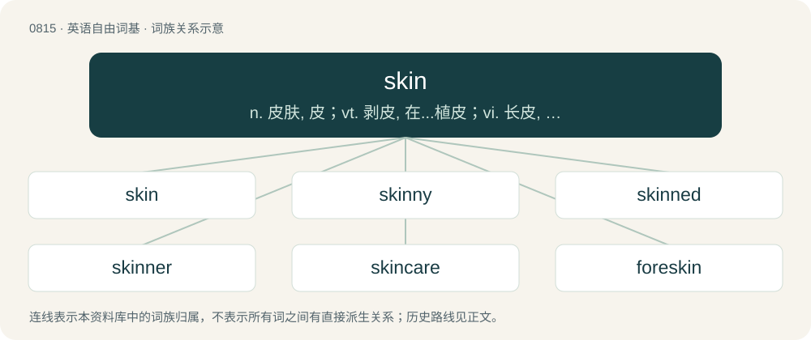

# 0885 · skin — n. 皮肤, 皮；vt. 剥皮, 在...植皮；vi. 长皮, 愈合, 蜕皮

[总目录](../00_总目录_按常用程度.md)

**类型**：英语自由词基　｜　**来源语言**：见词源记录

## 核心含义与来源

- 核心含义：n. 皮肤, 皮；vt. 剥皮, 在...植皮；vi. 长皮, 愈合, 蜕皮
- 英文含义：The outer protective layer of the body of any animal, including of a human.
- 词形：skin

**来源记录 1**（名词；The outer protective layer of the body of any animal, including of a human.）

From Middle English skyn, skinn, from Old English scinn, from Old Norse skinn (“animal hide”), from Proto-Germanic \*skinþą, from Proto-Indo-European \*sken- (“to split off”), nasal variant of \*skeh₁i-d- (“to cut”). Partially displaced native Old English hȳd (“skin, hide”), from which derives hide. Cognate with Dutch schinde (“bark”), dialectal German Schinde (“fruit peel”); also Breton skant (“scales”), Old Irish cenn (“covering, shell”), Irish scáin (“to tear, burst”), Latin scindō (“to split, divide”), Sanskrit छिनत्ति (chinátti, “to split”).

## 词族图

## 单词速览（常用到不常用）

| 单词 | 音标 | 释义 |
|---|---|---|
| [skin](#w-1) | /skɪn/ | n. 皮肤, 皮；vt. 剥皮, 在...植皮；vi. 长皮, 愈合, 蜕皮 |
| [skinny](#w-2) | /ˈskɪni/ | a. 似皮的, 极瘦的, 少的, 小气的；\[医\] 皮的; 消瘦的 |
| [skinned](#w-3) | /skɪnd/ | a. 具有...皮肤的, 具有...肤色的, 没有草皮的 |
| [skinner](#w-4) | /ˈskinə/ | n. 皮商, 剥皮工人, 骗子；\[电\] 剥波者 |
| [skincare](#w-5) | 英 /ˈskɪn.kɛə/；美 /ˈskɪn.kɛɹ/ | a. 护理皮肤的 |
| [foreskin](#w-6) | 英 /ˈfɔːskɪn/；美 /ˈfɔɹskɪn/ | n. 包皮；\[医\] 包皮 |
| [skinhead](#w-7) | /ˈskɪn.hɛd/ | n. 理光头的男人 |
| [sheepskin](#w-8) | /ˈʃiːpskin/ | n. 绵羊毛皮, 羊皮袄, 羊皮纸, 羊皮革, 羊皮毯, (写在羊皮纸上的)文件, 毕业文凭 |
| [snakeskin](#w-9) | /ˈsneɪkˌskɪn/ | n. 蛇皮, 蛇皮革 |
| [skinless](#w-10) |  | a. 无皮的, 易受感动的, 敏感的 |
| [buckskin](#w-11) | /ˈbʌkˌskɪn/ | n. 鹿皮；\[化\] 鹿皮 |
| [pigskin](#w-12) | /ˈpɪɡˌskɪn/ | n. 猪皮, 猪皮革, 马鞍 |
| [redskin](#w-13) | 美 /ˈɹɛdˌskɪn/ | n. 红皮肤人 |
| [skintight](#w-14) | 美 /ˈskɪnˌtaɪt/ | a. 紧身的 |
| [bearskin](#w-15) | 英 /ˈbɛə.skɪn/；美 /ˈbɛəɹ.skɪn/ | n. 熊皮, 熊皮衣 |
| [lambskin](#w-16) | /ˈlæmskin/ | n. 小羊皮, 羊皮纸 |
| [calfskin](#w-17) | 美 /ˈkæfˌskɪn/ | n. 小牛的皮, 犊皮所制的革 |

## 逐词详解

### 1. skin

**词性**：名词　｜　**音标**：/skɪn/

**中文释义**：n. 皮肤, 皮；vt. 剥皮, 在...植皮；vi. 长皮, 愈合, 蜕皮

**英文义项**：The outer protective layer of the body of any animal, including of a human. / The outer protective layer of the fruit of a plant.

**词源与演化**：

From Middle English skyn, skinn, from Old English scinn, from Old Norse skinn (“animal hide”), from Proto-Germanic \*skinþą, from Proto-Indo-European \*sken- (“to split off”), nasal variant of \*skeh₁i-d- (“to cut”). Partially displaced native Old English hȳd (“skin, hide”), from which derives hide. Cognate with Dutch schinde (“bark”), dialectal German Schinde (“fruit peel”); also Breton skant (“scales”), Old Irish cenn (“covering, shell”), Irish scáin (“to tear, burst”), Latin scindō (“to split, divide”), Sanskrit छिनत्ति (chinátti, “to split”).

**例句**：

> In order to get to the rest of the paint in the can, you′ll have to remove the skin floating on top of it.

该用例对应义项：A congealed layer on the surface of a liquid.

### 2. skinny

**词性**：形容词　｜　**音标**：/ˈskɪni/

**中文释义**：a. 似皮的, 极瘦的, 少的, 小气的；\[医\] 皮的; 消瘦的

**英文义项**：Thin, generally in a negative sense (as opposed to slim, which is thin in a positive sense). / Of food or a beverage, having reduced fat or calories.

**构词拆分**：skin + -y

**词源与演化**：

From Middle English skinny (“resembling skin”), equivalent to skin + -y. The meaning associated with lack of fat or muscle possibly derives from the phrase skin and bones; the meaning associated with nudity refers to the exposed skin.

**用法示例／搭配（非完整句）**：

> Her recent weight loss has made her look rather skinny than slender

该用例对应义项：Thin, generally in a negative sense (as opposed to slim, which is thin in a positive sense).

### 3. skinned

**词性**：形容词　｜　**音标**：/skɪnd/

**中文释义**：a. 具有...皮肤的, 具有...肤色的, 没有草皮的

**英文义项**：Having skin. / Having a specific type of skin.

**构词拆分**：skin + -ed

**词源与演化**：

From skin (noun) + -ed (“having”).

**例句**：

> Tom fell down and skinned his knee on a rock.

### 4. skinner

**词性**：名词　｜　**音标**：/ˈskinə/

**中文释义**：n. 皮商, 剥皮工人, 骗子；\[电\] 剥波者

**英文义项**：Someone who skins animals. / A hunting knife used for skinning animal carcasses.

**构词拆分**：skin + -er

**词源与演化**：

From Middle English skynner, skinner, skynnere, schynnere, equivalent to skin + -er. Cognate with Old Norse skinnari (“skinner”), Old Swedish skinnare (“skinner”), Middle Low German schinder, schinner (“skinner”).

### 5. skincare

**词性**：名词　｜　**音标**：英 /ˈskɪn.kɛə/；美 /ˈskɪn.kɛɹ/

**中文释义**：a. 护理皮肤的

**英文义项**：The care and treatment of the skin, especially of the face.

**构词拆分**：skin + care

**词源与演化**：

From skin + care.

**例句**：

> The saleswoman told her that her face would look older unless she bought this line of skincare products.

该用例对应义项：The care and treatment of the skin, especially of the face.

### 6. foreskin

**词性**：名词　｜　**音标**：英 /ˈfɔːskɪn/；美 /ˈfɔɹskɪn/

**中文释义**：n. 包皮；\[医\] 包皮

**英文义项**：The nerve-dense, retractable fold of skin which covers and protects the glans of the penis in humans and some other mammals.

**构词拆分**：fore- + skin

**词源与演化**：

From fore- + skin, a loose calque of Latin praepūtium. Compare German Vorhaut, etc. First attested in c. 1535.

**例句**：

> In the female genitalia, the clitoral hood is homologous to the foreskin.

该用例对应义项：The nerve-dense, retractable fold of skin which covers and protects the glans of the penis in humans and some other mammals.

### 7. skinhead

**词性**：名词　｜　**音标**：/ˈskɪn.hɛd/

**中文释义**：n. 理光头的男人

**英文义项**：Someone with a shaved head. / A member of a subculture that arose among working-class youth in late 1960s England or its diaspora, defined by close-cropped or shaven heads and working-class clothing, and often associated with violence and white-supremacist or anti-immigrant principles.

**构词拆分**：skin + head

**词源与演化**：

From skin + head.

**例句**：

> Layla received threats from a skinhead movement.

### 8. sheepskin

**词性**：名词　｜　**音标**：/ˈʃiːpskin/

**中文释义**：n. 绵羊毛皮, 羊皮袄, 羊皮纸, 羊皮革, 羊皮毯, (写在羊皮纸上的)文件, 毕业文凭

**英文义项**：The skin of a sheep, especially an adult sheep, and especially when used to make parchment or in bookbinding. / The tanned skin of a sheep with the fleece left on, especially when used for clothing, rugs, etc.

**构词拆分**：sheep + skin

**词源与演化**：

From sheep + skin.

**例句**：

> The coarse sieve mocks the fine sieve, while the sheepskin rug smiles mischievously.

### 9. snakeskin

**词性**：名词　｜　**音标**：/ˈsneɪkˌskɪn/

**中文释义**：n. 蛇皮, 蛇皮革

**英文义项**：The hide of a snake, used as leather. / The moult of a snake.

**构词拆分**：snake + skin

**词源与演化**：

From snake + skin.

### 10. skinless

**词性**：形容词

**中文释义**：a. 无皮的, 易受感动的, 敏感的

**英文义项**：Not having an outer layer of skin or skinlike material, or with such a layer removed.

**构词拆分**：skin + -less

**词源与演化**：

From Middle English skynles, equivalent to skin + -less. Cognate with Old Norse skinnlauss (“skinless”).

**例句**：

> I bought skinless chicken breast because the fat right under the skin is supposed to be fattening; but they don't crisp as much.

该用例对应义项：Not having an outer layer of skin or skinlike material, or with such a layer removed.

### 11. buckskin

**词性**：名词　｜　**音标**：/ˈbʌkˌskɪn/

**中文释义**：n. 鹿皮；\[化\] 鹿皮

**英文义项**：The skin of a male deer, a buck. / Clothing made from buckskin.

**构词拆分**：buck + skin

**词源与演化**：

From Middle English bukskyn; equivalent to buck + skin.

### 12. pigskin

**词性**：名词　｜　**音标**：/ˈpɪɡˌskɪn/

**中文释义**：n. 猪皮, 猪皮革, 马鞍

**英文义项**：The skin of a pig. / Leather made from the skin of a pig.

**构词拆分**：pig + skin

**词源与演化**：

Compound of pig + skin. The American football is a direct descendant of the ball used in the game of rugby. The rugby ball originally was made of a pig’s bladder with a leather cover; the earliest versions of the leather exterior sometimes were made of pigskin.

### 13. redskin

**词性**：名词　｜　**音标**：美 /ˈɹɛdˌskɪn/

**中文释义**：n. 红皮肤人

**英文义项**：A Native American.

**构词拆分**：red + skin

**词源与演化**：

From red + skin. References to indigenous Americans' skin being red can be found from the 1580s, although not consistently (another European in 1584 described indigenous Americans as "yellowish"); in some cases the reference may be not to their skin color per se but to their painting themselves with red paint. A letter ostensibly from 1699, which was formerly cited as the earliest reference to "red skins", was not published until 1900 and is now recognized as fake. The earliest documented instance of the term "redskin" is from a 1769 discussion between the Piankeshaw and John Wilkins, this and other early uses appear to be translating terms meaning red + skin, flesh, or people that the tribes of the Illinois / Mississippi Valley area used to refer to themselves when communicating with the French (who translated such terms as French peau-rouge) and with English-speakers (whence redskin). Piecewise doublet of Rauðskinna.

### 14. skintight

**词性**：形容词　｜　**音标**：美 /ˈskɪnˌtaɪt/

**中文释义**：a. 紧身的

**英文义项**：Conforming tightly to the body, snug against the skin.

**构词拆分**：skin + tight

**词源与演化**：

From skin + tight.

**例句**：

> The BioSuit is a skintight spacesuit that provides astronauts with greater mobility.

### 15. bearskin

**词性**：名词　｜　**音标**：英 /ˈbɛə.skɪn/；美 /ˈbɛəɹ.skɪn/

**中文释义**：n. 熊皮, 熊皮衣

**英文义项**：The pelt of a bear, especially when used as a rug. / A tall ceremonial hat worn by members of some British regiments for ceremonial occasions; a busby.

**构词拆分**：bear + skin

**词源与演化**：

From bear + skin.

### 16. lambskin

**词性**：名词　｜　**音标**：/ˈlæmskin/

**中文释义**：n. 小羊皮, 羊皮纸

**英文义项**：The skin of a very young sheep, especially prepared with the fleece still attached. A very fine form of leather. / A kind of woollen cloth resembling this.

**构词拆分**：lamb + skin

**词源与演化**：

From lamb + skin.

### 17. calfskin

**词性**：名词　｜　**音标**：美 /ˈkæfˌskɪn/

**中文释义**：n. 小牛的皮, 犊皮所制的革

**英文义项**：A fine leather made from the hide of a calf.

**构词拆分**：calf + skin

**词源与演化**：

From calf + skin.

**例句**：

> Is that bag made of calfskin?
