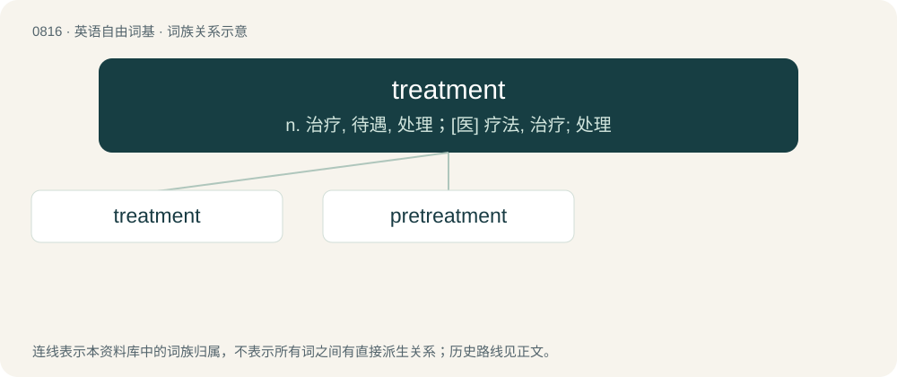

# 0886 · treatment — n. 治疗, 待遇, 处理；\[医\] 疗法, 治疗; 处理

[总目录](../00_总目录_按常用程度.md)

**类型**：英语自由词基　｜　**来源语言**：见词源记录

## 核心含义与来源

- 核心含义：n. 治疗, 待遇, 处理；\[医\] 疗法, 治疗; 处理
- 英文含义：The process or manner of treating someone or something.
- 词形：treatment

**来源记录 1**（名词；The process or manner of treating someone or something.）

From treat + -ment. Compare French traitement.

## 词族图

## 单词速览（常用到不常用）

| 单词 | 音标 | 释义 |
|---|---|---|
| [treatment](#w-1) | /ˈtɹiːtmənt/ | n. 治疗, 待遇, 处理；\[医\] 疗法, 治疗; 处理 |
| [pretreatment](#w-2) | /priːˈtriːtmənt/ | n. 预处理；\[化\] 前处理; 预处理 |

## 逐词详解

### 1. treatment

**词性**：名词　｜　**音标**：/ˈtɹiːtmənt/

**中文释义**：n. 治疗, 待遇, 处理；\[医\] 疗法, 治疗; 处理

**英文义项**：The process or manner of treating someone or something. / Medical care for an illness or injury.

**构词拆分**：treat + -ment

**词源与演化**：

From treat + -ment. Compare French traitement.

**例句**：

> He still has nightmares resulting from the abusive treatment he received from his captors.

该用例对应义项：The process or manner of treating someone or something.

### 2. pretreatment

**词性**：形容词　｜　**音标**：/priːˈtriːtmənt/

**中文释义**：n. 预处理；\[化\] 前处理; 预处理

**英文义项**：Prior to treatment.

**构词拆分**：pre- + treatment

**词源与演化**：

From pre- + treatment.
