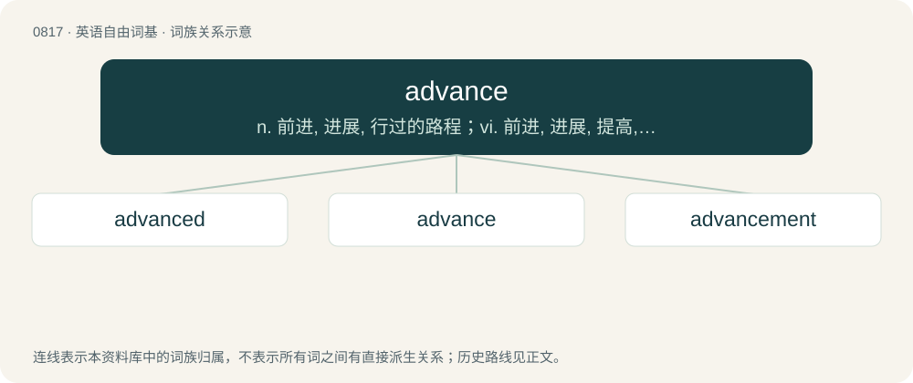

# 0887 · advance — n. 前进, 进展, 行过的路程；vi. 前进, 进展, 提高, 上涨；vt. 使前进, 促进, 提出, 提高, 使提前, 预付

[总目录](../00_总目录_按常用程度.md)

**类型**：英语自由词基　｜　**来源语言**：见词源记录

## 核心含义与来源

- 核心含义：n. 前进, 进展, 行过的路程；vi. 前进, 进展, 提高, 上涨；vt. 使前进, 促进, 提出, 提高, 使提前, 预付
- 英文含义：To help the progress of (something); to further.
- 词形：advance

**来源记录 1**（动词；To help the progress of (something); to further.）

From Middle English avauncen, avancen, borrowed from Anglo-Norman avauncier, from Vulgar Latin \*abanteāre, from Late Latin ab ante, from Latin ab + ante (“before”). ⟨d⟩ added in analogy to Latin ad- (cf. Middle French advancer). Compare avaunt.

## 词族图

## 单词速览（常用到不常用）

| 单词 | 音标 | 释义 |
|---|---|---|
| [advanced](#w-1) | 英 /ədˈvɑːnst/；美 /ədˈvænst/ | a. 在前的, 高级的, 先进的, 年老的；\[法\] 预付的, 预支的, 垫付的 |
| [advance](#w-2) | 英 /ədˈvɑːns/；美 /ədˈvæns/ | n. 前进, 进展, 行过的路程；vi. 前进, 进展, 提高, 上涨；vt. 使前进, 促进, 提出, 提高, 使提前, 预付 |
| [advancement](#w-3) | 英 /ædˈvɑːns.mənt/；美 /ædˈvæns.mənt/ | n. 前进, 进步, 提升；\[医\] 徙前术 |

## 逐词详解

### 1. advanced

**词性**：形容词　｜　**音标**：英 /ədˈvɑːnst/；美 /ədˈvænst/

**中文释义**：a. 在前的, 高级的, 先进的, 年老的；\[法\] 预付的, 预支的, 垫付的

**英文义项**：At or close to the state of the art. / Involving greater complexity; more difficult, elaborate or specialized.

**构词拆分**：advance + -ed

**词源与演化**：

From advance + -ed.

**例句**：

> This is an advanced prototype, it already has most of the features the final product will have.

该用例对应义项：In a late stage of development or education; having greatly progressed beyond an initial stage.

### 2. advance

**词性**：名词　｜　**音标**：英 /ədˈvɑːns/；美 /ədˈvæns/

**中文释义**：n. 前进, 进展, 行过的路程；vi. 前进, 进展, 提高, 上涨；vt. 使前进, 促进, 提出, 提高, 使提前, 预付

**英文义项**：A forward move; improvement or progression. / An amount of money or credit, especially given as a loan, or paid before it is due; an advancement.

**词源与演化**：

From Middle English avauncen, avancen, borrowed from Anglo-Norman avauncier, from Vulgar Latin \*abanteāre, from Late Latin ab ante, from Latin ab + ante (“before”). ⟨d⟩ added in analogy to Latin ad- (cf. Middle French advancer). Compare avaunt.

**用法示例／搭配（非完整句）**：

> an advance on the prime cost of goods

该用例对应义项：An addition to the price; rise in price or value.

### 3. advancement

**词性**：名词　｜　**音标**：英 /ædˈvɑːns.mənt/；美 /ædˈvæns.mənt/

**中文释义**：n. 前进, 进步, 提升；\[医\] 徙前术

**英文义项**：The act of advancing; promotion to a higher place or dignity / The state of being advanced

**构词拆分**：advance + -ment

**词源与演化**：

From Middle English avancement, Old French avancement. See advance. Morphologically advance + -ment.

**用法示例／搭配（非完整句）**：

> the advancement of learning

该用例对应义项：The act of advancing; promotion to a higher place or dignity
