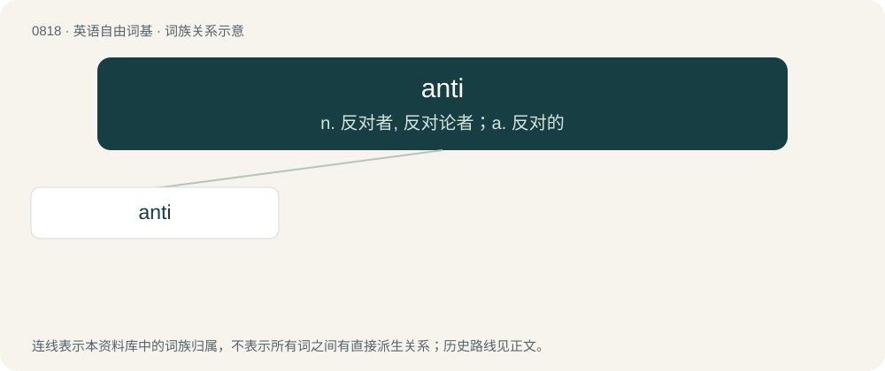

# 0888 · anti — n. 反对者, 反对论者；a. 反对的

[总目录](../00_总目录_按常用程度.md)

**类型**：英语自由词基　｜　**来源语言**：见词源记录

## 核心含义与来源

- 核心含义：n. 反对者, 反对论者；a. 反对的
- 英文含义：Opposed to something.
- 词形：anti

**来源记录 1**（形容词；Opposed to something.）

Conversion of the prefix anti- to an adjective.

## 词族图

## 单词速览（常用到不常用）

| 单词 | 音标 | 释义 |
|---|---|---|
| [anti](#w-1) | 英 /ˈæn.ti/；美 /ˈæn.taɪ/ | n. 反对者, 反对论者；a. 反对的 |

## 逐词详解

### 1. anti

**词性**：形容词　｜　**音标**：英 /ˈæn.ti/；美 /ˈæn.taɪ/

**中文释义**：n. 反对者, 反对论者；a. 反对的

**英文义项**：Opposed to something. / That has a torsion angle between 90° and 180°

**词源与演化**：

Conversion of the prefix anti- to an adjective.

**例句**：

> Which anti depressant would you recommend for someone who can not take hormones?
