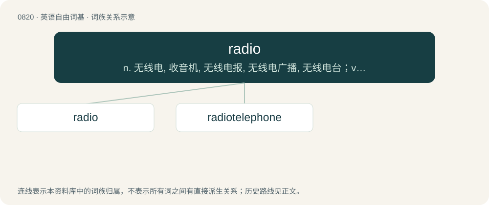

# 0889 · radio — n. 无线电, 收音机, 无线电报, 无线电广播, 无线电台；v. 用无线电发送

[总目录](../00_总目录_按常用程度.md)

**类型**：英语自由词基　｜　**来源语言**：见词源记录

## 核心含义与来源

- 核心含义：n. 无线电, 收音机, 无线电报, 无线电广播, 无线电台；v. 用无线电发送
- 英文含义：The technology that allows for the transmission of sound or other signals by modulation of electromagnetic waves.
- 词形：radio

**来源记录 1**（名词；The technology that allows for the transmission of sound or other signals by modulation of electromagnetic waves.）

Short for radiotelegraphy.

## 词族图

## 单词速览（常用到不常用）

| 单词 | 音标 | 释义 |
|---|---|---|
| [radio](#w-1) | 英 /ˈɹeɪ.diˌəʊ/；美 /ˈɹeɪ.diˌoʊ/ | n. 无线电, 收音机, 无线电报, 无线电广播, 无线电台；v. 用无线电发送 |
| [radiotelephone](#w-2) | /.reidiəuˈteləfəun/ | n. 无线电话学；v. 打无线电话 |

## 逐词详解

### 1. radio

**词性**：名词　｜　**音标**：英 /ˈɹeɪ.diˌəʊ/；美 /ˈɹeɪ.diˌoʊ/

**中文释义**：n. 无线电, 收音机, 无线电报, 无线电广播, 无线电台；v. 用无线电发送

**英文义项**：The technology that allows for the transmission of sound or other signals by modulation of electromagnetic waves. / A device that can capture (receive) the signal sent over radio waves and render the modulated signal as sound.

**词源与演化**：

Short for radiotelegraphy.

**例句**：

> She was listening to the radio when he knocked on the door.

该用例对应义项：A device that can capture (receive) the signal sent over radio waves and render the modulated signal as sound.

### 2. radiotelephone

**词性**：名词　｜　**音标**：/.reidiəuˈteləfəun/

**中文释义**：n. 无线电话学；v. 打无线电话

**英文义项**：A device that allows two-way communication by means of a radio. / Synonym of mobile phone

**构词拆分**：radio + telephone

**词源与演化**：

From radio + telephone.
