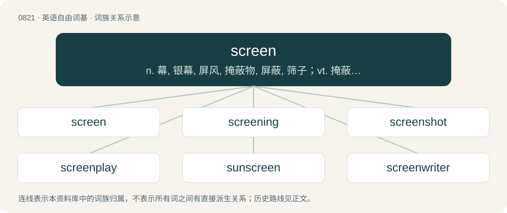

# 0890 · screen — n. 幕, 银幕, 屏风, 掩蔽物, 屏蔽, 筛子；vt. 掩蔽, 放映, 拍摄, 掩护, 筛, 甄别；vi. 拍电影

[总目录](../00_总目录_按常用程度.md)

**类型**：英语自由词基　｜　**来源语言**：见词源记录

## 核心含义与来源

- 核心含义：n. 幕, 银幕, 屏风, 掩蔽物, 屏蔽, 筛子；vt. 掩蔽, 放映, 拍摄, 掩护, 筛, 甄别；vi. 拍电影
- 英文含义：A physical divider intended to block an area from view, or provide shelter from something dangerous.
- 词形：screen

**来源记录 1**（名词；A physical divider intended to block an area from view, or provide shelter from something dangerous.）

From Middle English scren, screne (“windscreen, firescreen”), from Anglo-Norman escren (“firescreen, the tester of a bed”), Old French escren, escrein, escran (modern French écran (“screen”)), from Middle Dutch scherm, from Old Dutch skirm, from Proto-West Germanic \*skirmi, from Proto-Germanic \*skirmiz (“fur, shelter, covering, screen”), from Proto-Indo-European \*(s)ker- (“to cut, divide”). Cognate with Dutch scherm (“screen”), German Schirm (“screen”). Doublet of scherm. An alternative etymology derives Old French escren, escran from Old Dutch \*scranc (“barrier”) (compare Middle Dutch schranc, schranke (“palisade, trellis, grid”), German Schrank (“cupboard, cabinet”), German Schranke (“fence”)), from Proto-West Germanic \*skrank, from Proto-Germanic \*skrankaz.

## 词族图

## 单词速览（常用到不常用）

| 单词 | 音标 | 释义 |
|---|---|---|
| [screen](#w-1) | /ˈskɹiːn/ | n. 幕, 银幕, 屏风, 掩蔽物, 屏蔽, 筛子；vt. 掩蔽, 放映, 拍摄, 掩护, 筛, 甄别；vi. 拍电影 |
| [screening](#w-2) | /ˈskɹiːnɪŋ/ | \[医\] 筛选, 筛分(如普查癌、结核等病), 萤光屏检查 |
| [screenshot](#w-3) | 英 /ˈskriːn.ʃɒt/；美 /ˈskriːn.ʃɑt/ | 屏幕截图 |
| [screenplay](#w-4) | 美 /ˈskɹiːnˌpleɪ/ | n. 电影剧本 |
| [sunscreen](#w-5) | /ˈsʌn.skriːn/ | n. (防晒油中的)遮光剂 |
| [screenwriter](#w-6) | /ˈskriːnraitə/ | n. 电影剧本作家, 编剧家 |
| [onscreen](#w-7) | /ɒnskˈriːn/ | adv. & adj. 在银幕上（的） |
| [windscreen](#w-8) | /ˈwɪn(d).skɹiːn/ | n. 汽车的挡风玻璃 |
| [widescreen](#w-9) | /ˈwaɪdˌskɹin/ | n. 宽银幕；a. 宽银幕的 |
| [screenwriting](#w-10) | /ˈskriːn,raitiŋ/ | n. & adj.电影剧本创作(的) |
| [smokescreen](#w-11) | 美 /ˈsmoʊkˌskɹin/ | n. 烟幕, 掩盖某人真实意图的东西 |
| [screensaver](#w-12) | /ˈskɹiːnˌseɪ.və(ɹ)/ | n. 屏幕保护（程序） |
| [fullscreen](#w-13) |  | 【英文】To make a window occupy the entire screen. |
| [screener](#w-14) | 英 /ˈskɹiːnəː/；美 /ˈskɹinɚ/ | 筛 |
| [offscreen](#w-15) | /uːfskˈriːn/ | a. 画面以外的, 实际生活中的；adv. 在电影摄影机拍摄距离外地 |
| [homescreen](#w-16) |  | 【英文】The main or first interface shown in a graphical user interface. |
| [silkscreen](#w-17) | 美 /ˈsɪlkˌskɹin/ | n. 丝网印刷,丝网印刷品；a. 丝网印刷的,用丝网印刷术印制的 |
| [flatscreen](#w-18) | /flætskˈriːn/ | n. 平板筛; 平面银幕; 超薄屏幕；a. 平板荧光屏的, 平面式电视的 |

## 逐词详解

### 1. screen

**词性**：名词　｜　**音标**：/ˈskɹiːn/

**中文释义**：n. 幕, 银幕, 屏风, 掩蔽物, 屏蔽, 筛子；vt. 掩蔽, 放映, 拍摄, 掩护, 筛, 甄别；vi. 拍电影

**英文义项**：A physical divider intended to block an area from view, or provide shelter from something dangerous. / A dwarf wall or partition carried up to a certain height for separation and protection, as in a church, to separate the aisle from the choir, etc.

**词源与演化**：

From Middle English scren, screne (“windscreen, firescreen”), from Anglo-Norman escren (“firescreen, the tester of a bed”), Old French escren, escrein, escran (modern French écran (“screen”)), from Middle Dutch scherm, from Old Dutch skirm, from Proto-West Germanic \*skirmi, from Proto-Germanic \*skirmiz (“fur, shelter, covering, screen”), from Proto-Indo-European \*(s)ker- (“to cut, divide”). Cognate with Dutch scherm (“screen”), German Schirm (“screen”). Doublet of scherm. An alternative etymology derives Old French escren, escran from Old Dutch \*scranc (“barrier”) (compare Middle Dutch schranc, schranke (“palisade, trellis, grid”), German Schrank (“cupboard, cabinet”), German Schranke (“fence”)), from Proto-West Germanic \*skrank, from Proto-Germanic \*skrankaz.

**例句**：

> Clicking the Edit button sends you to a screen where you can change the name and description.

该用例对应义项：The visualised data or imagery displayed on a computer screen.

### 2. screening

**词性**：名词　｜　**音标**：/ˈskɹiːnɪŋ/

**中文释义**：\[医\] 筛选, 筛分(如普查癌、结核等病), 萤光屏检查

**英文义项**：Mesh material that is used to screen (as in a "screen door"). / The examination and treatment of a material to detect and remove unwanted fractions by passing it through a screen (sieve).

**构词拆分**：From screen + -ing.

**词源与演化**：

From screen + -ing.

**例句**：

> I'll have to buy some screening and fix the doors before mosquito season starts.

该用例对应义项：Mesh material that is used to screen (as in a "screen door").

### 3. screenshot

**词性**：名词　｜　**音标**：英 /ˈskriːn.ʃɒt/；美 /ˈskriːn.ʃɑt/

**中文释义**：屏幕截图

**英文义项**：An image of computer or smartphone screen output at a given moment in time.

**构词拆分**：screen + shot (“(photography) single unbroken sequence of photographic exposures”)

**词源与演化**：

From screen + shot (“(photography) single unbroken sequence of photographic exposures”).

**例句**：

> I grabbed a screenshot of my desktop.

该用例对应义项：An image of computer or smartphone screen output at a given moment in time.

### 4. screenplay

**词性**：名词　｜　**音标**：美 /ˈskɹiːnˌpleɪ/

**中文释义**：n. 电影剧本

**英文义项**：A script for a movie or (less commonly) a television show.

**构词拆分**：screen + play

**词源与演化**：

From screen + play.

**例句**：

> She became famous after having written the screenplay for that movie.

### 5. sunscreen

**词性**：名词　｜　**音标**：/ˈsʌn.skriːn/

**中文释义**：n. (防晒油中的)遮光剂

**英文义项**：A topical substance formulated to protect the skin from the harmful effects of ultraviolet radiation by absorbing, reflecting or scattering ultraviolet rays.

**构词拆分**：sun + screen

**词源与演化**：

From sun + screen.

**例句**：

> Remember to wear sunscreen and protect your skin from the sun.

### 6. screenwriter

**词性**：名词　｜　**音标**：/ˈskriːnraitə/

**中文释义**：n. 电影剧本作家, 编剧家

**英文义项**：One who writes for the screen, who writes drama for film or television; especially a professional who knows the conventions appropriate to such work.

**构词拆分**：screen + writer

**词源与演化**：

From screen + writer.

**例句**：

> I think that Tom used to be a screenwriter.

### 7. onscreen

**词性**：形容词　｜　**音标**：/ɒnskˈriːn/

**中文释义**：adv. & adj. 在银幕上（的）

**英文义项**：As seen on a screen (as of television, film, or computer) rather than in real life.

**构词拆分**：on + screen

**词源与演化**：

From on + screen.

**例句**：

> The two actors had a very realistic onscreen romance, but in reality they couldn't stand each other.

该用例对应义项：As seen on a screen (as of television, film, or computer) rather than in real life.

### 8. windscreen

**词性**：名词　｜　**音标**：/ˈwɪn(d).skɹiːn/

**中文释义**：n. 汽车的挡风玻璃

**英文义项**：A transparent screen made of glass, located at the front of a vehicle in order to protect its occupants from the wind and weather. / A cover for a microphone to exclude airy noises such as wind and breathing.

**构词拆分**：wind + screen

**词源与演化**：

From wind + screen.

**例句**：

> Oh no! A vandal has just smashed our windscreen! Susan, can you go and call the insurance company?

该用例对应义项：A transparent screen made of glass, located at the front of a vehicle in order to protect its occupants from the wind and weather.

### 9. widescreen

**词性**：名词　｜　**音标**：/ˈwaɪdˌskɹin/

**中文释义**：n. 宽银幕；a. 宽银幕的

**英文义项**：A screen with a wider aspect ratio than the ordinary 35-millimeter frame, making more effective use of the human field of view and producing a more immersive view experience.

**构词拆分**：wide + screen

**词源与演化**：

From wide + screen.

**例句**：

> Local protestors showed gruesome abattoir footage on widescreen TVs.

### 10. screenwriting

**词性**：名词　｜　**音标**：/ˈskriːn,raitiŋ/

**中文释义**：n. & adj.电影剧本创作(的)

**英文义项**：The art of writing screenplays. / A screenplay.

**构词拆分**：screen + writing

**词源与演化**：

From screen + writing.

### 11. smokescreen

**词性**：名词　｜　**音标**：美 /ˈsmoʊkˌskɹin/

**中文释义**：n. 烟幕, 掩盖某人真实意图的东西

**英文义项**：Smoke used as a disguise, mask or cover, as of troops in battle. / Anything used metaphorically to conceal or distract.

**构词拆分**：smoke + screen

**词源与演化**：

From smoke + screen.

**例句**：

> All that talk is just a smokescreen to disguise the fact that he has nothing to say.

该用例对应义项：Anything used metaphorically to conceal or distract.

### 12. screensaver

**词性**：名词　｜　**音标**：/ˈskɹiːnˌseɪ.və(ɹ)/

**中文释义**：n. 屏幕保护（程序）

**英文义项**：A computer program that displays aesthetic patterns or images when the computer is not being used, originally intended to prevent screenburn. / The background picture of a computer, smartphone, or similar mobile device.

**构词拆分**：screen + saver

**词源与演化**：

From screen + saver.

**例句**：

> I configured my screensaver to appear after only two minutes, because I enjoyed watching it so much.

该用例对应义项：A computer program that displays aesthetic patterns or images when the computer is not being used, originally intended to prevent screenburn.

### 13. fullscreen

**词性**：动词

**英文义项**：To make a window occupy the entire screen.

**构词拆分**：full + screen

**词源与演化**：

From full + screen.

### 14. screener

**词性**：名词　｜　**音标**：英 /ˈskɹiːnəː/；美 /ˈskɹinɚ/

**中文释义**：筛

**英文义项**：A question or survey used to filter potential participants based on some characteristic. / An advance screening of a film sent to critics, awards voters, etc.

**构词拆分**：From screen + -er.

**词源与演化**：

From screen + -er.

### 15. offscreen

**词性**：动词　｜　**音标**：/uːfskˈriːn/

**中文释义**：a. 画面以外的, 实际生活中的；adv. 在电影摄影机拍摄距离外地

**英文义项**：To kill a character offscreen.

**构词拆分**：off + screen

**词源与演化**：

From off + screen.

**例句**：

> Yeah, I also hate her. I hope she gets offscreened in the third act low-key.

该用例对应义项：To kill a character offscreen.

### 16. homescreen

**词性**：名词

**英文义项**：The main or first interface shown in a graphical user interface.

**构词拆分**：home + screen

**词源与演化**：

From home + screen.

### 17. silkscreen

**词性**：名词　｜　**音标**：美 /ˈsɪlkˌskɹin/

**中文释义**：n. 丝网印刷,丝网印刷品；a. 丝网印刷的,用丝网印刷术印制的

**英文义项**：A sheet of material (originally silk but now synthetic) with areas that are porous to ink and others that are non-porous to allow printing of images, such as on T-shirts.

**构词拆分**：silk + screen

**词源与演化**：

From silk + screen.

### 18. flatscreen

**词性**：形容词　｜　**音标**：/flætskˈriːn/

**中文释义**：n. 平板筛; 平面银幕; 超薄屏幕；a. 平板荧光屏的, 平面式电视的

**英文义项**：Being slim from front to back, as opposed to earlier bulky, CRT-based models.

**构词拆分**：flat + screen

**词源与演化**：

From flat + screen.

**例句**：

> Ziri was trying to steal Rima's flatscreen TV.
