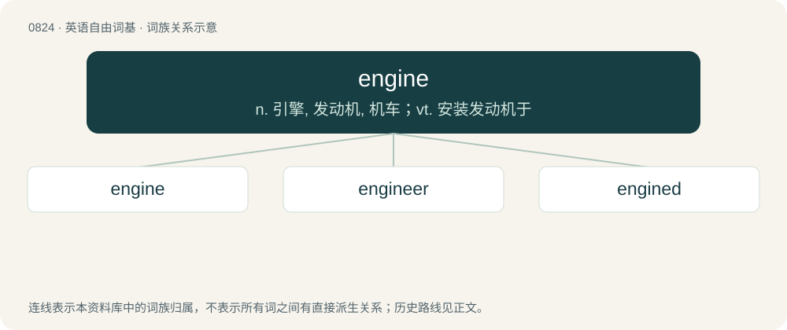

# 0893 · engine — n. 引擎, 发动机, 机车；vt. 安装发动机于

[总目录](../00_总目录_按常用程度.md)

**类型**：英语自由词基　｜　**来源语言**：见词源记录

## 核心含义与来源

- 核心含义：n. 引擎, 发动机, 机车；vt. 安装发动机于
- 英文含义：A large construction used in warfare, such as a battering ram, catapult etc.
- 词形：engine

**来源记录 1**（名词；A large construction used in warfare, such as a battering ram, catapult etc.）

From Middle English engyn, from Anglo-Norman engine, Old French engin (“skill, cleverness, war machine”), from Latin ingenium (“innate or natural quality, nature, genius, a genius, an invention, (in Late Latin) a war-engine, battering-ram”), related to ingignō (“to instil by birth, implant, produce in”). Compare gin, ingenious, engineer.

## 词族图

## 单词速览（常用到不常用）

| 单词 | 音标 | 释义 |
|---|---|---|
| [engine](#w-1) | 英 /ˈɛnd͡ʒɪn/；/ˈɛnd͡ʒən/ | n. 引擎, 发动机, 机车；vt. 安装发动机于 |
| [engineer](#w-2) | 英 /ˌɛn(d)ʒɪˈnɪə/；美 /ˌɛnd͡ʒɪˈnɪ(ə)ɹ/ | n. 工程师, 工兵；vt. 设计, 监造, 精明地处理, 策划 |
| [engined](#w-3) |  | a. 装有若干数量或某种类型发动机的 |

## 逐词详解

### 1. engine

**词性**：名词　｜　**音标**：英 /ˈɛnd͡ʒɪn/；/ˈɛnd͡ʒən/

**中文释义**：n. 引擎, 发动机, 机车；vt. 安装发动机于

**英文义项**：A large construction used in warfare, such as a battering ram, catapult etc. / A complex mechanical device which converts energy into useful motion or physical effects.

**词源与演化**：

From Middle English engyn, from Anglo-Norman engine, Old French engin (“skill, cleverness, war machine”), from Latin ingenium (“innate or natural quality, nature, genius, a genius, an invention, (in Late Latin) a war-engine, battering-ram”), related to ingignō (“to instil by birth, implant, produce in”). Compare gin, ingenious, engineer.

**用法示例／搭配（非完整句）**：

> a graphics engine

该用例对应义项：A software or hardware system responsible for a specific technical task (usually with qualifying word).

### 2. engineer

**词性**：名词　｜　**音标**：英 /ˌɛn(d)ʒɪˈnɪə/；美 /ˌɛnd͡ʒɪˈnɪ(ə)ɹ/

**中文释义**：n. 工程师, 工兵；vt. 设计, 监造, 精明地处理, 策划

**英文义项**：A soldier engaged in designing or constructing military works for attack or defence, or other engineering works. / A person professionally engaged in the technical design and construction of large-scale private and public works such as bridges, buildings, harbours, railways, roads, etc.; a civil engineer.

**构词拆分**：engine + -er (occupational suffix)；engine + -eer (suffix forming nouns denoting people associated with, concerned with, or engaged in specified activities)

**词源与演化**：

The noun is derived from: \* Middle English enginour (“one who designs, constructs, or operates military works for attack or defence, etc.; machine designer”) \[and other forms\], from Anglo-Norman enginour, engigneour \[and other forms\], and Middle French and Old French engigneor, engigneour, engignier (“one who designs, constructs, or operates military works for attack or defence; architect; carpenter; craftsman; designer; planner; one who deceives or schemes”) (modern French ingénieur), from engin (“contraption, device; machine; invention; creativity, ingenuity; intelligence; deception, ruse, trickery”) + -eor, -or (suffix forming agent nouns); engin is derived from Latin ingenium (“innate or natural quality, nature; intelligence, natural capacity; ability, skill, talent; (Medieval Latin) engine; machine”), from in- (prefix meaning ‘in, inside, within’) + gignere (the present active infinitive of gignō (“to bear, beget, give birth to; to cause, produce, yield”), ultimately from Proto-Indo-European \*ǵenh₁- (“to beget, give birth to; to produce”)) + -ium (suffix forming abstract nouns); and \* from engine + -er (occupational suffix); and \* from engine + -eer (suffix forming nouns denoting people associated with, concerned with, or engaged in specified activities), possibly modelled after Middle French ingénieur (a variant of Middle French, Old French engigneour; see above), and Italian ingegniere (“engineer”) (obsolete; modern Italian ingegnere). The verb is derived from the noun. Cognates \* Medieval Latin, Late Latin ingeniārius (“engineer”) \* Medieval Latin ingeniator (“one constructing or using an engine”) \* Old Occitan engenhador, enginhador \* Portuguese engenhador (obsolete), engenheiro (“engineer”) \* Spanish engeñero (obsolete), ingeniero (“engineer”)

**用法示例／搭配（非完整句）**：

> a political engineer

该用例对应义项：Preceded by a qualifying word: a person who uses abilities or knowledge to manipulate events or people.

### 3. engined

**词性**：形容词

**中文释义**：a. 装有若干数量或某种类型发动机的

**英文义项**：Having a specified number or configuration of engines, or having a certain type of engine.

**构词拆分**：From engine (“noun”) + -ed.

**词源与演化**：

From engine (“noun”) + -ed.

**用法示例／搭配（非完整句）**：

> diesel-engined

该用例对应义项：Having a specified number or configuration of engines, or having a certain type of engine.
