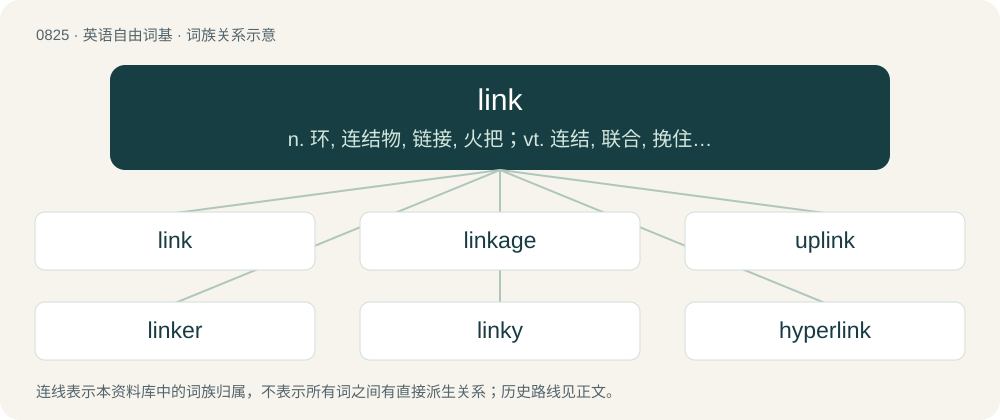

# 0894 · link — n. 环, 连结物, 链接, 火把；vt. 连结, 联合, 挽住；vi. 连接起来

[总目录](../00_总目录_按常用程度.md)

**类型**：英语自由词基　｜　**来源语言**：见词源记录

## 核心含义与来源

- 核心含义：n. 环, 连结物, 链接, 火把；vt. 连结, 联合, 挽住；vi. 连接起来
- 英文含义：A connection between places, people, events, things, or ideas.
- 词形：link

**多个词源／构词路径**：同一拼写可能有不同来源；以下按词性和含义分别列出。

**来源记录 1**（名词；A connection between places, people, events, things, or ideas.）

From Middle English linke, lenke, from a merger of Old English hlenċe, hlenċa (“ring; chainlink”) and Old Norse \*hlenkr, hlekkr (“ring; chain”); both from Proto-Germanic \*hlankiz (“ring; bond; fettle; fetter”), from Proto-Germanic \*hlankaz (“bendsome, flexible”), from Proto-Indo-European \*kleng-, \*klenk- (“to bend; twist; wind”). Used in English since the 14th century. Related to lank. Cognates Cognate with Low German Lenk (“link”), Danish lænke (“chain; link”), Elfdalian lekk (“link”), Icelandic hlekkur (“link”), Norwegian Bokmål lenke (“chain; link”), Norwegian Nynorsk lenke, lenkje (“chain; link”), Swedish länk (“chain; link”).

**来源记录 2**（动词；To skip or trip along smartly; to go quickly.）

Unknown.

## 词族图

## 单词速览（常用到不常用）

| 单词 | 音标 | 释义 |
|---|---|---|
| [link](#w-1) | /ˈlɪŋk/ | n. 环, 连结物, 链接, 火把；vt. 连结, 联合, 挽住；vi. 连接起来 |
| [linkage](#w-2) | /ˈlɪŋkɪdʒ/ | n. 联合, 连锁, 结合, 联动；\[计\] 连接 |
| [uplink](#w-3) | /ˈʌp,liŋk/ | \[计\] 上行链路 |
| [linker](#w-4) | 英 /ˈlɪŋkə/；美 /ˈlɪŋkɚ/ | \[计\] 连接程序, 链接程序 |
| [linky](#w-5) | /ˈlɪŋki/ | 【英文】Of or pertaining to hyperlinks. |
| [hyperlink](#w-6) | /ˈhaɪpə(ɹ)ˌlɪŋk/ | \[计\] 超级链接 |
| [downlink](#w-7) | /ˈdaʊnlɪŋk/ | \[计\] 下行链路 |
| [backlink](#w-8) |  | 【英文】A hyperlink to a webpage from an external website. |
| [permalink](#w-9) | 英 /ˈpɜː(ɹ).mə.lɪŋk/ | 【英文】A permanent (unchanging) link to an individual blog entry or news item on the World Wide Web. |
| [linkup](#w-10) | /ˈliŋkʌp/ | n. 结合, 连结, 联合 |

## 逐词详解

### 1. link

**词性**：名词　｜　**音标**：/ˈlɪŋk/

**中文释义**：n. 环, 连结物, 链接, 火把；vt. 连结, 联合, 挽住；vi. 连接起来

**英文义项**：A connection between places, people, events, things, or ideas. / One element of a chain or other connected series.

**词源与演化**：

From Middle English linke, lenke, from a merger of Old English hlenċe, hlenċa (“ring; chainlink”) and Old Norse \*hlenkr, hlekkr (“ring; chain”); both from Proto-Germanic \*hlankiz (“ring; bond; fettle; fetter”), from Proto-Germanic \*hlankaz (“bendsome, flexible”), from Proto-Indo-European \*kleng-, \*klenk- (“to bend; twist; wind”). Used in English since the 14th century. Related to lank. Cognates Cognate with Low German Lenk (“link”), Danish lænke (“chain; link”), Elfdalian lekk (“link”), Icelandic hlekkur (“link”), Norwegian Bokmål lenke (“chain; link”), Norwegian Nynorsk lenke, lenkje (“chain; link”), Swedish länk (“chain; link”).

**例句**：

> The third link of the silver chain needs to be resoldered.

该用例对应义项：One element of a chain or other connected series.

### 2. linkage

**词性**：名词　｜　**音标**：/ˈlɪŋkɪdʒ/

**中文释义**：n. 联合, 连锁, 结合, 联动；\[计\] 连接

**英文义项**：A mechanical device that connects things. / A connection or relation between things or ideas.

**构词拆分**：link + -age

**词源与演化**：

From link + -age.

**例句**：

> A linkage in my car's transmission is broken so I can't shift out of first gear.

该用例对应义项：A mechanical device that connects things.

### 3. uplink

**词性**：名词　｜　**音标**：/ˈʌp,liŋk/

**中文释义**：\[计\] 上行链路

**英文义项**：The portion of a communications link used for the transmission of signals from a ground station to a satellite or to an airborne platform. / The communication path from a mobile device to a base station, a consumer to the network backbone, a client device to a server, etc.

**构词拆分**：up + link

**词源与演化**：

From up + link.

### 4. linker

**词性**：名词　｜　**音标**：英 /ˈlɪŋkə/；美 /ˈlɪŋkɚ/

**中文释义**：\[计\] 连接程序, 链接程序

**英文义项**：That which links. / A computer program that takes one or more objects generated by compilers and assembles them into a single executable program.

**构词拆分**：link + -er

**词源与演化**：

From link + -er

### 5. linky

**词性**：形容词　｜　**音标**：/ˈlɪŋki/

**英文义项**：Of or pertaining to hyperlinks.

**构词拆分**：link + -y

**词源与演化**：

From link + -y.

### 6. hyperlink

**词性**：名词　｜　**音标**：/ˈhaɪpə(ɹ)ˌlɪŋk/

**中文释义**：\[计\] 超级链接

**英文义项**：Some text or a graphic in an electronic document that can be activated to display another document or trigger an action. / The URL or other address that defines a hyperlink's target or function.

**构词拆分**：hyper- + link

**词源与演化**：

From hyper- + link, or a blend of hypertext + link.

**例句**：

> Copy the hyperlink and paste it into an email.

该用例对应义项：The URL or other address that defines a hyperlink's target or function.

### 7. downlink

**词性**：名词　｜　**音标**：/ˈdaʊnlɪŋk/

**中文释义**：\[计\] 下行链路

**英文义项**：The transmission of a signal from a satellite to a receiving station on earth; or the means of this transmission. / The transmission of data from a network, usually wireless, to the user.

**构词拆分**：From down- + link.

**词源与演化**：

From down- + link.

### 8. backlink

**词性**：名词

**英文义项**：A hyperlink to a webpage from an external website. / A reference to an object on another server, allowing it to be updated periodically.

**构词拆分**：back + link

**词源与演化**：

From back + link.

### 9. permalink

**词性**：名词　｜　**音标**：英 /ˈpɜː(ɹ).mə.lɪŋk/

**英文义项**：A permanent (unchanging) link to an individual blog entry or news item on the World Wide Web.

**构词拆分**：perma- + link

**词源与演化**：

From perma- + link.

### 10. linkup

**词性**：名词　｜　**音标**：/ˈliŋkʌp/

**中文释义**：n. 结合, 连结, 联合

**英文义项**：A connection. / The act of connecting.

**构词拆分**：link + up

**词源与演化**：

From link + up.

**例句**：

> The linkup between the devices broke and we lost control.

该用例对应义项：A connection.
