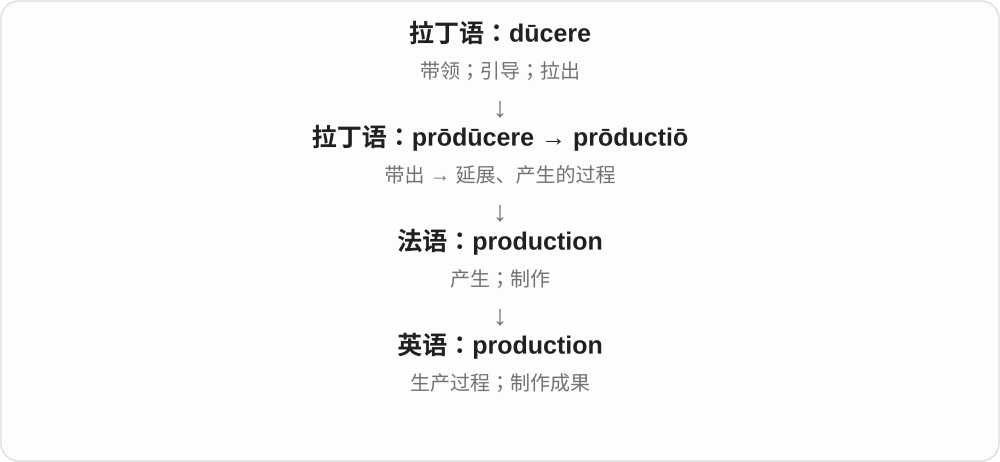

# 0895 · production — 复制、再现与产出过量

[逐词精讲目录](../00_逐词精讲目录.md) · [总目录](../00_总目录_按常用程度.md)

## 核心词根与来源

production 的历史接引出、产出的拉丁词族；reproduction 有多条应用语境，overproduction 明确过量。

**PRODUCTION：产出；RE- 再产出，OVER- 产出过头**

基本词 production 与 preproduction 已精讲，这里接复制、繁殖和过剩。

- **基本生产与准备**：production · preproduction
- **再次产出与产出过量**：reproduction · overproduction

## 词形与演化规律

production → preproduction、reproduction、overproduction。

## 单词速览（按词族由简到繁）

同一基础词的相关扩展放在一起，先读基础形式，再读扩展；各组之间优先读常用的。具体词源关系见各词讲解。

| 单词 | 音标 | 核心意思 |
|---|---|---|
| [production](#w-1) | /prəˈdʌkʃən/ | 生产；制作；一部演出或影视作品 |
| [reproduction](#w-2) | 英 /ˌriːprəˈdʌkʃən/；美 /ˌriːprəˈdʌkʃən/ | 复制、复制品；再现；繁殖 |
| [overproduction](#w-3) | 英 /ˌəʊvəprəˈdʌkʃən/；美 /ˌoʊvərprəˈdʌkʃən/ | 生产过剩；产出过量 |
| [preproduction](#w-4) | 英、美 /ˌpriːprəˈdʌkʃən/ | 前期筹备；投产前阶段；试生产阶段的 |

## 逐词讲解

### 1. production — 生产；制作；一部演出或影视作品

**音标**：/prəˈdʌkʃən/

**先抓住这个画面**

production 是把东西做出来的整套过程。工厂生产食品，剧组制作影片，剧院呈现一台演出，都可以用它。

**怎么拆**

经法语来自拉丁语 prōductiō，与 prōdūcere“带出、产生”相连；现代对应 produce 的动作名词。

**怎么变成今天的意思**

泛指生产时通常不可数；a production 可指某一部戏剧或影视制作。a stage production 就是一台具体舞台演出。

**常见搭配与例句**

increase production（增加产量）；go into production（投产）；a stage production（舞台演出）。

> The factory increased production last month.

工厂上个月提高了产量。

> We saw a new production of the play.

我们看了这部戏的一版新制作。

**别混淆**

product 是一个产物；production 可能是过程、产量或一整部制作。根据搭配判断，别统一译成“生产”。

### 2. reproduction — 复制、复制品；再现；繁殖

**音标**：英 /ˌriːprəˈdʌkʃən/；美 /ˌriːprəˈdʌkʃən/

**先抓住这个画面**

让另一份相同或相近的东西产生出来：可以是印画复制，也可以是生物产生后代。

**怎么拆**

re- 再 + production 产出，历史也经法语及 reproduce 对应名词形成。不同语境抓再产生，不把生物繁殖只翻成复印。

**怎么变成今天的意思**

**拉丁 producere 引出、带出 → 法语及英语 produce**  
产出、制造、产生

↓

**英语 production 及派生**  
生产、制作 → 复制；生产过量

↓

**re- + production → reproduction**  
再次产出 → 复制、再现；繁殖

a reproduction of a painting 画作复制品，sound reproduction 声音重现，plant reproduction 植物繁殖。

**常见搭配与例句**

a reproduction of；sound reproduction；plant reproduction。

> The museum shop sells reproductions of famous paintings.

博物馆商店出售名画复制品。

> The lesson explains how plant reproduction works.

这节课解释植物如何繁殖。

**别混淆**

reproduction 复制不保证原作身份；original 原作与 reproduction 复制品要分开。

### 3. overproduction — 生产过剩；产出过量

**音标**：英 /ˌəʊvəprəˈdʌkʃən/；美 /ˌoʊvərprəˈdʌkʃən/

**先抓住这个画面**

生产的量超过实际需要、需求或适当程度；不只是产量很大。

**怎么拆**

over- 过度 + production 生产、产生。可谈工业库存，也可在其他领域说某物产生过量。

**怎么变成今天的意思**

**拉丁 producere 引出、带出 → 法语及英语 produce**  
产出、制造、产生

↓

**英语 production 及派生**  
生产、制作 → 复制；生产过量

↓

**over- + production → overproduction**  
产出超过需要 → 生产过剩

overproduction of goods 商品生产过剩，reduce overproduction 减少过量生产；影视评论也可指制作加工过头。

**常见搭配与例句**

overproduction of；industrial overproduction；reduce overproduction。

> Overproduction left the company with unsold stock.

生产过剩让公司积压了卖不掉的库存。

> The report links waste to the overproduction of goods.

报告把浪费与商品生产过量联系起来。

**别混淆**

mass production 大规模生产，overproduction 超过需求；前者规模大并不自动后者过剩。

### 4. preproduction — 前期筹备；投产前阶段；试生产阶段的

**音标**：英、美 /ˌpriːprəˈdʌkʃən/

**先抓住这个画面**

正式大量生产或开拍之前，先把方案、人员、场地和样品准备好。

**怎么拆**

英语 pre- + production；production 在电影中是制作、拍摄，在工业中是生产。

**怎么变成今天的意思**

**拉丁语 prae → 法语、中世纪拉丁语 pre- → 英语 pre-**  
时间在先；位置在前；后来可与英语现成词自由组合

↓

**英语 pre- + production → preproduction**  
正式生产、拍摄以前的准备与试制阶段

电影的 preproduction 可包含选角、选景和分镜等工作；preproduction model 是量产前的样机，可能还会修改。

**常见搭配与例句**

in preproduction；preproduction planning；a preproduction model。

> The film is still in preproduction.

这部电影仍处于前期筹备阶段。

> The reviewers tested a preproduction model of the camera.

评测人员测试了这款相机的一台量产前样机。

**别混淆**

postproduction 是拍摄完成后的剪辑等制作；preproduction 位于实际拍摄之前。

## 这一组要分清什么

reproduction 也可生物繁殖，不只复印；overproduction 不是一切大规模生产。

## 串起来练习

The company reduced production to avoid overproduction.

公司削减产量，避免生产过剩。
